# Workgraph

Workgraph gives cooperating agents a local place to plan work, retain memory,
ask accountable questions, and preserve evidence. A task in Jira or Linear can
have a local Workgraph project with subtasks, decisions, handoffs, files and
searchable conversation records. After a reset, an agent reads those records to
continue from the actual state.

One OCaml/Core/Eio executable supplies a CLI and a daemon reached through a Unix
socket. Data stays in folders you choose. No hosted account, database server,
model credentials or MCP server is needed. Workgraph is [MIT licensed](LICENSE).
The harness owns agents, prompts, model calls, filesystem edits and external side
effects; Workgraph records and coordinates their work.

**Version boundary:** this checkout documents development toward the next preview.
The published [v0.4.0 preview](https://github.com/dakotamurphyucf/workgraph/releases/tag/v0.4.0)
has matching packaged documentation. New methods in this checkout require its
matching executable; they are not a claim that a newer release exists. Preview
formats are intentionally incompatible across breaking versions. Use fresh
registry/workspace data and request journals when changing an incompatible preview.

Start with [installation](#install-and-set-up), then the [eight workflows](#eight-workflows).
Give an agent the concise [AGENT_GUIDE.md](AGENT_GUIDE.md), its own context, and
access to the focused references. [Guide coverage](docs/guide-coverage.md) maps the
complete supplied team guide to this README, including corrected examples and
all maintained script sources [inline below](#complete-maintained-scripts).

## What lives here

| Record | Use |
| --- | --- |
| Work | Projects, milestones, tickets, dependencies, ownership, review gates |
| Memory | Facts, decisions, progress, handoffs and versioned resources |
| Conversation | Messages, accountable requests, inbox delivery, imported visible history |
| Proof | Exact input/output pins, test captures, submissions, review and acceptance records |

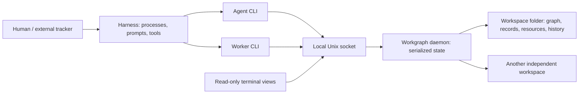

Workgraph communication goes through the daemon; a harness may also have other
channels. Multiple agents can share one daemon. Actor names are cooperative
attribution, not authentication. A recorded test result is a submitted claim;
configured evidence and review checks provide stronger, explicit gates.

## Concepts and choosing a record

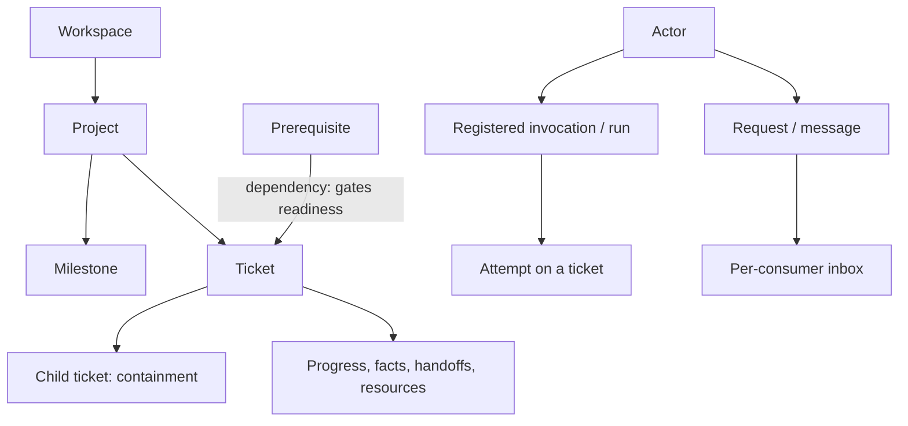

| Term | Meaning |
| --- | --- |
| Daemon | Local state service; not an agent launcher |
| Workspace | Independent durable graph and history in one managed root |
| Project / milestone / ticket | Organization, scheduling and work records |
| Actor | Stable cooperative identity; one context per participant |
| Context | Client connection, optional attribution and private journal defaults |
| Run | One registered invocation with immutable declared capabilities |
| Attempt | One try at a ticket; `ticket.start --attempt-id` or `claim_next` creates it |
| Token | Ownership fence returned by acquisition; preserve its actual value |
| Handoff | Structured recorded state for another invocation to resume |
| Fact | Small named JSON value in one explicit scope |
| Request | Accountable question, review, blocker or handoff with a resolver |
| Inbox | Notifications, acknowledged separately by each consumer |
| Saved request | Exact serialized command identity and bytes for safe retry |
| Transaction | Up to 32 supported operations committed atomically in the daemon |
| Capability / pool | Cooperative eligibility requirements and bounded allocation capacity |
| Path reservation | Shared/exclusive logical file or subtree fence |
| Session | Explicitly imported conversation/tool history; no automatic capture |

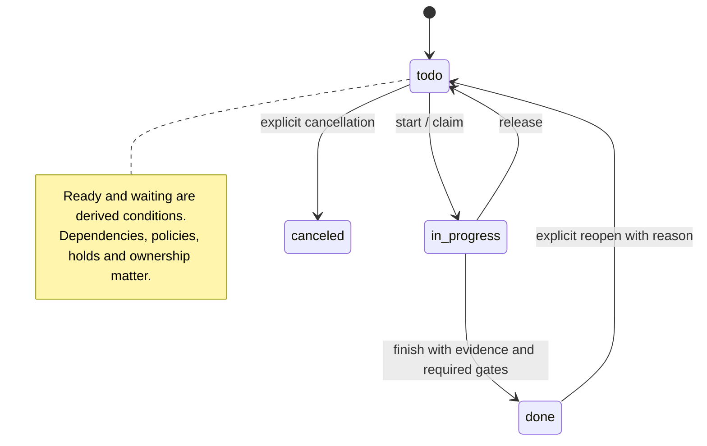

Parenthood organizes work; it does not automatically inherit dependencies. Gate
each phase's children explicitly, or choose a supported dependency policy.
`ticket.claim` does not itself create an attempt. A run's reported status or an
expired lease does not prove its external process stopped. Cancellation records
do not kill processes.

| Need | Record |
| --- | --- |
| Small reusable result | Fact: at most 4096 canonical JSON bytes; scopes never inherit |
| Choice and reason | Decision progress/comment |
| What changed during a try | Progress with current ownership token |
| Resume after a reset | Handoff, including objective, decisions, blockers, evidence, next steps |
| Finished outcome | Completion evidence and, when configured, acceptance records |
| Long text, logs, source or binary | Versioned resource, linked to work |
| Answer owed by someone | Request, with explicit recipient/resolver |
| Inform someone without tracking an answer | Message |
| Recover original visible dialogue/tool records | Session history with stable source IDs |

### Route capabilities and scarce capacity

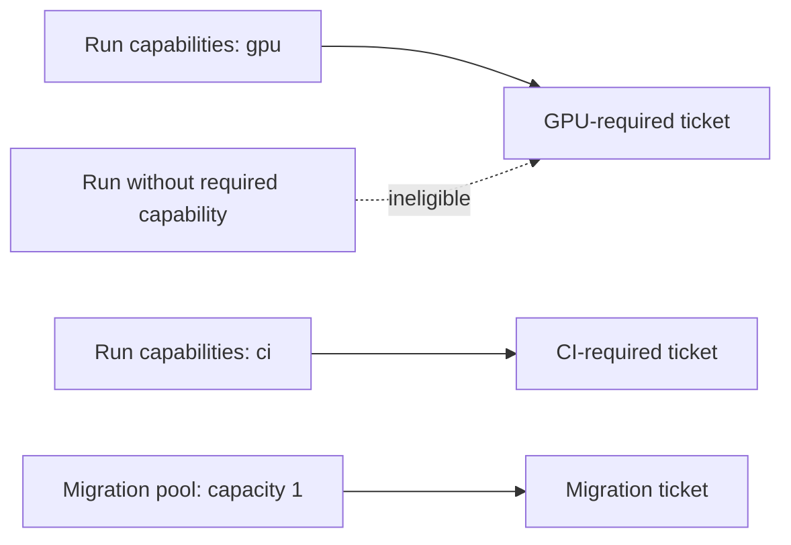

After defining the quoted `wg` function in setup, a routing example is:

```bash
wg run register --target-run-id gpu-1 --json-field capabilities '["gpu"]' --objective 'GPU work'
wg allocation.pool_put --name migration --limit 1 --expected-revision 0
wg allocation.ticket_policy_put --ticket-id train --expected-revision 0 \
  --json-field required_capabilities '["gpu"]' --json-field pools '["migration"]'
wg allocation.ticket_policies
wg allocation.pools
wg run get --target-run-id gpu-1
```

Requirements compose at acquisition; inspect run-aware readiness before assigning
work. A run's declared capabilities are immutable and cooperative. Pools allocate
one slot per participating ticket under the current policy, not arbitrary weighted
jobs. The historical routing fixture observed `missing_capability` for a run
without GPU and `pool_full` for a second migration. A read-only observer does not
gain permission to act as another worker.

## Install and set up

### Published packages and matching documentation

The following concrete URLs install **v0.4.0**, whose own documentation applies.
Choose the matching platform and stop if checksum verification fails. Keep WSL
managed data on Linux `$HOME`, not `/mnt/c`. Review privileged installation commands
under your own machine policy.

```bash
# AlmaLinux 10 x86_64, including AlmaLinux under WSL
set -euo pipefail
sudo dnf install -y jq curl-minimal
mkdir -p "$HOME/Downloads/workgraph-0.4.0"
cd "$HOME/Downloads/workgraph-0.4.0"
RELEASE=https://github.com/dakotamurphyucf/workgraph/releases/download/v0.4.0
FILE=workgraph-0.4.0-1.el10.x86_64.rpm
curl -fLO "$RELEASE/$FILE"
curl -fLO "$RELEASE/SHA256SUMS"
awk -v name="$FILE" '$2 == name {print; count++} END {if (count != 1) exit 1}' SHA256SUMS > selected.sha256
sha256sum --check selected.sha256
sudo dnf install -y "./$FILE"
hash -r
workgraph --version
```

For macOS ARM64, use the archive rather than an RPM. `jq` is also required by the
shell examples and helper; install it through your usual package manager.

```bash
set -euo pipefail
mkdir -p "$HOME/Downloads/workgraph-0.4.0"
cd "$HOME/Downloads/workgraph-0.4.0"
RELEASE=https://github.com/dakotamurphyucf/workgraph/releases/download/v0.4.0
FILE=workgraph-0.4.0-macos-arm64.tar.gz
curl -fLO "$RELEASE/$FILE"
curl -fLO "$RELEASE/SHA256SUMS"
awk -v name="$FILE" '$2 == name {print; count++} END {if (count != 1) exit 1}' SHA256SUMS > selected.sha256
shasum -a 256 --check selected.sha256
mkdir -p "$HOME/.local/opt/workgraph-0.4.0" "$HOME/.local/bin"
tar -xzf "$FILE" -C "$HOME/.local/opt/workgraph-0.4.0"
# Inspect the archive's bin/ and accompanying docs/ layout before choosing a link.
ln -s "$HOME/.local/opt/workgraph-0.4.0/workgraph-0.4.0-macos-arm64/bin/workgraph" "$HOME/.local/bin/workgraph"
export PATH="$HOME/.local/bin:$PATH"
workgraph --version
```

Follow [macOS installation](docs/macos-install.md) for the exact extracted path,
PATH and packaged documentation discovery; retain the accompanying docs/examples.
### Build the current checkout from source

For this checkout, use the provisioned pinned toolchain and `./dev`; do not change
unrelated opam switches or global defaults. See [engineering standards](engineering-standards.md).

```bash
./dev build @install
./dev exec bin/main.exe -- --version
# Required development qualification, run against the matching checkout:
./dev build @fmt @runtest @install
```

### Bootstrap a private workspace

Choose an absolute, private state parent and a matching executable. These are
shell values, not implicit CLI configuration. `--context` applies them explicitly.
Re-running init reuses only matching existing connection/root/workspace state;
it is not a promise to overwrite arbitrary mismatched directories safely.

```bash
umask 077
WG=workgraph                       # or absolute matching checkout executable
WG_HOME="$HOME/.local/state/workgraph-demo"
mkdir -p "$WG_HOME"
export WG_CONTEXT="$WG_HOME/agent.json"
"$WG" init --context "$WG_CONTEXT" --socket "$WG_HOME/daemon.sock" \
  --workspace-id demo --actor-id "$USER" --root "$WG_HOME/workspace" --name Demo \
  --request-directory "$WG_HOME/requests" --start-daemon true \
  --registry "$WG_HOME/registry" --daemon-log "$WG_HOME/daemon.log"
wg() { "$WG" --context "$WG_CONTEXT" "$@"; }
```

```text
~/.local/state/workgraph-demo/
├── daemon.sock       local connection endpoint
├── daemon.log        startup and diagnostics; inspect first on failure
├── registry/         daemon's workspace registrations
├── workspace/        graph, immutable content, journal and conversation history
├── agent.json        socket/workspace/actor and request-directory defaults
├── requests/         exact saved write requests; retain after uncertain outcomes
└── agents/           added for other participants
    ├── worker-1.json
    └── worker-1-requests/
```

Smoke test with fresh IDs. Check the CLI exit before parsing its JSON. A
`saved_request: …` line is a diagnostic on **stderr**, not corrupt JSON on stdout.
Do not suppress errors or combine both streams before `jq`.

```bash
set -euo pipefail
wg project create --project-id demo-project --title 'My first project'
wg ticket create --project-id demo-project --ticket-id first-task --title 'Try Workgraph'
if started=$(wg ticket start --ticket-id first-task --initial-note 'Testing the basic workflow.'); then
  token=$(jq -er '.result.data.token' <<<"$started")
else
  exit 1                         # retain exact journal; do not invent a fresh retry
fi
wg ticket progress --ticket-id first-task --token "$token" --body 'Basic commands work.'
wg ticket finish --ticket-id first-task --token "$token" --evidence 'Created, started and finished a ticket.'
wg workspace overview --output text
```

Create separate contexts and private journals for the orchestrator, workers and CI:

```bash
mkdir -p "$WG_HOME/agents"
for agent in agent-orch worker-1 worker-2 ci; do
  "$WG" init --context "$WG_HOME/agents/$agent.json" --socket "$WG_HOME/daemon.sock" \
    --workspace-id demo --actor-id "$agent" --root "$WG_HOME/workspace" --name Demo \
    --request-directory "$WG_HOME/agents/$agent-requests"
done
lead() { "$WG" --context "$WG_HOME/agents/agent-orch.json" "$@"; }
```

An observer context may omit actor/run; ordinary reads remain unfiltered. Writes
need explicit attribution. Context `--self` is an explicit supported selector,
not a hidden filter on every read. A context default `run_id` is attribution;
`target_run_id` and `attempt_id` are separate identities.

After a reboot, rerun the matching init command to start the daemon, or follow
[administration](docs/agent/administration.md). Stop with
`wg daemon shutdown`. There is no assumed system service. Preserve logs and data
when startup fails. A connection refusal, process-name search or expired lease
is not proof that a socket belongs to a stopped process. **Do not use
`pgrep || rm socket`.** Inspect the exact endpoint/registry identity and supported
lifecycle diagnostics. If ownership remains uncertain, preserve it and choose a
fresh private socket; do not unlink a foreign endpoint or open the same root in
two live writers. Graceful shutdown drains admitted work.

### Give it to an agent

Installation/setup prompt (adapt paths and privileges deliberately):

```text
Install or locate the matching Workgraph executable and its packaged documentation.
Read AGENT_GUIDE.md and the setup/lifecycle reference before using it. Reuse the
supplied daemon/workspace. If none exists, choose private absolute state paths and
bootstrap one. Use your own actor/context and private saved-request directory.
Do not delete occupied sockets, locks or managed data. Ask before privileged
installation or deletion if my machine policy requires it.
Run an end-to-end project/ticket/start/progress/finish smoke test with fresh IDs.
Report executable version, context/socket/workspace paths and observed results.
Retain exact request files after uncertain outcomes. Do not launch other agents
unless I or the harness explicitly authorizes them.
```

Connection prompt:

```text
Use Workgraph at EXECUTABLE with context ABS_CONTEXT. Read ABS_AGENT_GUIDE and the
focused references beside it. Your actor is ACTOR; your private request directory
is REQUESTS. Reuse this workspace. Inspect assigned work, ownership and open
requests; record meaningful progress, decisions, evidence and handoff. Keep actual
tokens, revision guards and exact retry paths. The harness owns tools and processes.
```

## Eight workflows

### 1. Memory across resets

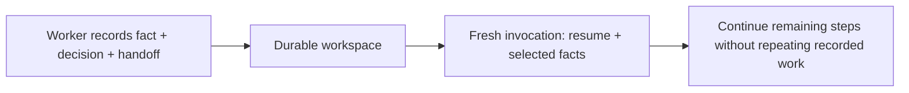

For a fresh `res-task`, preserve results and every useful handoff field:

```bash
started=$(wg ticket start --ticket-id res-task)
token=$(jq -er '.result.data.token' <<<"$started")
wg fact put --json-field scope '{"kind":"ticket","id":"res-task"}' --key total_primes \
  --json-field value '{"below":10000,"count":1229}' --expected-revision 0
wg ticket progress --ticket-id res-task --token "$token" \
  --body 'Sieve found 1229 primes below 10000; checked against trial division.'
wg ticket progress --ticket-id res-task --token "$token" --kind decision \
  --body 'Exclude 2 from both residue classes; it is the only even prime. Use exact integers.'
wg handoff set --ticket-id res-task --token "$token" --expected-revision 0 \
  --summary 'Step 1 done; steps 2–3 remain.' \
  --objective 'Finish residue split and record class1/class3 facts.' \
  --completed 'total_primes=1229, verified twice.' \
  --decisions 'Exclude 2; exact integer arithmetic.' --blockers 'None.' \
  --next-steps 'Count odd primes by n mod 4, store facts and finish.' \
  --evidence 'total_primes fact and two progress notes.'
wg ticket release --ticket-id res-task --token "$token"
# Fresh actor/context reads the recorded material; facts require explicit selection.
resume=$(wg ticket resume --ticket-id res-task --include-markdown true \
  --json-field fact_selections '[{"scope":{"kind":"ticket","id":"res-task"},"key":"total_primes"}]')
jq -r '.result.data.markdown' <<<"$resume"
```

Resume performs no model inference. If an old invocation still owns the task,
inspect it and follow guarded reassignment/recovery; a context reset does not
invalidate its token automatically. Keep a small local recovery index pointing
to durable records and request files. Historical October 2026 AlmaLinux/Claude
Code experiment: a fresh agent understood the next step after two calls and
finished in 13; this is an observation, not a latency or call-count guarantee.

### 2. Orchestrator, workers and CI

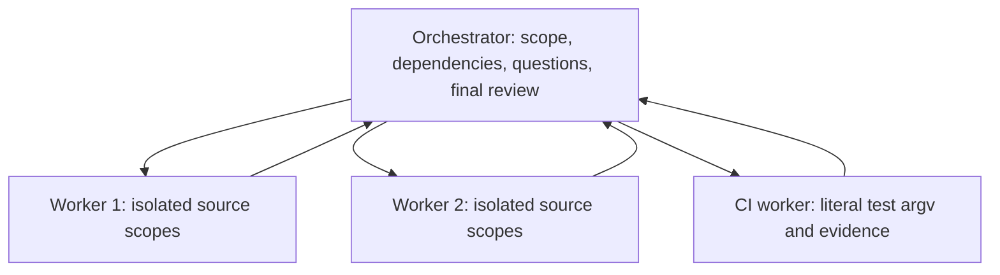

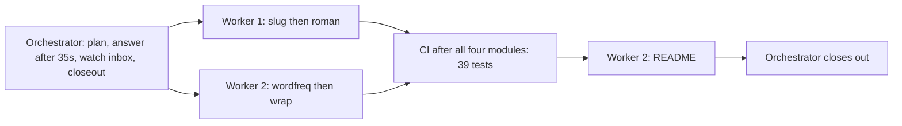

The historical run used Claude Code, including both workers. A mixed Codex/Claude
harness is possible but was not measured by that experiment. The guide recorded
six tickets/four modules/39 tests/about nine minutes overall (the recorded claim/finish timeline spans 21:09–21:16 UTC on 2026-10-09), 26 planning operations, an
answer after roughly 35 seconds (asked around 12 seconds), and a CI bar that included a bot restart; the tests themselves took 45ms. These observations do not establish current performance or harness support.

Use separate contexts from setup. A small **fresh-workspace** atomic plan illustrates
aliases; aliases exist only inside the transaction. Instructions, dependencies,
capability policy and decisions belong in the same coherent plan when possible.

```json
{"operations":[
 {"method":"label.put","params":{"label_id":"ci","expected_revision":"0","name":"CI"}},
 {"method":"project.create","as":"p","params":{"project_id":"demo-build","title":"Two-module example"}},
 {"method":"ticket.create","params":{"ticket_id":"module-a","project_id":"$p","title":"Implement module A","description":"Publish exact source and test evidence."}},
 {"method":"ticket.create","params":{"ticket_id":"module-b","project_id":"$p","title":"Implement module B"}},
 {"method":"ticket.create","params":{"ticket_id":"test-all","project_id":"$p","title":"Run integrated tests"}},
 {"method":"ticket.create","params":{"ticket_id":"package-readme","project_id":"$p","title":"Document the checked package"}},
 {"method":"ticket.metadata","params":{"ticket_id":"module-b","expected_revision":"1","acceptance_criteria":"Module behavior checked."}},
 {"method":"ticket.metadata","params":{"ticket_id":"test-all","expected_revision":"1","label_ids":["ci"]}},
 {"method":"dependency.add","params":{"ticket_id":"test-all","prerequisite_id":"module-a"}},
 {"method":"dependency.add","params":{"ticket_id":"test-all","prerequisite_id":"module-b"}},
 {"method":"dependency.add","params":{"ticket_id":"package-readme","prerequisite_id":"test-all"}},
 {"method":"allocation.ticket_policy_put","params":{"ticket_id":"test-all","expected_revision":"0","required_capabilities":["ci"],"pools":[]}},
 {"method":"comment.add","params":{"target":{"kind":"project","id":"$p"},"kind":"decision","body":"Separate module scopes; CI waits for both."}}
]}
```

Save this as `plan.json`, then validate before committing. Preflight does not
reserve resources or commit; it is not a guarantee a later guarded apply succeeds.
Transactions never roll back external tools, uploaded bytes or filesystem edits.
The original experiment committed four result writes at one revision; an oversized
fact rejected the whole batch and left the ticket in progress. It followed a real
review where separate finish/fact writes left a completed ticket without its
verdict for about ten seconds. Record result and completion together when coupled.

```bash
lead transaction preflight --actor-id agent-orch --params-file plan.json
lead transaction apply --params-file plan.json
```

A registered worker uses explicit run-aware acquisition. Switch on the result
kind before reading a token. Handle an empty result without a rapid write loop:

```bash
RUN=worker-1-invocation-1             # fresh invocation identity, not ticket ID
wg run register --target-run-id "$RUN" --json-field capabilities '["ocaml"]' --objective 'Module work'
reply=$(wg ticket claim_next --run-id "$RUN" --target-run-id "$RUN" --attempt-id "$RUN-a1" --project-id demo-build)
kind=$(jq -er '.result.data.kind' <<<"$reply")
case "$kind" in
  selected)
    ticket=$(jq -er '.result.data.claim.ticket_id' <<<"$reply")
    token=$(jq -er '.result.data.claim.token' <<<"$reply")
    wg ticket brief --ticket-id "$ticket"
    wg ticket context --ticket-id "$ticket"  # full bounded recorded context
    wg ticket progress --run-id "$RUN" --ticket-id "$ticket" --token "$token" --body 'Implementation and focused checks underway.'
    # Run tools, publish evidence and satisfy review policy before this finish.
    wg ticket finish --run-id "$RUN" --ticket-id "$ticket" --token "$token" --evidence 'Actual checked output references go here.'
    ;;
  empty) echo 'No eligible work in this observed state; park or exit.' ;;
  *) echo 'Unexpected allocation response; retain exact journal.' >&2; exit 1 ;;
esac
run=$(wg run get --target-run-id "$RUN")
revision=$(jq -er '.result.data.revision' <<<"$run")
wg run transition --run-id "$RUN" --target-run-id "$RUN" --expected-revision "$revision" \
  --status completed --evidence 'Invocation stopped after the outcome recorded above.'
```

An empty standalone `claim_next` is an explicitly classified **non-durable
observation**, not a committed no-op, ticket claim or inferred process state.
Exact retries preserve saved request identity. Do not interpret an uncertain
mutation or JSON parse failure as empty, and do not refresh guards silently.
Run/attempt receipts retain the actual resulting recorded state and typed refs;
there is no invented universal receipt ID/status.

For idle waiting, capture a planning feed before the readiness read, then park
on its returned cursor and re-read run-aware readiness. `attention.read/wait`
can combine attention sources; readiness inside attention is separately paged.
Never claim a first bounded attention response traversed all nested readiness.
Stop at the harness's deadline/cancellation, terminal project or explicit idle
budget; Workgraph does not keep a worker process alive.

Publish long external resources first. A transaction can then record an exact
pin, a small fact and completion together. Envelope workspace/actor/run/mutation
fields belong **only outside** operations. Here all IDs/guards are illustrative
for fresh records and the actual claim token must be substituted:

```bash
ops=$(jq -nc --arg token "$token" '{operations:[
 {method:"resource.put_text",params:{resource_id:"module-result",expected_revision:"0",title:"Module result",text:"Observed checks and exact source references."}},
 {method:"resource.link",params:{resource_id:"module-result",expected_revision:"1",target:{kind:"ticket",id:"module-a"}}},
 {method:"fact.put",params:{scope:{kind:"ticket",id:"module-a"},key:"checks",expected_revision:"0",value:{passed:15}}},
 {method:"ticket.finish",params:{ticket_id:"module-a",token:$token,evidence:"15 actual focused checks passed; module-result contains exact source and output refs."}}
]}')
wg transaction apply --run-id "$RUN" --params-file - <<<"$ops"
```

#### Ask rather than guess

```mermaid
sequenceDiagram
  participant W as Worker
  participant D as Workgraph
  participant O as Resolver
  W->>D: request.ask (question + recipients + resolver)
  D-->>O: Inbox notification
  O->>D: Read question, accept responsibility if appropriate
  O->>D: Resolve at exact request revision with answer body
  D-->>W: Resolution notification + pinned answer reference
  W->>D: Read current question and expanded answer; acknowledge selected delivery
```

```bash
wg request ask --run-id "$RUN" --request-id module-api-question --title 'Empty input contract?' --kind clarification \
  --resolver-id agent-orch --json-field recipients '[{"kind":"actor","id":"agent-orch"}]' \
  --ticket-id module-a --body 'Should the empty input return zero or an error?'
lead inbox wait --consumer-id orch-current --json-field recipient '{"kind":"actor","id":"agent-orch"}' \
  --exclude-self true --timeout-ms 25000
lead request list --open-only true --resolver-id agent-orch
question=$(lead request get --request-id module-api-question --include-messages true)
jq '.result.data.related.source_message, .result.data.related.messages.items' <<<"$question"
revision=$(jq -er '.result.data.revision' <<<"$question")
lead request resolve --request-id module-api-question --expected-revision "$revision" \
  --body 'Return zero for empty input; keep malformed input as an error.'
answer=$(wg request get --request-id module-api-question --include-messages true)
jq '.result.data.status.answer, .result.data.related.messages.items' <<<"$answer"
notifications=$(wg inbox read --consumer-id "$RUN" --json-field recipient '{"kind":"actor","id":"worker-1"}')
# Select only IDs whose bodies/references you actually processed; never ack all unseen rows.
processed=$(jq -c '[.result.data.items[] | select(.source.kind == "request" and .source.id == "module-api-question") | .notification_id]' <<<"$notifications")
if jq -e 'length > 0' <<<"$processed" >/dev/null; then
  wg inbox ack --consumer-id "$RUN" --json-field recipient '{"kind":"actor","id":"worker-1"}' \
    --json-field notification_ids "$processed"
fi
```

Use `--exclude-self true` where supported to omit echo deliveries from a wait;
that does not acknowledge them. One logical exchange can produce several
notifications. Request revision, thread revision, current source message revision and immutable
answer-comment pin are distinct. A request can be delivered, accepted and resolved
at different times; inbox acknowledgement does not accept or resolve it.

#### CI is a worker with explicit outcomes

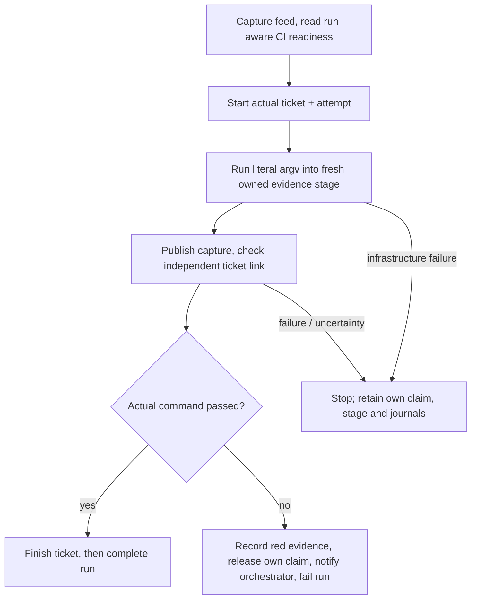

[examples/ci-worker.sh](examples/ci-worker.sh), reproduced completely below, runs
one job per invocation. It has a bounded idle policy, fresh stage leaf under an
existing parent, literal argv, durable capture, independent publication/link
checks, and separate success/red/infrastructure handling. It does not hide stderr
or treat failure as success. The context must have a private journal directory.
For a shell pipeline pass an explicit `bash -o pipefail -c '…'` argv.

```bash
CTX="$WG_HOME/agents/ci.json" RUN=ci-invocation-1 PROJECT=demo-build \
SRC=/absolute/git/checkout STAGES=/absolute/existing/private/stages WG="$WG" \
  bash examples/ci-worker.sh ./dev build @runtest
```

Captured output has observed/retained byte counts and truncation indicators. A
bounded retained prefix is not the whole command output. Declare provenance
sources explicitly; selected files do not establish whole-tree coverage.
Publication retry never reruns the command. Upload and ticket link are independent
commits: on partial failure preserve both actual receipt and saved publication
plan/stage, then retry the saved publication. Never finish from a failed link.

Closeout includes overview, open questions and meaningful notes to the team:

```bash
lead workspace overview
lead request list --open-only true
lead project brief --project-id demo-build
lead message send --message-id demo-closeout \
  --json-field recipients '[{"kind":"actor","id":"worker-1"},{"kind":"actor","id":"worker-2"}]' \
  --body 'Review recorded completion evidence and report remaining blockers before closeout.'
```

Project completion is a guarded declaration after checking current children and
policy, not an automatic consequence of a dashboard count. Orchestrator prompt:

```text
Plan small independently reviewable tickets with explicit dependencies and source
ownership. Register each invocation's capabilities; route CI and scarce pools.
Answer formal questions with the current guard. Read worker evidence and exact
output versions, arrange independent review, and verify the integrated result.
Record decisions and handoffs. Keep completed/deferred scope and release checks
separate. The harness owns processes and approvals for external side effects.
```

Worker prompt:

```text
Read your ticket, instructions, effective policy and current ownership before editing.
Acquire only your declared source scopes. Keep actual token/attempt/run identities.
Ask an accountable question when a material contract is unclear. Publish meaningful
progress, exact source/test evidence and handoff. Satisfy gates before finishing;
release only intended owned holds. On uncertain writes retain and retry exact bytes.
When idle, perform bounded capture/read/wait or stop; never spin claim mutations.
```

### 3. Agent-to-agent Q&A and messages

A direct message is useful for conversation without a tracked answer obligation.
Use a request for accountable clarification, blockers, review or handoff.

```bash
wg message send --run-id "$RUN" --message-id worker-observation \
  --json-field recipients '[{"kind":"actor","id":"agent-orch"}]' \
  --body 'The second fixture also exercises Unicode paths.'
lead message send --message-id orch-reply --reply-to-message-id worker-observation \
  --json-field recipients '[{"kind":"actor","id":"worker-1"}]' \
  --body 'Keep that fixture and include its exact test evidence.'
messages=$(lead inbox read --consumer-id orch-current --json-field recipient '{"kind":"actor","id":"agent-orch"}')
jq '.result.data.items[]' <<<"$messages"
# After processing this known message, select its actual returned delivery IDs.
processed=$(jq -c '[.result.data.items[] | select(.source.kind == "message" and .source.id == "worker-observation") | .notification_id]' <<<"$messages")
if jq -e 'length > 0' <<<"$processed" >/dev/null; then
  lead inbox ack --consumer-id orch-current --json-field recipient '{"kind":"actor","id":"agent-orch"}' \
    --json-field notification_ids "$processed"
fi
```

Use `inbox.wait` to park with a bounded timeout. Reading never acknowledges;
acknowledgement is per consumer and separate from request responsibility. Historical
small-run Q&A latency was approximately 3–6 seconds, not a delivery SLA.

### 4. Independent review gates

```mermaid
sequenceDiagram
  participant A as Author
  participant R as Separate reviewer
  A->>A: Publish outputs and exact version/digest manifest
  A->>R: Submit round 1
  R-->>A: request_changes on exact submission
  A->>A: Publish corrected output; new manifest
  A->>R: Submit round 2
  R-->>A: approve exact round 2
  A->>A: Accept with required validations, then finish
```

Configure reviewer/separate-actor policy, capture exact input/output pins, submit,
record approve/request_changes, accept and finish. The runnable
[gated review workflow](docs/gated-review-workflow.md) and
[Python recipe](examples/gated-review-workflow.py) show two actors and two rounds.
An approval binds the exact submitted resource version/digest; later publication
is different evidence. Tests passing do not automatically accept work. The system
records gates; it does not make filesystem edits impossible. The original two-round
example took about two minutes on its historical harness.

### 5. A merge-request snapshot with backstory

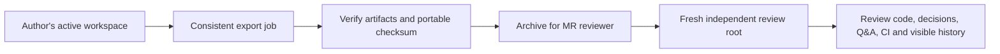

Export captures one consistent moment while writers continue. Choose fresh absolute
output roots. Poll with a deadline and handle failure/cancellation, not an endless
`until completed` loop. Retain the returned job ID rather than choosing an unrelated
most recent job.

```bash
EXPORT=/absolute/fresh/export
job=$(lead workspace export --destination "$EXPORT")
job_id=$(jq -er '.result.data.job_id' <<<"$job")
end=$((SECONDS + 120))
while :; do
  job=$(lead export get --job-id "$job_id")
  state=$(jq -er '.result.data.status' <<<"$job")
  case "$state" in
    completed) break ;;
    failed|canceled|interrupted) printf '%s\n' "$job" >&2; exit 1 ;;
  esac
  [ "$SECONDS" -lt "$end" ] || { echo 'Export still pending; retain job ID.' >&2; exit 1; }
  sleep 1
done
lead export verify --directory "$EXPORT"
tar -czf /absolute/review-workgraph.tar.gz -C "$(dirname "$EXPORT")" "$(basename "$EXPORT")"
# Linux: sha256sum /absolute/review-workgraph.tar.gz
shasum -a 256 /absolute/review-workgraph.tar.gz
```

Review exported records for private data before sharing. Verify the delivered
archive checksum using the separately supplied expected digest, extract to a fresh
parent, then use the matching executable:

```bash
# Archive checksum verification precedes extraction.
mkdir /absolute/fresh/review-package
tar -xzf /absolute/review-workgraph.tar.gz -C /absolute/fresh/review-package
# This operator context must point at an independent review daemon/registry.
: "${REVIEW_OPERATOR_CONTEXT:?set a private review operator context}"
review() { workgraph --context "$REVIEW_OPERATOR_CONTEXT" "$@"; }
EXP=/absolute/fresh/review-package/export
verified=$(review export verify --directory "$EXP")
WS=$(jq -er '.result.data.workspace_id' <<<"$verified")
review workspace restore --directory "$EXP" --root /absolute/fresh/review-workspace
SOCKET=$(jq -er '.socket' "$REVIEW_OPERATOR_CONTEXT")
workgraph init --context /absolute/review-agent.json --socket "$SOCKET" \
  --workspace-id "$WS" --actor-id reviewer --root /absolute/fresh/review-workspace \
  --name "Review $WS" --request-directory /absolute/fresh/reviewer-requests
wgx --context /absolute/review-agent.json status
```

Restore does not merge with the author's live history. The same workspace ID
cannot be simultaneously registered twice in one daemon; use an independent
review daemon/registry. Human-readable artifacts aid review; durable data and
verified content support exact restore. The historical sample was about 100KB and
a reviewer used 35 calls; size and effort depend on retained data.

Review-agent prompt:

```text
Read the code and independently verify the exported Workgraph snapshot. Establish:
1. Who implemented each part and what exact tests ran?
2. Why were important design choices made?
3. Which questions were asked, answered and pinned?
4. What did CI actually capture, retain and publish?
5. Which choices were unspecified or made without agreement?
6. Where did participants disagree, and how was that resolved?
Distinguish recorded claims from independently checked evidence. Cite exact records
and output versions. Do not treat missing indexed hits as absence or attempt to
recover private model reasoning. Report concerns in the review workspace.
```

### 6. Shared skill backlog

```bash
wg allocation.ticket_policy_put --ticket-id train --expected-revision 0 \
  --json-field required_capabilities '["gpu"]' --json-field pools '[]'
wg run register --target-run-id gpu-next --json-field capabilities '["gpu"]' --objective 'GPU backlog'
wg ticket ready --target-run-id gpu-next --attempt-id gpu-next-a1 --project-id demo-build
wg ticket claim_next --run-id gpu-next --target-run-id gpu-next --attempt-id gpu-next-a1 --project-id demo-build
```

Acquisition serializes competing requests; retain the actual selected kind and
claim token. Capability declarations are cooperative, not proof hardware exists.
Run-aware readiness considers the actual worker; ordinary unfiltered lists do not.
The original 13-ticket experiment observed no overlapping claims. Idle workers
should park or exit rather than repeatedly mutating the backlog.

### 7. Same repository, explicit source ownership

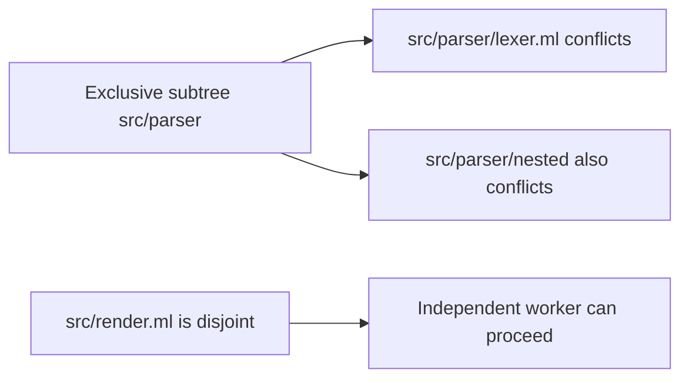

A logical `worktree_id` names a collision domain. Use the same ID across physical
checkouts when they share a protected integration target. The harness canonicalizes
aliases and enforces who edits; reservations are cooperative and do not lock files.
Declare only exact needed paths. A fresh two-ticket plan can create and reserve
scopes atomically on start:

```json
{"operations":[
 {"method":"ticket.create","params":{"ticket_id":"parser","title":"Parser"}},
 {"method":"ticket.create","params":{"ticket_id":"renderer","title":"Renderer"}},
 {"method":"ticket.paths.put","params":{"ticket_id":"parser","expected_revision":"0","require_reservations":true,"declarations":[{"target":{"worktree_id":"integration","kind":"subtree","path":"src/parser"},"mode":"exclusive"}]}},
 {"method":"ticket.paths.put","params":{"ticket_id":"renderer","expected_revision":"0","require_reservations":true,"declarations":[{"target":{"worktree_id":"integration","kind":"file","path":"src/render.ml"},"mode":"exclusive"}]}},
 {"method":"ticket.start","params":{"ticket_id":"parser"}}
]}
```

Save that JSON as `paths.json`. Use a registered run owned by your context actor
when acquiring required paths:

```bash
wg transaction preflight --actor-id worker-1 --run-id "$RUN" --params-file paths.json
wg transaction apply --run-id "$RUN" --params-file paths.json
```

Ticket-scoped automatic grants are tied to their claim borrower and ordinary
lifecycle cleanup. Independently held/manual reservations survive unrelated ticket
finish. Preserve each returned grant/token, not an assumed `1`. An ad-hoc hold:

```bash
held=$(wg reservation paths acquire --run-id "$RUN" --target-run-id "$RUN" \
  --json-field requests '[{"target":{"worktree_id":"integration","kind":"file","path":"docs/notes.md"},"mode":"exclusive","lease_duration_ms":"30000"}]')
jq '.result.data.holds' <<<"$held"
# For a selected actual grant, copy its exact target and current token:
wg reservation path release --run-id "$RUN" --target-run-id "$RUN" \
  --json-field target '{"worktree_id":"integration","kind":"file","path":"docs/notes.md"}' \
  --token ACTUAL_RETURNED_TOKEN
```

For several holds, iterate only the selected owned grants and their exact tokens;
never release every hold of a run indiscriminately or clean foreign ownership.
Expiry is a state signal, **not automatic removal or proof of death**. Recovery
requires explicit stopped/isolated assertions and exact ownership/lease fences.

The opt-in reservation helper retries the original atomic named/path batch only
on definite typed contention for a requested original target. It captures before
parking, journals each exact attempt before send, and stops on uncertainty or
other errors. Defaults: 30s total, 32 attempts, 1000ms recheck; configured bounds
are 1–300s, 1–100 attempts and 1–25000ms. Timer wakeups only recheck state; they
do not acquire expired foreign holds. Inspect actual daemon response separately
from helper metadata and require completion; an incomplete helper exits nonzero.

### 8. Searchable user-visible conversations

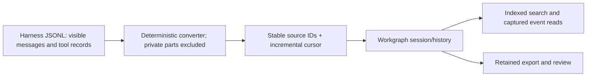

Workgraph does not discover or extract model reasoning. The maintained
[transcript-converter.py](examples/transcript-converter.py), included completely
below, selects visible user/assistant text, tool names/inputs and visible tool
results from Claude JSONL. Private reasoning types are always excluded, with no
opt-in extraction switch. Unknown parts are counted. Missing/duplicate source
UUIDs and malformed records reject before output is published. Large selected
text is split at UTF-8 boundaries without silently clipping its contents.

Find your harness's actual transcript path; a Claude location may be
`~/.claude/projects/ENCODED_PROJECT/SESSION.jsonl`. Subagent files and other harness
formats need an explicit reviewed adapter; do not assume one path captures them.
No mixed-harness transcript compatibility is implied by the historical example.

```bash
mkdir -p "$HOME/.local/bin" /absolute/private/import
install -m 755 examples/transcript-converter.py "$HOME/.local/bin/transcript-converter"
# Only replace the converter output after a complete successful conversion.
transcript-converter /absolute/visible-session.jsonl > /absolute/private/import/events.new
mv /absolute/private/import/events.new /absolute/private/import/events.jsonl
python3 examples/history-adapter.py --help
# Use the adapter's explicit connection/session/source/cursor options below.
python3 examples/history-adapter.py /absolute/daemon.sock /absolute/private/import/events.jsonl \
  /absolute/private/import/cursor.json --workspace demo --actor worker-1 --session visible-session
```

Repeat conversion/import after an append using the same source IDs and cursor.
Identical appends deduplicate; edited prior source bytes must reject rather than
rewrite history. Review the adapter's `--help` for its exact installed version.
Visible data can still contain secrets: select/redact deliberately before import,
keep the original immutable selected source, and review exports before sharing.
History is retained; no automatic pruning or blob garbage collection is promised.

```bash
wg history search --text 'residue decision' --limit 20
wg history read --session-id visible-session --direction after --anchor 0 --limit 20
wgx --context "$WG_CONTEXT" history 'residue decision'
wgx --context "$WG_CONTEXT" convo visible-session 57 5
```

A displayed event might read `57 assistant tool_call: bash {"command":"…"}`.
That is a visible tool record, not private thought. Expand exact payload bytes
under the same returned history capture; `wgx convo` is only a preview. The
original import observed 124 records / 102 events in about a second and roughly
1.2KB per event, growing a 100KB export to 323KB. These are historical sizes,
not a retention budget or throughput guarantee.

## Watch agents work

Install the maintained source from **this matching checkout**; do not fetch an
unpublished release or overwrite a locally adapted installed helper automatically.
The complete same source is included below. Requirements: Bash, `jq`, matching
`workgraph` on PATH and an explicit context. `wgx` makes read-only requests.

```bash
mkdir -p "$HOME/.local/bin"
install -m 755 tools/wgx.sh "$HOME/.local/bin/wgx"
export PATH="$HOME/.local/bin:$PATH"
wgx --context "$WG_CONTEXT" status
# In separate tmux panes:
wgx --context "$WG_CONTEXT" dash
wgx --context "$WG_CONTEXT" watch --all
```

The maintained baseline preserves the Bash 3.2 portability and controlling-TTY
viewport fixes: it reads `stty size </dev/tty`, redraws after resize, uses all
available content rows above its footer, and restores terminal wrapping/cursor.
It polls dashboard changes at roughly two seconds; no immediate latency guarantee.

**Preview qualification boundary:** tickets are paged, but several other panels
use bounded first pages and text previews. Local dashboard readiness is an
approximation, not run-aware scheduling authority. Project filtering selects
tickets while auxiliary panels can remain workspace-wide. Some optional-panel
failures can look empty. Use the CLI for authoritative or complete reads. The
legacy `output` decoder is for small trusted captures; large/binary-safe output,
all collection paging, explicit omissions and all platform fixtures remain the
final helper gate. [Detailed limits](docs/agent/wgx.md) are part of this source.

| Command | View |
| --- | --- |
| `status [-p PROJECT]` | Dashboard snapshot and cumulative storage gauges |
| `dash [-p PROJECT]` | Scrollable dashboard; j/k/arrows/space/b/g/G/q |
| `watch [--all]` | Live planning activity from a retained consumed position |
| `feed [N]` | Recent revision range; N is not exactly N events |
| `ticket TICKET` | Bounded task card, ownership, notes, handoff, resources |
| `questions` | Bounded tracked request list with resolver/status |
| `agents` | Caller-reported run state and claimed tasks, not process liveness |
| `inbox ACTOR [CONSUMER]` | That consumer's unacknowledged notifications; no ack |
| `output RESOURCE` | Legacy raw decoder; trusted small captures only |
| `storage` | Named lifetime admission meters and remaining allowances |
| `files` | Bounded path holders, fences and lease state |
| `history TEXT` | Bounded indexed search; inspect index coverage |
| `convo SESSION [SEQ] [N]` | Up to 1200 bytes / 14 lines per event preview |

Illustrative views, not fixture output or a completeness claim:

```text
WORKGRAPH   demo     revision 42
  done 4   in_progress 2   waiting/ready: inspect daemon readiness
  module-a     worker-1   Implement module A
  module-b     worker-2   Implement module B
  test-all     waiting    prerequisites: module-a, module-b
  questions: module-api-question → agent-orch
  storage: planning/history use separate cumulative limits
```

```text
revision 39  worker-1  progress module-a
revision 40  worker-2  question: edge-case contract
revision 41  agent-orch resolved module-api-question
revision 42  worker-1  finished module-a with exact evidence
```

```text
module-a — Implement module A
status: done    recorded owner/attempt: inspect current context
decision: use exact integer arithmetic
handoff: summary / objective / completed / decisions / blockers / next / evidence
resources: exact content version and digest; expand beyond preview
```

### Plain jq views

Capture CLI success before parsing. For supported collections, `--paginate` is
opt-in and bounded: check `.result.data.pagination.complete`, continuation and
stop reason. It preserves the method's capture/selectors and stops on no progress,
budget, cancellation or error. It never fakes an atomic multi-page write.

```bash
owners=$(wg ticket list --paginate)
jq '.result.data.pages[].data.items[] | select(.claim != null) | {ticket_id,title,claim}' <<<"$owners"
counts=$(wg workspace overview)
jq '.result.data' <<<"$counts"
questions=$(wg request list --open-only true --paginate)
jq '.result.data.pages[].data.items[] | {request_id,resolver_id,status}' <<<"$questions"
ready=$(wg ticket ready --target-run-id "$RUN" --paginate)
jq '.result.data.pages[].data.items[]' <<<"$ready"
changes=$(wg activity since --after 0 --paginate)
jq '[.result.data.pages[].data.items[]] | .[-10:]' <<<"$changes"
decisions=$(wg comment list --json-field target '{"kind":"ticket","id":"module-a"}' --paginate)
jq '.result.data.pages[].data.items[] | select(.kind == "decision")' <<<"$decisions"
```

The last-ten expression applies only after successful complete traversal, not
to a bounded first page. Preserve method-specific captures and revision guards;
a stale capture is not permission to refresh CAS silently. `attention.read` is
manual because readiness has independent continuation.

## Inspect a workspace

Successful JSON uses `.result.data` for method data and `.result.meta` for
workspace revision/durability/budget information. Errors and nonzero exits require
handling before data extraction. Offline `help METHOD` and family `--help` never
need a socket or context read; `--full` expands the public schema.

| Need | CLI / source |
| --- | --- |
| Daemon, workspaces, lifetime capacity | `daemon.health`, `workspace.list`, `workspace.metrics` |
| Workspace summary | `workspace.overview` |
| Project brief | `project.brief` |
| Compact ticket / full recorded context | `ticket.brief` / `ticket.context`; `ticket.get` stays full |
| Resume and selected fact values | `ticket.resume`; explicit `fact_selections` |
| Run-aware ready work and exact blockers | `ticket.ready --target-run-id RUN`, `ticket.readiness`, `ticket.blockers` |
| Coordination / actor / run overview | `coordinator.overview`, `actor.overview`, `run.get/list` |
| Notes and decisions | `comment.list`, `search.query` |
| Handoff current/history | `handoff.get/history` |
| Fact names/value/history | `fact.keys/get/multi_get/history` |
| Request filters and expanded question/answer | `request.list`, `request.get --include-messages true` |
| Consumer-specific notifications | `inbox.read/wait`; selected `inbox.ack` is a write |
| Resource metadata/content | `resource.brief/get/versions/read`; download for exact large bytes |
| Decoded execution output | `evidence-show`; separate stdout/stderr and retention metadata |
| Recorded conversation | `history.search/read/payload`; preserve captured head/index coverage |
| Incremental trail | `activity.since/digest`, `changes.read/wait` |
| Usage and caller-supplied model counts | `usage.aggregate`, `workspace.metrics`; not provider quota enforcement |
| Method spelling and precise response paths | `help ticket.start`, `ticket --help`, `help --full METHOD` |

```bash
# Owned local stage: decoded bounded output, including truthful tail semantics.
workgraph evidence-show --stage /absolute/owned/stage --stdout --offset 0 --length 4096
# Download first for verified large/binary published captures; inspect in the matching helper.
wg resource download --resource-id ci-capture --destination /absolute/fresh/capture.json
# Preserve input bytes before journaling, including a trailing newline; one stdin consumer.
wg resource put_text --resource-id long-note --expected-revision 0 --title 'Long note' --field-file text - < note.txt
```

Inspect helper help for exact stream bounds and supported capture inputs. A tail
is of the retained bytes; it does not reconstruct discarded output. Resource
metadata revision guards publication; immutable content version/digest pins bytes.
Omitting a title preserves the current title only after the exact entity guard;
creation requires a title. Owned-stage cleanup never removes foreign stages or
reruns a command during publication retry.

| Identity / revision | Meaning |
| --- | --- |
| Workspace planning revision | One serialized state capture / planning feed position |
| Entity revision | CAS guard for that entity; never substitute workspace revision |
| Domain revision | Coordination/discussion serial where a method declares it |
| Content revision + digest | Immutable resource bytes, independent of metadata changes |
| Run revision / claim token | Resulting run state / current ownership fence |
| Request revision / answer-comment pin | Request transitions / exact durable answer version |
| History through / index coverage | Captured event boundary / searchable coverage |
| Inbox notification ID / consumer | Delivery identity / independent acknowledgement scope |
| Opaque cursor | Method/source/filter-bound continuation, not a revision number |

## Backup, share, move and retire

| Action | Contract |
| --- | --- |
| Export one / all | `workspace.export` / `daemon.export_all`; fresh absolute non-overlapping destinations |
| Follow jobs | `export.get/list`; use returned ID, terminal failure/cancellation and a deadline |
| Verify | `export.verify`; verify content, metadata, hashes and replay artifacts |
| Restore | `workspace.restore`; fresh root, matching schema/executable, independent copy |
| Register/open/init | Follow administration guide; same workspace ID once per daemon |
| Close/unregister | Drain work and close before moving or Git handoff; preserve needed data |

Export a consistent moment while writers continue, then verify before sharing.
Keep review copies private until their content is checked. For Git handoff, close
the managed root and transfer one writer's history; never pull into an open tree.
Disconnected histories are not mergeable synchronization branches. Do not mutate
managed JSON/journals by hand. A successor workspace is deliberate capacity
rollover, not silent pruning or an automatic migration.

## Limits and operational care

- The daemon is local and cooperative. Actor identity, capability declarations,
  reservations and reported run state do not authenticate users or prove liveness.
- Current preview supports its current schema only. Keep old required data with
  its matching executable; start incompatible versions with fresh roots/journals.
- Planning and history have separate lifetime admission limits and named meters;
  inspect `workspace.metrics`. Current named maxima include 100000 planning commits,
  128MiB planning transaction bytes, 64MiB planning payload bytes, 1000000 history
  commits and 64MiB history batch bytes. The original guide's roughly 40000 writes
  and 50000 events were average-size estimates against byte budgets, not count
  limits. Other resource/fact/upload meters apply independently; no retained data
  is silently deleted.
- Ready/waiting are derived. Explicit holds, policy/gates, capabilities, pools,
  paths, dependencies and cancellations matter. A partial dashboard is not proof.
- Timed expiry does not remove a holder. Recovery needs exact guards and an
  explicit stopped/isolated assertion; never unlink a socket or clean foreign holds
  from process-name or wall-clock guesses.
- Saved exact writes support original receipts after lost replies/restart. An
  uncertain write fences unsafe fresh mutations. Retry exact bytes/identity;
  parameter overrides or new stdin on retry reject before reading input.
- Captured execution and publication/linking are separate. External tools are
  outside transactions; output/provenance omissions are explicit. No full-tree or
  full-output claim follows from a selected bounded capture.
- Lists and searches are bounded. Check budget, index coverage, continuation,
  no-progress and incomplete indicators. Each feed/cursor retains its own source
  and selectors. Do not advance past unconsumed pages or acknowledge unread inboxes.
- Private reasoning is excluded from the transcript converter. Visible transcripts,
  payloads, resources and exports may still contain private data; select deliberately.

## References

- [Agent overview](AGENT_GUIDE.md), [team checkpoints](docs/agent/team-workflows.md), [wgx limits](docs/agent/wgx.md)
- [CLI/context](docs/agent/cli-contract.md), [planning](docs/agent/planning.md), [resume/digest](docs/agent/resume-digest.md)
- [Coordination](docs/agent/coordination.md), [paths and recovery](docs/agent/path-conditions-recovery.md), [communication/evidence](docs/agent/communication-evidence.md)
- [Resources](docs/agent/resources.md), [execution](docs/agent/execution.md), [history](docs/agent/history.md), [harness hooks](docs/agent/harness-hooks.md)
- [Administration](docs/agent/administration.md), [capacity rollover](docs/agent/capacity-rollover.md), [metrics](docs/agent/metrics.md)
- [macOS](docs/macos-install.md), [AlmaLinux/WSL](docs/wsl-quickstart.md), [gated review](docs/gated-review-workflow.md)
- [Coordination runner](examples/coordination-runner.py), [coordination shell](examples/coordination-workflow.sh), [notifications](examples/notification-watcher.py), [history adapter](examples/history-adapter.py), [Codex hooks](examples/codex-hooks/)
- [Generated API reference](docs/api-reference/index.md), offline `workgraph help METHOD`, `workgraph help METHOD --full`
- [Repository](https://github.com/dakotamurphyucf/workgraph), [published releases](https://github.com/dakotamurphyucf/workgraph/releases), [coverage audit](docs/guide-coverage.md)

## Complete maintained scripts

These are the complete maintained sources, repeated for a self-contained team guide.
The consistency test rejects drift between each block and its linked source file.
Read the qualification limits above before using the preview helper.

<!-- MAINTAINED_SCRIPT_SOURCES -->

<details>
<summary>CI worker: examples/ci-worker.sh</summary>

<!-- source: examples/ci-worker.sh -->

```bash
#!/usr/bin/env bash
# One CI job per invocation; bounded idle waits, explicit lifecycle and exact journals.
# Usage: CTX=ABS_CONTEXT RUN=FRESH_RUN PROJECT=P SRC=ABS_CHECKOUT STAGES=ABS_PARENT
#        WG=ABS_MATCHING_EXECUTABLE bash ci-worker.sh COMMAND ARG...
# The context must configure an existing private request_directory. No stderr hiding.
set -euo pipefail
set -o noclobber
WG=${WG:-workgraph}
: "${CTX:?set CTX}" "${RUN:?set a fresh RUN}" "${PROJECT:?set PROJECT}"
: "${SRC:?set absolute SRC}" "${STAGES:?set existing absolute STAGES}"
ORCH=${ORCH:-agent-orch}
[ "$#" -gt 0 ] || { echo 'ci-worker: supply the literal test argv' >&2; exit 1; }
case "$SRC:$STAGES" in /*:/*) ;; *) echo 'ci-worker: absolute paths required' >&2; exit 1 ;; esac
[ -d "$STAGES" ] || { echo 'ci-worker: stage parent must exist' >&2; exit 1; }
jq -e '.request_directory | type == "string" and startswith("/")' "$CTX" >/dev/null
wg() { "$WG" --context "$CTX" "$@"; }
trap 'echo "ci-worker interrupted; retain own claim/stage/journals; inspect before retry" >&2; exit 130' INT TERM

wg run register --run-id "$RUN" --target-run-id "$RUN" \
  --json-field capabilities '["ci"]' --objective "CI for $PROJECT" >/dev/null
finish_run() {
  local status=$1 evidence=$2 record revision
  record=$(wg run get --target-run-id "$RUN")
  revision=$(jq -er '.result.data.revision' <<<"$record")
  wg run transition --run-id "$RUN" --target-run-id "$RUN" \
    --expected-revision "$revision" --status "$status" --evidence "$evidence" >/dev/null
}

n=0
while [ "$n" -lt 24 ]; do
  n=$((n + 1))
  # Capture before readiness to avoid losing a release between read and park.
  overview=$(wg workspace overview)
  revision=$(jq -er '.result.meta.workspace_revision' <<<"$overview")
  feed=$(wg changes read --source planning --after "$revision")
  jq -e '.result.data.needs_larger_budget == false' <<<"$feed" >/dev/null
  cursor=$(jq -er '.result.data.cursor' <<<"$feed")
  ready=$(wg ticket ready --project-id "$PROJECT" --target-run-id "$RUN" \
    --label-id ci --leaf-only true --limit 1 --max-bytes 1048576)
  jq -e '(.result.meta.budget.truncated // false) == false' <<<"$ready" >/dev/null
  ticket=$(jq -er '.result.data.items[0].ticket_id // ""' <<<"$ready")
  if [ -z "$ticket" ]; then
    # The feed is a wake hint; readiness is always re-read. Never poll claim_next.
    wg changes wait --source planning --cursor "$cursor" --timeout-ms 2500 >/dev/null
    continue
  fi
  # A competing start is a reason to stop and inspect, not to parse a null token
  # or repeat a possibly committed acquisition with a fresh identity.
  started=$(wg ticket start --run-id "$RUN" --ticket-id "$ticket" --attempt-id "$RUN-$n")
  token=$(jq -er '.result.data.token' <<<"$started")
  stage="$STAGES/$RUN-$ticket-$n"
  resource="$RUN-$ticket-$n"
  test_status=0
  "$WG" evidence-run --stage "$stage" --cwd "$SRC" --source-root "$SRC" \
    --output-limit 1048576 -- "$@" >"$STAGES/$RUN-$n.capture-summary.json" || test_status=$?
  if [ "$test_status" -ne 0 ] && [ "$test_status" -ne 2 ]; then
    echo "ci-worker: capture infrastructure failure; preserve $stage and own claim $ticket/$token" >&2
    exit 1
  fi
  # Publication + linking are independent commits. A nonzero result can mean
  # publication committed but link failed; stop and retry stage/publication.json.
  published=$(wg evidence-publish --run-id "$RUN" --stage "$stage" \
    --resource-id "$resource" --expected-revision 0 --title "CI for $ticket" --ticket-id "$ticket")
  digest=$(jq -er '.result.data.version.digest' <<<"$published")
  version=$(jq -er '.result.data.version.revision' <<<"$published")
  outcome=$(jq -ce ' .outcome ' "$STAGES/$RUN-$n.capture-summary.json")
  evidence="Capture helper exit=$test_status; command outcome=$outcome; resource=$resource version=$version sha256=$digest; publication/link receipts checked."
  if [ "$test_status" -eq 0 ]; then
    wg ticket finish --run-id "$RUN" --ticket-id "$ticket" --token "$token" --evidence "$evidence" >/dev/null
    finish_run completed "$evidence"
    echo "$ticket: passed; $resource@$version"
    exit 0
  fi
  wg ticket progress --run-id "$RUN" --ticket-id "$ticket" --token "$token" \
    --kind evidence --body "$evidence" >/dev/null
  wg ticket release --run-id "$RUN" --ticket-id "$ticket" --token "$token" >/dev/null
  recipients=$(jq -nc --arg actor "$ORCH" '[{kind:"actor",id:$actor}]')
  wg message send --run-id "$RUN" --message-id "$RUN-$n-failed" \
    --json-field recipients "$recipients" --body "$ticket failed. $evidence Add a fix prerequisite before another CI run." >/dev/null
  finish_run failed "$evidence"
  exit 2
done
finish_run completed 'No eligible CI ticket during 24 bounded wake/read cycles; no work claimed.'
echo 'ci-worker: idle limit reached; harness decides whether/when to launch a fresh run' >&2
exit 3
```

</details>

<details>
<summary>Visible transcript converter: examples/transcript-converter.py</summary>

<!-- source: examples/transcript-converter.py -->

```python
#!/usr/bin/env python3
"""Convert selected user-visible Claude JSONL parts into deterministic history events.

Text, tool names/inputs and visible tool results only. Private reasoning is never
imported. Oversized visible parts are split on UTF-8 boundaries without clipping.
Unsupported parts are counted on stderr; missing/duplicate UUIDs and malformed
records reject. Publish output only after successful conversion.
"""
import argparse
import json
from pathlib import Path
import sys


def canonical(value):
    return json.dumps(value, ensure_ascii=False, sort_keys=True, separators=(",", ":"))


def chunks(text, limit):
    current, size = [], 0
    for char in text:
        count = len(char.encode("utf-8"))
        if size + count > limit:
            yield "".join(current)
            current, size = [], 0
        current.append(char)
        size += count
    if current:
        yield "".join(current)


def visible(part, counts):
    if not isinstance(part, dict):
        raise ValueError("message part must be an object")
    kind = part.get("type")
    if kind == "text":
        text = part.get("text")
        if not isinstance(text, str):
            raise ValueError("text part requires text")
        return "message", text
    if kind == "tool_use":
        name = part.get("name")
        if not isinstance(name, str) or not name or "input" not in part:
            raise ValueError("tool use requires name and input")
        return "tool_call", name + " " + canonical(part["input"])
    if kind == "tool_result":
        content = part.get("content")
        if isinstance(content, str):
            return "tool_result", content
        if not isinstance(content, list):
            raise ValueError("tool result requires string or part list")
        texts = []
        for item in content:
            if isinstance(item, dict) and item.get("type") == "text" and isinstance(item.get("text"), str):
                texts.append(item["text"])
            else:
                counts["unsupported_parts"] += 1
        return "tool_result", "\n".join(texts)
    if kind in ("thinking", "redacted_thinking", "reasoning"):
        counts["private_parts_excluded"] += 1
    else:
        counts["unsupported_parts"] += 1
    return None


def convert(lines, max_bytes=32768):
    if not 1024 <= max_bytes <= 262144:
        raise ValueError("max-event-bytes must be 1024..262144")
    seen, result = set(), []
    counts = {"records": 0, "events": 0, "private_parts_excluded": 0, "unsupported_parts": 0, "non_message_records": 0}
    for number, line in enumerate(lines, 1):
        if not line.strip():
            raise ValueError(f"line {number}: blank JSONL record")
        entry = json.loads(line)
        if not isinstance(entry, dict):
            raise ValueError(f"line {number}: record must be an object")
        if entry.get("type") not in ("user", "assistant"):
            counts["non_message_records"] += 1
            continue
        counts["records"] += 1
        uuid = entry.get("uuid")
        if not isinstance(uuid, str) or not uuid or len(uuid.encode()) > 128 or uuid in seen:
            raise ValueError(f"line {number}: missing, duplicate or oversized source UUID")
        seen.add(uuid)
        message = entry.get("message")
        if not isinstance(message, dict):
            raise ValueError(f"line {number}: message object required")
        role = message.get("role", entry["type"])
        if role not in ("user", "assistant"):
            raise ValueError(f"line {number}: unsupported visible role")
        content = message.get("content")
        parts = [{"type": "text", "text": content}] if isinstance(content, str) else content
        if not isinstance(parts, list):
            raise ValueError(f"line {number}: content must be text or a part list")
        for index, part in enumerate(parts):
            selected = visible(part, counts)
            if selected is None:
                continue
            kind, text = selected
            for chunk_index, text_chunk in enumerate(chunks(text, max_bytes)):
                result.append({"source_id": f"{uuid}:{index}:{chunk_index}", "role": role, "kind": kind,
                               "payload": {"timestamp": entry.get("timestamp"), "role": role, "kind": kind,
                                           "part_index": index, "chunk_index": chunk_index, "text": text_chunk},
                               "searchable_text": text_chunk})
    counts["events"] = len(result)
    return result, counts


def main():
    parser = argparse.ArgumentParser(description=__doc__)
    parser.add_argument("transcript", type=Path)
    parser.add_argument("--max-event-bytes", type=int, default=32768)
    args = parser.parse_args()
    try:
        with args.transcript.open(encoding="utf-8") as source:
            events, counts = convert(source, args.max_event_bytes)
        for event in events:
            print(canonical(event))
        print(canonical(counts), file=sys.stderr)
    except (ValueError, OSError, UnicodeError) as error:
        parser.exit(1, f"transcript-converter: {error}\n")


if __name__ == "__main__":
    main()
```

</details>

<details>
<summary>Read-only terminal helper: tools/wgx.sh</summary>

<!-- source: tools/wgx.sh -->

```bash
#!/usr/bin/env bash
# wgx: readable terminal views of a Workgraph workspace (read-only).
#
#   wgx status [-p PROJECT]      one-screen dashboard: tickets, owners, questions, agents, storage
#   wgx dash   [-p PROJECT]      the dashboard, redrawn every time something changes (Ctrl-C to quit)
#   wgx watch  [--all]           live event stream: one plain-English line per change (--all replays history first)
#   wgx feed   [N]               the last N events (default 30)
#   wgx ticket TICKET            one ticket: task, owner, prerequisites, handoff, notes, decisions, evidence, files
#   wgx questions                tracked questions: who asked, who must answer, status
#   wgx agents                   registered runs and what each one is working on
#   wgx inbox ACTOR [CONSUMER]   notifications ACTOR has not acknowledged (consumer id defaults to ACTOR)
#   wgx output RESOURCE          the captured stdout/stderr inside an evidence-run resource
#   wgx storage                  how much of the workspace's lifetime budget is used
#   wgx files                    which files/folders are reserved, by whom
#   wgx history TEXT             search saved agent conversations
#   wgx convo SESSION [SEQ] [N]  read N saved conversation events around SEQ (default: the start)
#
# Needs: workgraph 0.4, jq. Uses $WG_CONTEXT, or pass --context FILE before the command.
# Nothing here writes to Workgraph.

set -o pipefail
# macOS ships Bash 3.2, where nounset rejects valid empty array expansions.
export PATH="$HOME/.local/bin:/opt/homebrew/bin:$PATH"

CTX=${WG_CONTEXT:-$HOME/.local/state/workgraph-0.4/agent.json}
if [ "${1:-}" = "--context" ]; then CTX=$2; shift 2; fi
case "${1:-}" in -h|--help|help) sed -n '2,18p' "$0" | sed 's/^# \{0,1\}//'; exit 0 ;; esac
command -v jq >/dev/null || { echo "wgx: jq is required (sudo dnf install -y jq)" >&2; exit 1; }
[ -f "$CTX" ] || { echo "wgx: no context file at $CTX (set WG_CONTEXT or pass --context FILE)" >&2; exit 1; }

if [ -t 1 ] && [ -z "${NO_COLOR:-}" ]; then
  B=$'\e[1m' D=$'\e[2m' R=$'\e[0m' G=$'\e[32m' Y=$'\e[33m' C=$'\e[36m' M=$'\e[35m' RED=$'\e[31m'
else
  B='' D='' R='' G='' Y='' C='' M='' RED=''
fi
COLORS=(--arg B "$B" --arg D "$D" --arg R "$R" --arg G "$G" --arg Y "$Y" --arg C "$C" --arg M "$M" --arg RED "$RED")

# Read-only call; prints .result as JSON, or a clear error and a non-zero status.
wg() {
  local out
  if ! out=$(workgraph "$@" --context "$CTX"); then
    echo "wgx: Workgraph command failed: $*" >&2; return 1
  fi
  if [ -z "$out" ]; then echo "wgx: '$*' failed: is the daemon running? (try: workgraph daemon health --context $CTX)" >&2; return 1; fi
  if echo "$out" | jq -e 'has("error") or has("kind")' >/dev/null 2>&1; then
    echo "wgx: '$*': $(echo "$out" | jq -r '.error.data.message // .error.message // .message')" >&2; return 1
  fi
  printf '%s\n' "$out" | jq -ce 'if has("result") and (.result | type == "object") then .result else error("missing result envelope") end'
}

# For each request in a request-list result, look up its thread's title and linked ticket.
# Prints {"REQUEST_ID": {"title": ..., "ticket": ...}, ...}; only open requests unless ALL=1.
thread_info() {
  local rq=$1 all=${2:-0}
  echo "$rq" | jq -r --arg all "$all" '.data.items[] | select($all == "1" or .status.kind != "resolved") | "\(.request_id) \(.thread_id)"' \
    | while read -r rid th; do
        wg thread get --thread-id "$th" | jq -c --arg rid "$rid" '{($rid): {title: .data.title, ticket: ([.data.links[]? | select(.kind == "ticket") | .id] | join(","))}}'
      done | jq -s 'add // {}'
}

# Every page of ticket.list as one {data:{items}} object (pages pinned to one revision).
all_tickets() {
  local off=0 at=() page out=""
  while :; do
    page=$(wg ticket list "$@" --limit 100 --max-bytes 1048576 --offset "$off" "${at[@]}") || return 1
    [ ${#at[@]} -eq 0 ] && at=(--at-revision "$(jq -r .meta.workspace_revision <<<"$page")")
    out+="$page"$'\n'
    off=$(jq -r '.data.next_offset // empty' <<<"$page"); [ -z "$off" ] && break
  done
  jq -sc '{data: {items: (map(.data.items) | add // [])}}' <<<"$out"
}

# Shared jq helpers: time formatting and the event formatter.
JQLIB='
def t: if . == null then "        " else .[11:19] end;
def epoch: if . == null then null else (.[0:10] + "T" + .[11:19] + "Z" | fromdateiso8601) end;
def ago($now): (epoch) as $e | if $e == null then "" else ($now - $e) as $s |
  if $s < 60 then "\($s|floor)s ago" elif $s < 3600 then "\($s/60|floor)m ago"
  elif $s < 86400 then "\($s/3600|floor)h ago" else "\($s/86400|floor)d ago" end end;
def one: (. // "") | gsub("\\s+"; " ") | if length > 90 then .[0:87] + "..." else . end;
def short($n): (. // "") | gsub("\\s+"; " ") | if length > $n then .[0:($n-1)] + "~" else . end;
def pad($n): tostring | if length >= $n then .[0:$n] else . + (" " * ($n - length)) end;
def who: (.actor_id // "?");
def whorun: (.actor_id // "?") + (if .run_id then " (" + .run_id + ")" else "" end);
def tgt: if .kind == "ticket" then .ticket_id // .id elif .kind == "project" then "project " + (.project_id // .id)
  elif .kind == "workspace" then "workspace" else (.kind + " " + (.id // "")) end;
def line($ts; $who; $icon; $text): "\($D)\($ts|t)\($R)  \($who|pad(12))  \($icon) \($text)";
def event:
  . as $it
  | ([.changes[] | select(.kind == "ticket_put" and .ticket.revision == "1") | .ticket.ticket_id]) as $created
  | .changes[]
  | if .kind == "ticket_put" then .ticket as $k
      | if $k.revision == "1" then line($it.timestamp; $it|who; "\($C)+\($R)"; "created \($B)\($k.ticket_id)\($R)  \($k.title|short(60))")
        elif $k.status == "in_progress" and $k.claim then line($it.timestamp; $it|who; "\($Y)>\($R)"; "working on \($B)\($k.ticket_id)\($R)")
        elif $k.status == "done" then line($it.timestamp; $it|who; "\($G)v\($R)"; "finished \($B)\($k.ticket_id)\($R)")
        elif $k.status == "canceled" then line($it.timestamp; $it|who; "\($D)x\($R)"; "canceled \($k.ticket_id)")
        elif ($created | index($k.ticket_id)) then empty
        elif $k.claim == null and $k.status == "todo" then line($it.timestamp; $it|who; "\($D)~\($R)"; "\($k.ticket_id) is unclaimed again (released or edited)")
        else line($it.timestamp; $it|who; "\($D)~\($R)"; "updated \($k.ticket_id) (\($k.status))") end
    elif .kind == "comment_changed" and .change.kind == "create" then .change as $c
      | ($c.version.body|one) as $body
      | if ($c.comment_id|startswith("ask-")) then line($it.timestamp; $it|who; "\($M)?\($R)"; "asked: \($body)")
        elif ($c.comment_id|startswith("answer-")) then line($it.timestamp; $it|who; "\($M)!\($R)"; "answered: \($body)")
        elif ($c.comment_id|startswith("message-")) then line($it.timestamp; $it|who; "\($M)@\($R)"; "message: \($body)")
        elif $c.comment_kind == "decision" then line($it.timestamp; $it|who; "\($C)*\($R)"; "\($B)decision\($R) on \($c.target|tgt): \($body)")
        elif $c.comment_kind == "evidence" then line($it.timestamp; $it|who; "\($G)=\($R)"; "evidence on \($c.target|tgt): \($body)")
        elif $c.comment_kind == "blocker" then line($it.timestamp; $it|who; "\($RED)!\($R)"; "\($RED)blocker\($R) on \($c.target|tgt): \($body)")
        else line($it.timestamp; $it|who; "\($D)-\($R)"; "note on \($c.target|tgt): \($body)") end
    elif .kind == "communication_changed" and .event.update.kind == "request_put" then .event.update as $u
      | if $u.notification_kind == "request_created" then line($it.timestamp; $it|who; "\($M)?\($R)"; "opened question \($B)\($u.request.request_id)\($R) for \($u.request.resolver_id)")
        elif $u.notification_kind == "request_resolved" then line($it.timestamp; $it|who; "\($G)v\($R)"; "resolved question \($B)\($u.request.request_id)\($R)")
        else line($it.timestamp; $it|who; "\($M)~\($R)"; "question \($u.request.request_id): \($u.notification_kind // "updated")") end
    elif .kind == "agent_run_changed" and .event.update.kind == "run_put" then .event.update.run as $r
      | if $r.revision == "1" then line($it.timestamp; $it|who; "\($C)+\($R)"; "started run \($B)\($r.run_id)\($R)" + (if ($r.capabilities|length) > 0 then " (can: \($r.capabilities|join(", ")))" else "" end))
        else line($it.timestamp; $it|who; "\($D)~\($R)"; "run \($r.run_id) is now \($r.status)") end
    elif .kind == "agent_run_changed" and .event.update.kind == "ticket_policy_put" then .event.update.policy as $p
      | line($it.timestamp; $it|who; "\($C)#\($R)"; "\($p.ticket_id) now needs: \($p.required_capabilities|join(", "))")
    elif .kind == "agent_run_changed" and .event.update.kind == "path_reservation_put" then .event.update.reservation as $v
      | "\($v.target.worktree_id):\($v.target.path)\(if $v.target.kind == "subtree" then "/" else "" end)" as $where
      | if any($v.holders[]; .actor_id == $it.actor_id) then line($it.timestamp; $it|who; "\($C)#\($R)"; "reserved \($B)\($where)\($R)")
        else line($it.timestamp; $it|who; "\($D)#\($R)"; "released \($where)") end
    elif .kind == "agent_run_changed" and .event.update.kind == "ticket_paths_put" then .event.update.paths as $q
      | line($it.timestamp; $it|who; "\($C)#\($R)"; "\($q.ticket_id) will need: \([$q.declarations[] | "\(.target.worktree_id):\(.target.path) (\(.mode))"] | join(", "))")
    elif .kind == "agent_run_changed" and .event.update.kind == "pool_put" then
      line($it.timestamp; $it|who; "\($C)#\($R)"; "pool \(.event.update.pool.name // "?") allows \(.event.update.pool.limit // "?") at a time")
    elif .kind == "allocation_empty" then line($it.timestamp; $it|who; "\($D).\($R)"; "\($D)asked for work, nothing available\($R)")
    elif .kind == "resource_changed" then .change as $c
      | line($it.timestamp; $it|who; "\($C)#\($R)"; "\($c.kind) file \($B)\($c.resource_id)\($R)" + (if $c.metadata.title then "  \($c.metadata.title|short(50))" else "" end))
    elif .kind == "facts_changed" then .fact as $f
      | line($it.timestamp; $it|who; "\($C)#\($R)"; "fact \($f.key) = \($f.value|tojson|short(60))")
    elif .kind == "project_put" then line($it.timestamp; $it|who; "\($C)+\($R)"; "project \($B)\(.project.project_id)\($R) (\(.project.status))")
    else empty end;
'

cmd_feed() {
  local n=${1:-30} rev from
  rev=$(wg workspace overview | jq -r .meta.workspace_revision) || return 1
  from=$(( rev > n ? rev - n : 0 ))
  wg activity since --after "$from" --limit 100 --max-bytes 1048576 \
    | jq -r "${COLORS[@]}" "$JQLIB"' .data.items[] | event'
}

cmd_watch() {
  local rev
  rev=$(wg workspace overview | jq -r .meta.workspace_revision) || return 1
  [ "${1:-}" = "--all" ] && rev=0
  echo "${B}Watching workspace $(jq -r .workspace_id "$CTX")${R} from revision $rev. Ctrl-C to stop." >&2
  while true; do
    local page
    page=$(wg activity since --after "$rev" --limit 100 --max-bytes 1048576) || { sleep 3; continue; }
    echo "$page" | jq -r "${COLORS[@]}" "$JQLIB"' .data.items[] | event'
    local last; last=$(echo "$page" | jq -r '.data.items[-1].revision // empty')
    [ -n "$last" ] && rev=$last
    [ "$(echo "$page" | jq -r '.data.remaining')" != "0" ] && continue
    wg changes wait --after "$rev" --timeout-ms 25000 >/dev/null || sleep 3
    sleep 1   # coalesce bursts of writes into one redraw
  done
}

cmd_status() {
  local project=""
  [ "${1:-}" = "-p" ] && project=$2
  local pf=(); [ -n "$project" ] && pf=(--project-id "$project")
  local ov tl rq rn mt fd
  ov=$(wg workspace overview) || return 1
  tl=$(all_tickets "${pf[@]}") || return 1
  rq=$(wg request list --limit 100) || rq='{"data":{"items":[]}}'
  rn=$(wg run list) || rn='{"data":{"items":[]}}'
  local pr; pr=$(wg reservation path.list --limit 100 --max-bytes 1048576) || pr='{"data":{"items":[]}}'
  mt=$(wg workspace metrics) || mt='{"data":{"planning_admission":[],"storage_admission":[]}}'
  fd=$(cmd_feed 6 2>/dev/null)
  local ti; ti=$(thread_info "$rq")
  printf '%s\n' "$ov" "$tl" "$rq" "$rn" "$mt" "$ti" "$pr" | jq -sr "${COLORS[@]}" \
    --arg ws "$(jq -r .workspace_id "$CTX")" --arg project "$project" --arg feed "$fd" --argjson max "${WGX_MAX:-100000}" "$JQLIB"'
    . as [$ov, $tl, $rq, $rn, $mt, $ti, $pr] |
    (now) as $now
    | $tl.data.items as $T
    | ($T | map({key: .ticket_id, value: .status}) | from_entries) as $st
    | def bar($n; $total; $col): if $total == 0 then "" else $col + ("#" * (($n * 40 / $total) | ceil)) + $R end;
      def hdr($s): "\n\($B)\($s)\($R)";
      def more($a): if ($a|length) > $max then "  \($D)+ \(($a|length) - $max) more (wgx status -p PROJECT shows all)\($R)" else empty end;
    ($T | map(select(.status == "todo")) | map(. + {waits: [.prerequisite_ticket_ids[] | select(($st[.] // "done") != "done")]})) as $todo
    | ($todo | map(select((.waits|length) == 0))) as $ready
    | ($todo | map(select((.waits|length) > 0))) as $blocked
    | ($T | map(select(.status == "in_progress"))) as $doing
    | ($T | map(select(.status == "done")) | length) as $done
    | ($T | length) as $total
    | "\($B)Workgraph\($R) · workspace \($B)\($ws)\($R)" + (if $project != "" then " · project \($B)\($project)\($R)" else "" end)
      + " · revision \($ov.meta.workspace_revision) · \(now | strftime("%H:%M:%S")) UTC",
      "",
      "  done        \($done|pad(4)) \(bar($done; $total; $G))",
      "  working     \($doing|length|pad(4)) \(bar($doing|length; $total; $Y))",
      "  ready       \($ready|length|pad(4)) \(bar($ready|length; $total; $C))",
      "  waiting     \($blocked|length|pad(4)) \(bar($blocked|length; $total; $D))",
      hdr("IN PROGRESS"),
      (if ($doing|length) == 0 then "  \($D)nobody is working on a ticket right now\($R)" else
        ($doing[] | "  \($Y)>\($R) \(.ticket_id|pad(36)) \(.title|short(40)|pad(40))  \(.claim|whorun|pad(30)) \($D)\(.updated_at|ago($now))\($R)") end),
      hdr("READY TO START"),
      (if ($ready|length) == 0 then "  \($D)none\($R)" else
        ($ready[:$max][] | "  \($C)o\($R) \(.ticket_id|pad(36)) \(.title|short(40)|pad(40))" + (if (.label_ids|length) > 0 then "  \($D)[\(.label_ids|join(","))]\($R)" else "" end)), more($ready) end),
      hdr("WAITING ON OTHER TICKETS"),
      (if ($blocked|length) == 0 then "  \($D)none\($R)" else
        ($blocked[:$max][] | "  \($D)-\($R) \(.ticket_id|pad(36)) \(.title|short(40)|pad(40))  \($D)after \(.waits|length) tickets: \(.waits|join(", ")|short(50))\($R)"), more($blocked) end),
      hdr("OPEN QUESTIONS"),
      ([$rq.data.items[] | select(.status.kind != "resolved" and .status.kind != "cancelled" and .status.kind != "canceled")] as $open
        | if ($open|length) == 0 then "  \($D)none\($R)" else
          ($open[] | ($ti[.request_id] // {}) as $x
            | "  \($M)?\($R) \(.request_id|pad(18)) \(($x.title // "")|short(40)|pad(40)) \(.created.actor_id) -> \($B)\(.resolver_id)\($R)"
              + (if ($x.ticket // "") != "" then "  \($D)on \($x.ticket)\($R)" else "" end) + "  \($D)\(.created.timestamp|ago($now))\($R)") end),
      hdr("AGENTS (runs)"),
      ([$rn.data.items[] | select(.status == "running") | . as $r | select($max > 1000 or ([$T[] | select(.claim.run_id == $r.run_id)] | length) == 0)] as $runs
        | if ($runs|length) == 0 then "  \($D)\(if $max > 1000 then "no running runs" else "no idle runs (busy runs are listed under IN PROGRESS)" end)\($R)" else
          ($runs[] | . as $r | ([$T[] | select(.claim.run_id == $r.run_id) | .ticket_id] | join(", ")) as $on
            | "  \($r.run_id|pad(20)) \($r.actor_id|pad(14)) " + (if $on != "" then "\($Y)on \($on)\($R)" else "\($D)idle\($R)" end)
              + (if ($r.capabilities|length) > 0 then "  \($D)can: \($r.capabilities|join(","))\($R)" else "" end)) end),
      ([$pr.data.items[] | select((.holders|length) > 0)] as $held
        | if ($held|length) == 0 then empty else hdr("FILES RESERVED"),
          ($held[] | "  \($C)#\($R) \("\(.target.worktree_id):\(.target.path)\(if .target.kind == "subtree" then "/" else "" end)"|pad(34)) \([.holders[] | "\(.actor_id) (\(.mode))"] | join(", "))") end),
      hdr("RECENT"),
      ($feed | split("\n") | map(select(length > 0)) | .[] | "  " + .),
      ($mt.data.planning_admission[]? | select(.name == "planning_payload_bytes")
        | (.used|tonumber) as $u
        | "\n\($D)storage: \(if $u < 1048576 then "\($u/1024|floor) KiB" else "\($u/1048576*10|floor/10) MiB" end) of \((.limit|tonumber)/1048576|floor) MiB lifetime budget used (\($u*100/(.limit|tonumber)*100|round/100)%, \(.severity)) · details: wgx storage\($R)")
  '
}

cmd_dash() {
  # Full status, scrollable, redrawn in place when the workspace changes; the scroll position survives redraws.
  local off=0 last="" rev screen="" rows=24 cols=80 total maxoff key rest redraw=1
  local size next_rows next_cols saved_stty
  saved_stty=$(stty -g </dev/tty 2>/dev/null)
  trap 'tput smam 2>/dev/null; tput cnorm 2>/dev/null; [ -z "$saved_stty" ] || stty "$saved_stty" </dev/tty; exit 0' INT TERM
  trap 'redraw=1' WINCH
  tput civis 2>/dev/null; clear
  # Clip long logical rows instead of wrapping them into extra viewport rows.
  tput rmam 2>/dev/null
  while true; do
    # tput in $(...) can consult inherited LINES/COLUMNS or terminfo defaults.
    # Query the controlling TTY instead, and detect resizing even without new data.
    size=$(stty size </dev/tty 2>/dev/null)
    next_rows=${size%% *}; next_cols=${size##* }
    case "$next_rows" in ''|*[!0-9]*) next_rows=24 ;; esac
    case "$next_cols" in ''|*[!0-9]*) next_cols=80 ;; esac
    [ "$next_rows" -ge 2 ] || next_rows=24
    [ "$next_cols" -ge 1 ] || next_cols=80
    if [ "$rows" != "$next_rows" ] || [ "$cols" != "$next_cols" ]; then
      rows=$next_rows; cols=$next_cols; redraw=1
    fi
    rev=$(wg workspace overview 2>/dev/null | jq -r .meta.workspace_revision)
    if [ -n "$rev" ] && [ "$rev" != "$last" ]; then screen=$(WGX_MAX=${WGX_MAX:-100000} cmd_status "$@"); last=$rev; redraw=1; fi
    if [ -n "$redraw" ]; then
      total=$(printf '%s\n' "$screen" | wc -l)
      maxoff=$((total - rows + 1)); [ "$maxoff" -lt 0 ] && maxoff=0
      [ "$off" -gt "$maxoff" ] && off=$maxoff; [ "$off" -lt 0 ] && off=0
      tput cup 0 0 2>/dev/null
      printf '%s\n' "$screen" | tail -n +$((off + 1)) | head -n $((rows - 1)) | sed $'s/$/\033[K/'
      tput ed 2>/dev/null
      tput cup $((rows - 1)) 0 2>/dev/null
      printf '%s' "${D}lines $((off + 1))-$((off + rows - 1 < total ? off + rows - 1 : total)) of $total · live · j/k or arrows scroll · space/b page · g/G top/bottom · q quit${R}"
      redraw=""
    fi
    if IFS= read -rsn1 -t 2 key; then
      case "$key" in
        j) off=$((off + 1)) ;; k) off=$((off - 1)) ;;
        ' ') off=$((off + rows - 2)) ;; b) off=$((off - rows + 2)) ;;
        g) off=0 ;; G) off=1000000 ;;
        q) break ;;
        $'\e') read -rsn2 -t 1 rest
          case "$rest" in
            '[A') off=$((off - 1)) ;; '[B') off=$((off + 1)) ;;
            '[5') read -rsn1 -t 1; off=$((off - rows + 2)) ;;
            '[6') read -rsn1 -t 1; off=$((off + rows - 2)) ;;
          esac ;;
      esac
      redraw=1
    fi
  done
  trap - WINCH INT TERM
  tput smam 2>/dev/null; tput cnorm 2>/dev/null
  [ -z "$saved_stty" ] || stty "$saved_stty" </dev/tty
  echo
}

cmd_ticket() {
  local id=${1:?usage: wgx ticket TICKET}
  local ctx cm
  ctx=$(wg ticket get --ticket-id "$id" --max-bytes 1048576) || return 1
  cm=$(wg comment list --json-field target "{\"kind\":\"ticket\",\"id\":\"$id\"}" --limit 100 --max-bytes 1048576) || cm='{"data":{"items":[]}}'
  rs=$(wg resource list --limit 100) || rs='{"data":{"items":[]}}'
  printf '%s\n' "$ctx" "$cm" "$rs" | jq -sr "${COLORS[@]}" --arg id "$id" "$JQLIB"'
    . as [$x, $cm, $rs] |
    (now) as $now | $x.data.ticket as $k
    | "\($B)\($k.display_key)  \($k.ticket_id)\($R)  \($k.title)",
      "  status \($B)\($k.status)\($R) · project \($k.project_id) · priority \($k.priority)"
        + (if ($k.label_ids|length) > 0 then " · labels \($k.label_ids|join(","))" else "" end),
      (if $k.claim then "  owner  \($Y)\($k.claim|whorun)\($R) (token \($k.claim.token))" else "  owner  \($D)nobody\($R)" end),
      (if ($k.prerequisite_ticket_ids|length) > 0 then "  after  \($k.prerequisite_ticket_ids|join(", "))" else empty end),
      "",
      "\($B)TASK\($R)", ($k.description // "" | split("\n")[0:12][] | "  " + .),
      (if ($k.acceptance_criteria // "") != "" then "\n\($B)ACCEPTANCE\($R)", ($k.acceptance_criteria | split("\n")[] | "  " + .) else empty end),
      (if $x.data.handoff then $x.data.handoff as $h | "\n\($B)HANDOFF\($R) \($D)by \($h.actor_id), \($h.timestamp|ago($now))\($R)",
        ([["summary",$h.summary],["done",$h.completed],["decided",$h.decisions],["blockers",$h.blockers],["next",$h.next_steps]][]
          | select((.[1] // "") != "") | "  \(.[0]|pad(9)) \(.[1]|one)") else empty end),
      "\n\($B)NOTES, DECISIONS, EVIDENCE\($R)",
      (if ($cm.data.items|length) == 0 then "  \($D)none\($R)" else
        ($cm.data.items | sort_by(.created_at)[] |
          (if .kind == "decision" then $C + "decision" elif .kind == "evidence" then $G + "evidence" elif .kind == "blocker" then $RED + "blocker"
           else $D + .kind end) as $tag
          | "  \(.created_at|t)  \(.author_id // .actor_id|pad(12)) \($tag)\($R)  \(.body|one)") end),
      ([$rs.data.items[] | select(any(.metadata.targets[]?; .kind == "ticket" and .id == $id))] as $files
        | if ($files|length) > 0 then "\n\($B)FILES\($R)", ($files[] | "  \(.resource_id|pad(28)) \(.metadata.title // "")") else empty end)
  '
}

cmd_questions() {
  local rq ti; rq=$(wg request list --limit 100) || return 1
  ti=$(thread_info "$rq" 1)
  printf '%s\n' "$rq" "$ti" | jq -sr "${COLORS[@]}" "$JQLIB"'
    .[1] as $ti | .[0]
    | (now) as $now
    | if (.data.items|length) == 0 then "no questions or requests yet" else
      "\($B)\("REQUEST"|pad(20)) \("QUESTION"|pad(36)) \("FROM"|pad(10)) \("MUST ANSWER"|pad(12)) \("TICKET"|pad(10)) STATUS\($R)",
      (.data.items[] | ((.status.kind) as $s | ($ti[.request_id] // {}) as $x
        | "\(.request_id|pad(20)) \(($x.title // "")|short(36)|pad(36)) \(.created.actor_id|pad(10)) \(.resolver_id|pad(12)) \((if ($x.ticket // "") == "" then "-" else $x.ticket end)|pad(10)) "
          + (if $s == "resolved" then "\($G)resolved\($R) \($D)\(.status.attribution.timestamp|ago($now))\($R)"
             else "\($M)\($s)\($R) \($D)(\(.responsibility.kind)) asked \(.created.timestamp|ago($now))\($R)" end))) end
  '
  echo "${D}read one: workgraph request get --request-id ID --context \$WG_CONTEXT${R}"
}

cmd_agents() {
  local rn tl; rn=$(wg run list) || return 1; tl=$(all_tickets --status in_progress) || tl='{"data":{"items":[]}}'
  printf '%s\n' "$rn" "$tl" | jq -sr "${COLORS[@]}" "$JQLIB"'
    . as [$rn, $tl] |
    "\($B)\("RUN"|pad(22)) \("ACTOR"|pad(14)) \("STATUS"|pad(10)) \("WORKING ON"|pad(18)) CAN DO / OBJECTIVE\($R)",
    ($rn.data.items[] | . as $r | ([$tl.data.items[] | select(.claim.run_id == $r.run_id) | .ticket_id] | join(",")) as $on
      | "\($r.run_id|pad(22)) \($r.actor_id|pad(14)) "
        + (if $r.status == "running" then "\($G)running\($R)   " else "\($D)\($r.status|pad(10))\($R)" end)
        + " \((if $on == "" then "-" else $on end)|pad(18)) "
        + (if ($r.capabilities|length) > 0 then "[\($r.capabilities|join(","))] " else "" end) + ($r.objective|short(40)))
  '
}

cmd_inbox() {
  local who=${1:?usage: wgx inbox ACTOR [CONSUMER_ID]} consumer=${2:-$1}
  local ib; ib=$(wg inbox read --consumer-id "$consumer" --json-field recipient "{\"kind\":\"actor\",\"id\":\"$who\"}" --limit 100 --max-bytes 1048576) || return 1
  echo "${D}unacknowledged for $who (consumer id $consumer):${R}"
  jq -r "${COLORS[@]}" "$JQLIB"'
    (now) as $now
    | .data.items as $u
    | if ($u|length) == 0 then "\($D)nothing unacknowledged\($R)" else
      ($u[] | "\(.notification_id|pad(5)) \(.kind|pad(18)) from \(.attribution.actor_id|pad(12)) \($D)\(.attribution.timestamp|ago($now))\($R)  \(.body_source.body // "" | one)") end
  ' <<<"$ib"
}

cmd_output() {
  local id=${1:?usage: wgx output RESOURCE}
  local cap; cap=$(wg resource read --resource-id "$id" | jq -r .data.text) || return 1
  echo "$cap" | jq -r "${COLORS[@]}" '"\($B)$ \(.command.argv | join(" "))\($R)   \($D)(in \(.command.cwd))\($R)",
    "\($D)outcome: \(.outcome | tojson)\($R)"'
  for s in stdout stderr; do
    local bytes; bytes=$(echo "$cap" | jq -r ".$s.observed_bytes // 0")
    [ "$bytes" = "0" ] && continue
    echo "${B}--- $s ($bytes bytes) ---${R}"
    echo "$cap" | jq -r ".$s.base64" | base64 -d
  done
}

cmd_storage() {
  local mt; mt=$(wg workspace metrics) || return 1
  jq -r "${COLORS[@]}" "$JQLIB"'
    def pct: ((.used|tonumber) * 100 / (.limit|tonumber));
    def gauge($n): (if $n >= 95 then $RED elif $n >= 80 then $Y else $G end) as $c
      | (($n/5)|ceil) as $w | $c + ("#" * $w) + $R + $D + ("." * (20 - $w)) + $R;
    "\($B)\("METER"|pad(28)) \("USED"|pad(14)) \("LIMIT"|pad(14)) BUDGET\($R)",
    ((.data.planning_admission + .data.storage_admission)[] | select(.lifetime == "cumulative")
      | pct as $p | "\(.name|pad(28)) \(.used|pad(14)) \(.limit|pad(14)) \(gauge($p)) \($p*100|round/100)%")
  ' <<<"$mt"
  echo "${D}cumulative: nothing is ever freed. At 80% plan a successor workspace (docs/agent/capacity-rollover.md).${R}"
}

cmd_files() {
  local pr; pr=$(wg reservation path.list --limit 100 --max-bytes 1048576) || return 1
  jq -r "${COLORS[@]}" "$JQLIB"'
    (now) as $now
    | [.data.items[] | select((.holders|length) > 0)] as $held
    | if ($held|length) == 0 then "\($D)no files or folders are reserved\($R)" else
      "\($B)\("WORKTREE:PATH"|pad(36)) \("HOLDER"|pad(24)) \("MODE"|pad(10)) \("TOKEN"|pad(6)) LEASE\($R)",
      ($held[] | . as $r | .holders[] |
        "\("\($r.target.worktree_id):\($r.target.path)\(if $r.target.kind == "subtree" then "/" else "" end)"|pad(36)) \("\(.actor_id) (\(.run_id))"|pad(24)) \(.mode|pad(10)) \(.token|pad(6)) "
        + (if .lease.duration_ms == null then "until released" else "\((.lease.duration_ms|tonumber)/60000|floor) min lease" end)) end
  ' <<<"$pr"
}

cmd_history() {
  local text=${1:?usage: wgx history TEXT}
  local hs; hs=$(wg history search --text "$text" --limit 20 --max-bytes 1048576) || return 1
  jq -r "${COLORS[@]}" "$JQLIB"'
    if (.data.items|length) == 0 then "\($D)no saved conversation mentions that\($R)" else
      (.data.items[] | "\($B)\(.event_ref.session_id)\($R) #\(.event_ref.sequence|pad(5)) \($D)\(.role)/\(.kind|pad(12))\($R) \(.snippet|one)") end,
    (if .data.complete == false then "\($Y)search index still catching up; try again in a moment\($R)" else empty end),
    (if .data.has_more then "\($D)more hits exist; refine the text\($R)" else empty end),
    "\($D)read around a hit: wgx convo SESSION SEQ\($R)"
  ' <<<"$hs"
}

cmd_convo() {
  local session=${1:?usage: wgx convo SESSION [SEQ] [N]} seq=${2:-0} n=${3:-8}
  local page head
  if [ "$seq" = "0" ]; then
    page=$(wg history read --session-id "$session" --direction after --anchor 0 --limit "$n" --max-bytes 1048576) || return 1
  else
    page=$(wg history read --session-id "$session" --direction around --anchor "$seq" --limit "$n" --max-bytes 1048576) || return 1
  fi
  head=$(echo "$page" | jq -r .meta.history_capture.head)
  echo "$page" | jq -c '.data.items[] | {seq: .event_ref.sequence, role: .event.role, kind: .event.kind, actor: .actor_id, has_text: (.event.searchable_text != null)}' |
  while read -r ev; do
    local s; s=$(jq -r .seq <<<"$ev")
    local label; label=$(jq -r '"#\(.seq) \(.actor) \(.role)/\(.kind)"' <<<"$ev")
    if [ "$s" = "$seq" ]; then echo "${Y}${B}> $label${R}"; else echo "${B}$label${R}"; fi
    if [ "$(jq -r .has_text <<<"$ev")" = "true" ]; then
      wg history payload --head "$head" --json-field event_ref "{\"session_id\":\"$session\",\"sequence\":\"$s\"}" \
        --json-field part '{"kind":"searchable_text"}' --length 1200 | jq -r .data.bytes_base64 | base64 -d | sed 's/^/    /' | head -14
    fi
    echo
  done
  echo "${D}more: wgx convo $session $(( seq + n )) $n${R}"
}

case "${1:-status}" in
  status)    [ "$#" -gt 0 ] && shift; cmd_status "$@" ;;
  dash)      shift; cmd_dash "$@" ;;
  watch)     shift; cmd_watch "$@" ;;
  feed)      shift; cmd_feed "$@" ;;
  ticket)    shift; cmd_ticket "$@" ;;
  questions) cmd_questions ;;
  agents)    cmd_agents ;;
  inbox)     shift; cmd_inbox "$@" ;;
  output)    shift; cmd_output "$@" ;;
  storage)   cmd_storage ;;
  files)     cmd_files ;;
  history)   shift; cmd_history "$@" ;;
  convo)     shift; cmd_convo "$@" ;;
  *) echo "wgx: unknown command '$1' (try: wgx help)" >&2; exit 2 ;;
esac
```

</details>
