# Workgraph

Workgraph gives cooperating agents a local place to plan work, retain memory,
ask accountable questions, and preserve evidence. A task in Jira or Linear can
have a local Workgraph project with subtasks, decisions, handoffs, files and
searchable conversation records. After a reset, an agent reads those records to
continue from the actual state.

One OCaml/Core/Eio executable supplies a CLI and a daemon reached through a Unix
socket. Data stays in folders you choose. No hosted account, database server,
model credentials or MCP server is needed. Workgraph is [MIT licensed](LICENSE).
The harness owns agents, prompts, model calls, filesystem edits and external side
effects; Workgraph records and coordinates their work.

**Version 0.6.1 preview** uses application API **0.6**, affected stored roots
**5** and saved upload plan **2**, unchanged from 0.6.0. Upgrading from 0.6.0
retains existing data and journals; restart the daemon and use the matching client
and complete skill. Use fresh registry/workspace roots, socket,
contexts and request journals when moving from 0.5 or earlier. Preserve the old
binary with its old data; exports and saved requests are not a migration path.
See the [release and upgrade notes](docs/releases/v0.6.1.md). Qualification records
bind exact source and package artifacts to their observed platform checks.

Start with [installation](#install-and-set-up), then the [eight workflows](#eight-workflows).
Install the self-contained [Workgraph skill](skills/workgraph/SKILL.md), then give
the agent its executable and context-file paths. The skill introduces the concepts
and links to focused instructions, API schemas and runnable helpers. The bundled
[orchestrator overview](skills/workgraph/README.md) retains this complete team
guide, including worker prompts and independent review workflows.
See [skill installation](docs/agent-skill.md) for copying the full folder into a
harness. Version 0.6.1 packaging includes the full skill folder; the standalone
skill archive is described in the release notes. [Guide coverage](docs/guide-coverage.md) maps the
complete supplied team guide to this README, including corrected examples and
all maintained script sources [inline below](#complete-maintained-scripts).

## What lives here

| Record | Use |
| --- | --- |
| Work | Projects, milestones, tickets, dependencies, ownership, review gates |
| Memory | Facts, decisions, progress, handoffs and versioned resources |
| Conversation | Messages, accountable requests, inbox delivery, imported visible history |
| Proof | Exact input/output pins, test captures, submissions, review and acceptance records |

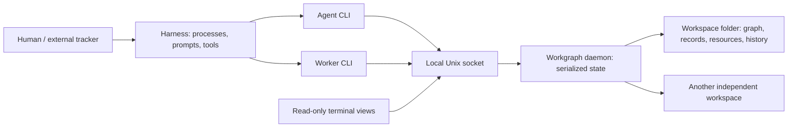

Workgraph communication goes through the daemon; a harness may also have other
channels. Multiple agents can share one daemon. Actor names are cooperative
attribution, not authentication. A recorded test result is a submitted claim;
configured evidence and review checks provide stronger, explicit gates.

## Capabilities at a glance

Use `wg help METHOD` for exact fields and response paths. These capabilities
belong to this checkout's matching executable and current schema.

| Need | Methods and focused guidance | State and lifecycle caveats |
| --- | --- | --- |
| Plan a bounded change | `transaction.preflight`, `transaction.apply`; [planning](skills/workgraph/references/planning.md) | Up to 128 expanded operations per atomic transaction, within the byte limit. Preflight commits and reserves nothing; external tools remain harness work. |
| Organize inherited prerequisites | `ticket.hierarchy.get`, `ticket.hierarchy.put`; [planning](skills/workgraph/references/planning.md) | Containment alone adds no scheduling gate. Explicit policy can inherit ancestor prerequisites; ownership and child-completion gates never inherit. |
| Route eligible work | `ticket.ready`, `ticket.readiness`, `allocation.ticket_policy_put`; [coordination](skills/workgraph/references/coordination.md) | Capabilities, pools and optional `allowed_actor_ids` cooperatively restrict registered-run eligibility; actor names are not authentication. |
| Change instructions accountably | `ticket.amendment.publish`, `ticket.amendment.get`, `ticket.amendment.list`, `ticket.amendment.acknowledge`, `ticket.amendment.withdraw`; [evidence and review](skills/workgraph/references/communication-evidence.md) | Immutable attributed versions retain exact text/resource pins. Required current-version acknowledgement binds actor/run/claim; a replacement claim must acknowledge again before finishing. |
| Discover small linked memory | `fact.keys`, `fact.list`, `fact.references`; [memory and resume](skills/workgraph/references/resume-digest.md) | Prefixes and scalar-equality JSON-pointer predicates select explicit scopes; missing differs from null. Reverse references are editable navigation links, not evidence pins. |
| Read only the needed context | `ticket.brief`, `resource.brief`, `ticket.context`; [CLI contracts](skills/workgraph/references/cli-contract.md) | Compact views and bounded full context disclose omissions. Expand exact records rather than assuming an entire graph or body was returned. |
| Observe work and consume notices | `attention.read`, `attention.wait`, `inbox.read`, `inbox.ack`, `changes.read`, `changes.wait`; [communication](skills/workgraph/references/communication-evidence.md) | A read does not acknowledge. Advance consumed delivery cursors, preserve current captures, and page nested readiness separately. |
| Inspect usage and capacity | `usage.aggregate`, `actor.overview`, `workspace.metrics`; [metrics](skills/workgraph/references/metrics.md) | These are recorded/caller-supplied counters and explicit captures, not provider quota enforcement or process-liveness proof. |
| Complete a project deliberately | `project.readiness`, `project.finish`; [planning](skills/workgraph/references/planning.md) | Readiness aggregates current blockers and completion gates. Finish uses an exact project revision and structured handoff; it does not finish tickets or resolve questions for you. |

## Concepts and choosing a record

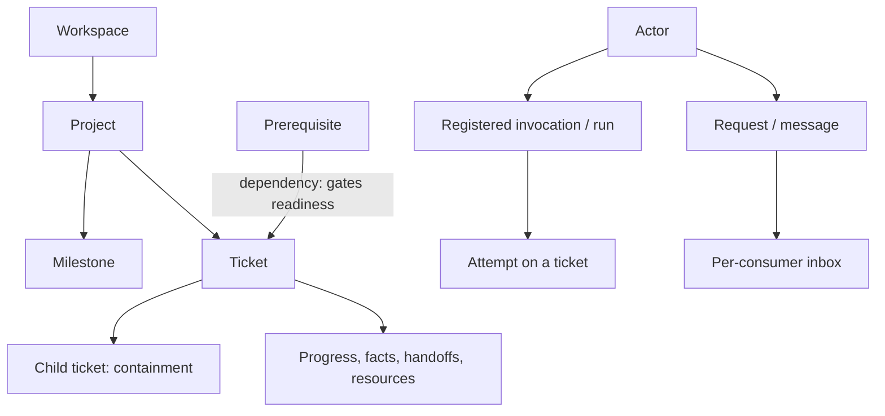

| Term | Meaning |
| --- | --- |
| Daemon | Local state service; not an agent launcher |
| Workspace | Independent durable graph and history in one managed root |
| Project / milestone / ticket | Organization, scheduling and work records |
| Actor | Stable cooperative identity; one context per participant |
| Context | Client connection, optional attribution and private journal defaults |
| Run | One registered invocation with immutable declared capabilities |
| Attempt | One try at a ticket; `ticket.start --attempt-id` or `claim_next` creates it |
| Token | Ownership fence returned by acquisition; preserve its actual value |
| Handoff | Structured recorded state for another invocation to resume |
| Fact | Small named JSON value in one explicit scope |
| Request | Accountable question, review, blocker or handoff with a resolver |
| Inbox | Notifications, acknowledged separately by each consumer |
| Saved request | Exact serialized command identity and bytes for safe retry |
| Transaction | Up to 32 supported operations committed atomically in the daemon |
| Capability / pool | Cooperative eligibility requirements and bounded allocation capacity |
| Path reservation | Shared/exclusive logical file or subtree fence |
| Session | Explicitly imported conversation/tool history; no automatic capture |

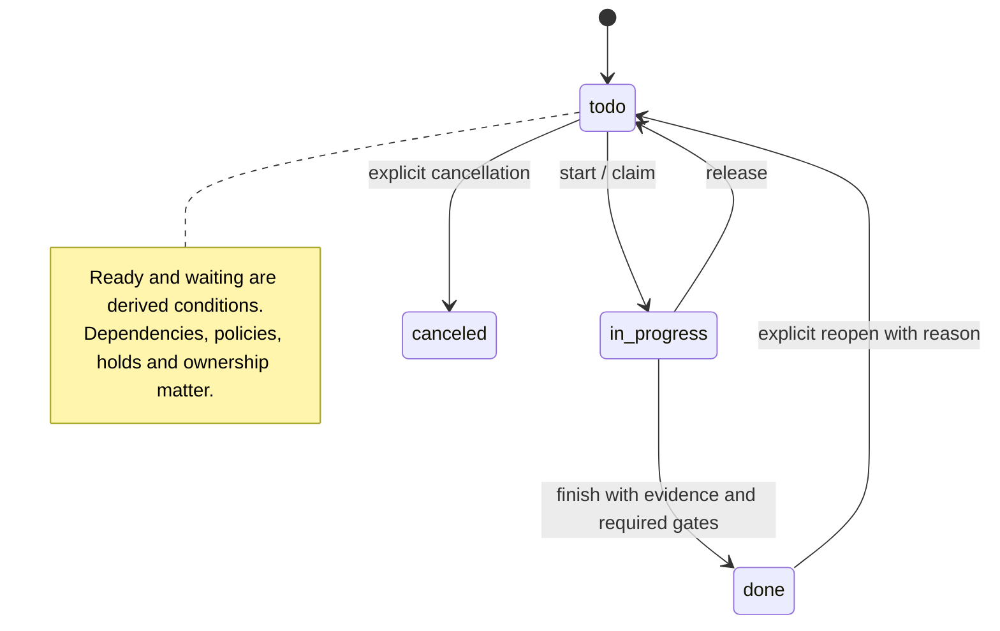

Parenthood organizes work; it does not automatically inherit dependencies. Gate
each phase's children explicitly, or choose a supported dependency policy.
`ticket.claim` does not itself create an attempt. A run's reported status or an
expired lease does not prove its external process stopped. Cancellation records
do not kill processes.

| Need | Record |
| --- | --- |
| Small reusable result | Fact: at most 4096 canonical JSON bytes; scopes never inherit |
| Choice and reason | Decision progress/comment |
| What changed during a try | Progress with current ownership token |
| Resume after a reset | Handoff, including objective, decisions, blockers, evidence, next steps |
| Finished outcome | Completion evidence and, when configured, acceptance records |
| Long text, logs, source or binary | Versioned resource, linked to work |
| Answer owed by someone | Request, with explicit recipient/resolver |
| Inform someone without tracking an answer | Message |
| Recover original visible dialogue/tool records | Session history with stable source IDs |

### Route capabilities and scarce capacity

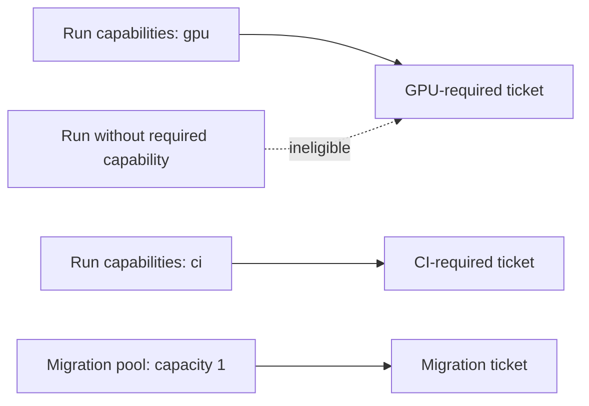

After defining the quoted `wg` function in setup, a routing example is:

```bash
wg run register --target-run-id gpu-1 --json-field capabilities '["gpu"]' --objective 'GPU work'
wg allocation.pool_put --name migration --limit 1 --expected-revision 0
wg allocation.ticket_policy_put --ticket-id train --expected-revision 0 \
  --json-field required_capabilities '["gpu"]' --json-field pools '["migration"]'
wg allocation.ticket_policies
wg allocation.pools
wg run get --target-run-id gpu-1
```

Requirements compose at acquisition; inspect run-aware readiness before assigning
work. A run's declared capabilities are immutable and cooperative. Pools allocate
one slot per participating ticket under the current policy, not arbitrary weighted
jobs. The historical routing fixture observed `missing_capability` for a run
without GPU and `pool_full` for a second migration. A read-only observer does not
gain permission to act as another worker.

## Install and set up

### Published packages and matching documentation

The following commands install **v0.6.1 preview** with its matching bundled docs.
Check the release qualification evidence for the exact artifacts and platform scope.
For an existing installation, complete the [upgrade steps](#upgrade-from-an-older-preview)
before replacing its executable or RPM.
Choose the matching platform and stop if checksum verification fails. Keep WSL
managed data on Linux `$HOME`, not `/mnt/c`. Review privileged installation commands
under your own machine policy.

```bash
# AlmaLinux 10 x86_64, including AlmaLinux under WSL
set -euo pipefail
sudo dnf install -y jq python3 curl-minimal
mkdir -p "$HOME/Downloads/workgraph-0.6.1"
cd "$HOME/Downloads/workgraph-0.6.1"
RELEASE=https://github.com/dakotamurphyucf/workgraph/releases/download/v0.6.1
FILE=workgraph-0.6.1-1.el10.x86_64.rpm
curl -fLO "$RELEASE/$FILE"
curl -fLO "$RELEASE/SHA256SUMS"
awk -v name="$FILE" '$2 == name {print; count++} END {if (count != 1) exit 1}' SHA256SUMS > selected.sha256
sha256sum --check selected.sha256
sudo dnf install -y "./$FILE"
hash -r
workgraph --version
```

For macOS ARM64, use the archive rather than an RPM. `jq` is also required by the
shell examples and helper; install it through your usual package manager.

```bash
set -euo pipefail
mkdir -p "$HOME/Downloads/workgraph-0.6.1"
cd "$HOME/Downloads/workgraph-0.6.1"
RELEASE=https://github.com/dakotamurphyucf/workgraph/releases/download/v0.6.1
FILE=workgraph-0.6.1-macos-arm64.tar.gz
curl -fLO "$RELEASE/$FILE"
curl -fLO "$RELEASE/SHA256SUMS"
awk -v name="$FILE" '$2 == name {print; count++} END {if (count != 1) exit 1}' SHA256SUMS > selected.sha256
shasum -a 256 --check selected.sha256
mkdir -p "$HOME/.local/opt/workgraph-0.6.1"
tar -xzf "$FILE" -C "$HOME/.local/opt/workgraph-0.6.1"
# Keep the versioned archive and docs together; select its executable explicitly.
export PATH="$HOME/.local/opt/workgraph-0.6.1/workgraph-0.6.1-macos-arm64/bin:$PATH"
hash -r
workgraph --version
```

Follow [macOS installation](docs/macos-install.md) for the exact extracted path,
PATH and packaged documentation discovery; retain the accompanying docs/examples.
### Build the current checkout from source

For this checkout, use the provisioned pinned toolchain and `./dev`; do not change
unrelated opam switches or global defaults. See [engineering standards](engineering-standards.md).

```bash
./dev build @install
./dev exec bin/main.exe -- --version
# Required development qualification, run against the matching checkout:
./dev build @fmt @runtest @install
```

### Upgrade from an older preview

From 0.6.0, preserve existing roots, contexts and exact journals; no reset or
migration is required. Drain work, stop the daemon gracefully, install the verified
0.6.1 client and daemon together, and replace the complete skill folder. Restart
the daemon against its existing roots and check `--version` and `initialize`.
See the [0.6.1 upgrade steps](docs/releases/v0.6.1.md#upgrade-from-060), including
the JSON error-output change for shell consumers.

From 0.5 or earlier, use the following preservation and fresh-root procedure.
Keep the matching older executable and downloaded archives before replacing the
command on PATH or upgrading an RPM. With that executable, finish or retain exact
uncertain requests, export and verify needed workspaces, stop its launchers and
shut down gracefully. Preserve complete stopped registry/workspace roots, contexts,
journals and exports separately. Verification is not a cross-version restore path.
Use fresh 0.6 roots and a new socket/context/request directory; do not edit format
markers or copy old managed files into them. See the [step-by-step upgrade](docs/releases/v0.6.0.md#upgrade-from-05-or-an-older-preview).

### Bootstrap a private workspace

Choose an absolute, private state parent and a matching executable. These are
shell values, not implicit CLI configuration. `--context` applies them explicitly.
Re-running init reuses only matching existing connection/root/workspace state;
it is not a promise to overwrite arbitrary mismatched directories safely.

```bash
umask 077
WG=workgraph                       # or absolute matching checkout executable
export WG
WG_HOME="$HOME/.local/state/workgraph-0.6"
mkdir -p "$WG_HOME"
export WG_CONTEXT="$WG_HOME/agent.json"
"$WG" init --context "$WG_CONTEXT" --socket "$WG_HOME/daemon.sock" \
  --workspace-id demo --actor-id "$USER" --root "$WG_HOME/workspace" --name Demo \
  --request-directory "$WG_HOME/requests" --start-daemon true \
  --registry "$WG_HOME/registry" --daemon-log "$WG_HOME/daemon.log"
wg() { "$WG" --context "$WG_CONTEXT" "$@"; }
```

```text
~/.local/state/workgraph-0.6/
├── daemon.sock       local connection endpoint
├── daemon.log        startup and diagnostics; inspect first on failure
├── registry/         daemon's workspace registrations
├── workspace/        graph, immutable content, journal and conversation history
├── agent.json        socket/workspace/actor and request-directory defaults
├── requests/         exact saved write requests; retain after uncertain outcomes
└── agents/           added for other participants
    ├── worker-1.json
    └── worker-1-requests/
```

Smoke test with fresh IDs. Check the CLI exit before parsing its JSON. A
`saved_request: …` line is a diagnostic on **stderr**, not corrupt JSON on stdout.
In JSON mode, both local failures and daemon failures return an error envelope on
stdout; inspect `.error.data.kind` after a nonzero exit. Text and raw-byte output
modes keep errors on stderr to protect the streamed content. `Outcome_unknown`
means a write might have committed: recover using its exact saved request.
Do not suppress errors or combine both streams before `jq`.

```bash
set -euo pipefail
wg project create --project-id demo-project --title 'My first project'
wg ticket create --project-id demo-project --ticket-id first-task --title 'Try Workgraph'
if started=$(wg ticket start --ticket-id first-task --initial-note 'Testing the basic workflow.'); then
  token=$(jq -er '.result.data.token' <<<"$started")
else
  exit 1                         # retain exact journal; do not invent a fresh retry
fi
wg ticket progress --ticket-id first-task --token "$token" --body 'Basic commands work.'
wg ticket finish --ticket-id first-task --token "$token" --evidence 'Created, started and finished a ticket.'
wg workspace overview --output text
```

Create separate contexts and private journals for the orchestrator, workers and CI:

```bash
mkdir -p "$WG_HOME/agents"
for agent in agent-orch worker-1 worker-2 ci; do
  "$WG" init --context "$WG_HOME/agents/$agent.json" --socket "$WG_HOME/daemon.sock" \
    --workspace-id demo --actor-id "$agent" \
    --request-directory "$WG_HOME/agents/$agent-requests"
done
lead() { "$WG" --context "$WG_HOME/agents/agent-orch.json" "$@"; }
```

An observer context may omit actor/run; ordinary reads remain unfiltered. Writes
need explicit attribution. Context `--self` is an explicit supported selector,
not a hidden filter on every read. A context default `run_id` is attribution;
`target_run_id` and `attempt_id` are separate identities.

After a reboot, rerun the matching init command to start the daemon, or follow
[administration](skills/workgraph/references/administration.md). Stop with
`wg daemon shutdown`. There is no assumed system service. Preserve logs and data
when startup fails. A connection refusal, process-name search or expired lease
is not proof that a socket belongs to a stopped process. **Do not use
`pgrep || rm socket`.** Inspect the exact endpoint/registry identity and supported
lifecycle diagnostics. If ownership remains uncertain, preserve it and choose a
fresh private socket; do not unlink a foreign endpoint or open the same root in
two live writers. Graceful shutdown drains admitted work.

### Give it to an agent

Installation/setup prompt (adapt paths and privileges deliberately):

```text
Install or locate the matching Workgraph executable and its packaged documentation.
Read skills/workgraph/SKILL.md and the setup/lifecycle reference before using it. Reuse the
supplied daemon/workspace. If none exists, choose private absolute state paths and
bootstrap one. Use your own actor/context and private saved-request directory.
Do not delete occupied sockets, locks or managed data. Ask before privileged
installation or deletion if my machine policy requires it.
Run an end-to-end project/ticket/start/progress/finish smoke test with fresh IDs.
Report executable version, context/socket/workspace paths and observed results.
Retain exact request files after uncertain outcomes. Do not launch other agents
unless I or the harness explicitly authorizes them.
```

Connection prompt:

```text
Use Workgraph at EXECUTABLE with context ABS_CONTEXT. Read ABS_SKILL_DIRECTORY/SKILL.md and the
focused references inside that skill directory. Your actor is ACTOR; your private request directory
is REQUESTS. Reuse this workspace. Inspect assigned work, ownership and open
requests; record meaningful progress, decisions, evidence and handoff. Keep actual
tokens, revision guards and exact retry paths. The harness owns tools and processes.
```

## Current coordination checkpoints

The [0.6 contract guide](docs/preview-0.6-contracts.md) links the focused rules for
read-only candidate eligibility, registered/observed participants, bounded activity
expansion, upload recovery, templates and shared inputs. Configure allocation
policy before dispatch and check its receipt: its `expected_revision` belongs to
the policy (`0` before creation), not the ticket. The atomic plan below keeps the
new ticket and gate together; an apply failure must stop dispatch.

Give synthesis/dispatch work explicitly to the lead and verification work to
eligible independent reviewers. Before creating a verifier ticket, compare
related findings at the same location and exclude all relevant authors through a
positive `allowed_actor_ids` policy. The daemon cannot infer duplicate findings.

Keep small fact summaries below about 3 KiB; the 4096 canonical-byte limit covers the
whole replacement JSON, including later verdict fields. Put complete reports and
verification evidence in pinned resources. JSON null is a value, not deletion.
Keep private per-agent scratch and caches outside the source checkout, for
example `~/.local/state/workgraph-0.6/scratch/ACTOR/`, separate from managed data.
Use repository scratch only when that repository explicitly provides and ignores
it; clean-worktree checks must not delete shared inputs or force repeated downloads.
Retain shared accepted context as versioned Workgraph resources. A local scratch
path is not portable evidence by itself.

A harness should inspect provider errors before relaunching, respect reset/retry
instructions, cap backoff and stop repeated rapid no-progress launches. It owns
foreground lock waits and process supervision; failed launches are not evidence
that an old owner stopped. [Team checkpoints](skills/workgraph/references/team-workflows.md)
describe these responsibilities.

## Eight workflows

### 1. Memory across resets

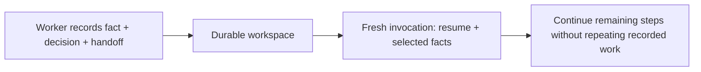

For a fresh `res-task`, preserve results and every useful handoff field:

```bash
started=$(wg ticket start --ticket-id res-task)
token=$(jq -er '.result.data.token' <<<"$started")
wg fact put --json-field scope '{"kind":"ticket","id":"res-task"}' --key total_primes \
  --json-field value '{"below":10000,"count":1229}' --expected-revision 0
wg ticket progress --ticket-id res-task --token "$token" \
  --body 'Sieve found 1229 primes below 10000; checked against trial division.'
wg ticket progress --ticket-id res-task --token "$token" --kind decision \
  --body 'Exclude 2 from both residue classes; it is the only even prime. Use exact integers.'
wg handoff set --ticket-id res-task --token "$token" --expected-revision 0 \
  --summary 'Step 1 done; steps 2–3 remain.' \
  --objective 'Finish residue split and record class1/class3 facts.' \
  --completed 'total_primes=1229, verified twice.' \
  --decisions 'Exclude 2; exact integer arithmetic.' --blockers 'None.' \
  --next-steps 'Count odd primes by n mod 4, store facts and finish.' \
  --evidence 'total_primes fact and two progress notes.'
wg ticket release --ticket-id res-task --token "$token"
# Fresh actor/context reads the recorded material; facts require explicit selection.
resume=$(wg ticket resume --ticket-id res-task --include-markdown true \
  --json-field fact_selections '[{"scope":{"kind":"ticket","id":"res-task"},"key":"total_primes"}]')
jq -r '.result.data.markdown' <<<"$resume"
```

Resume performs no model inference. If an old invocation still owns the task,
inspect it and follow guarded reassignment/recovery; a context reset does not
invalidate its token automatically. Keep a small local recovery index pointing
to durable records and request files. Historical October 2026 AlmaLinux/Claude
Code experiment: a fresh agent understood the next step after two calls and
finished in 13; this is an observation, not a latency or call-count guarantee.

### 2. Orchestrator, workers and CI

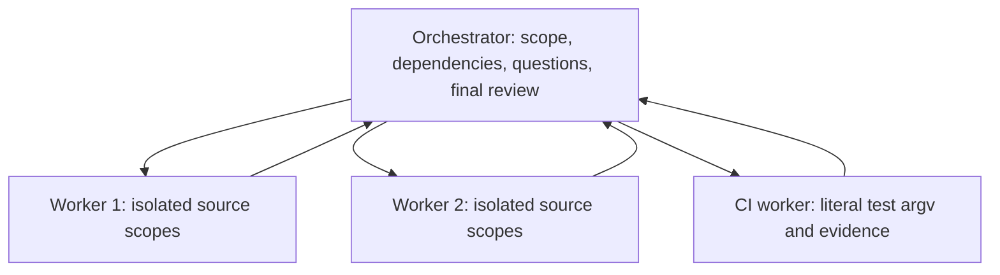

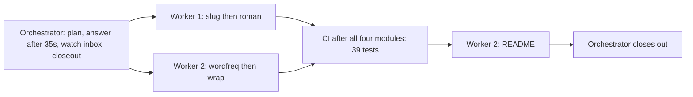

The historical run used Claude Code, including both workers. A mixed Codex/Claude
harness is possible but was not measured by that experiment. The guide recorded
six tickets/four modules/39 tests/about nine minutes overall (the recorded claim/finish timeline spans 21:09–21:16 UTC on 2026-10-09), 26 planning operations, an
answer after roughly 35 seconds (asked around 12 seconds), and a CI bar that included a bot restart; the tests themselves took 45ms. These observations do not establish current performance or harness support.

Use separate contexts from setup. A small **fresh-workspace** atomic plan illustrates
aliases; aliases exist only inside the transaction. Instructions, dependencies,
capability policy and decisions belong in the same coherent plan when possible.

```json
{"operations":[
 {"method":"label.put","params":{"label_id":"ci","expected_revision":"0","name":"CI"}},
 {"method":"project.create","as":"p","params":{"project_id":"demo-build","title":"Two-module example"}},
 {"method":"ticket.create","params":{"ticket_id":"module-a","project_id":"$p","title":"Implement module A","description":"Publish exact source and test evidence."}},
 {"method":"ticket.create","params":{"ticket_id":"module-b","project_id":"$p","title":"Implement module B"}},
 {"method":"ticket.create","params":{"ticket_id":"test-all","project_id":"$p","title":"Run integrated tests"}},
 {"method":"ticket.create","params":{"ticket_id":"package-readme","project_id":"$p","title":"Document the checked package"}},
 {"method":"ticket.metadata","params":{"ticket_id":"module-b","expected_revision":"1","acceptance_criteria":"Module behavior checked."}},
 {"method":"ticket.metadata","params":{"ticket_id":"test-all","expected_revision":"1","label_ids":["ci"]}},
 {"method":"dependency.add","params":{"ticket_id":"test-all","prerequisite_id":"module-a"}},
 {"method":"dependency.add","params":{"ticket_id":"test-all","prerequisite_id":"module-b"}},
 {"method":"dependency.add","params":{"ticket_id":"package-readme","prerequisite_id":"test-all"}},
 {"method":"allocation.ticket_policy_put","params":{"ticket_id":"test-all","expected_revision":"0","required_capabilities":["ci"],"pools":[]}},
 {"method":"comment.add","params":{"target":{"kind":"project","id":"$p"},"kind":"decision","body":"Separate module scopes; CI waits for both."}}
]}
```

Save this as `plan.json`, then validate before committing. Preflight does not
reserve resources or commit; it is not a guarantee a later guarded apply succeeds.
Transactions never roll back external tools, uploaded bytes or filesystem edits.
The original experiment committed four result writes at one revision; an oversized
fact rejected the whole batch and left the ticket in progress. It followed a real
review where separate finish/fact writes left a completed ticket without its
verdict for about ten seconds. Record result and completion together when coupled.

```bash
lead transaction preflight --actor-id agent-orch --params-file plan.json || exit 1
lead transaction apply --params-file plan.json || exit 1
```

A registered worker uses explicit run-aware acquisition. Switch on the result
kind before reading a token. Handle an empty result without a rapid write loop:

```bash
export WG_CONTEXT="$WG_HOME/agents/worker-1.json"
RUN=worker-1-invocation-1             # fresh invocation identity, not ticket ID
wg run register --target-run-id "$RUN" --json-field capabilities '["ocaml"]' --objective 'Module work'
reply=$(wg ticket claim_next --run-id "$RUN" --target-run-id "$RUN" --attempt-id "$RUN-a1" --project-id demo-build)
kind=$(jq -er '.result.data.kind' <<<"$reply")
case "$kind" in
  selected)
    ticket=$(jq -er '.result.data.claim.ticket_id' <<<"$reply")
    token=$(jq -er '.result.data.claim.token' <<<"$reply")
    wg ticket brief --ticket-id "$ticket"
    wg ticket context --ticket-id "$ticket"  # full bounded recorded context
    wg ticket progress --run-id "$RUN" --ticket-id "$ticket" --token "$token" --body 'Implementation and focused checks underway.'
    # Run tools, publish evidence and satisfy review policy before this finish.
    wg ticket finish --run-id "$RUN" --ticket-id "$ticket" --token "$token" --evidence 'Actual checked output references go here.'
    ;;
  empty) echo 'No eligible work in this observed state; park or exit.' ;;
  *) echo 'Unexpected allocation response; retain exact journal.' >&2; exit 1 ;;
esac
run=$(wg run get --target-run-id "$RUN")
revision=$(jq -er '.result.data.revision' <<<"$run")
wg run transition --run-id "$RUN" --target-run-id "$RUN" --expected-revision "$revision" \
  --status completed --evidence 'Invocation stopped after the outcome recorded above.'
```

An empty standalone `claim_next` is an explicitly classified **non-durable
observation**, not a committed no-op, ticket claim or inferred process state.
Exact retries preserve saved request identity. Do not interpret an uncertain
mutation or JSON parse failure as empty, and do not refresh guards silently.
Run/attempt receipts retain the actual resulting recorded state and typed refs;
there is no invented universal receipt ID/status.

For idle waiting, capture a planning feed before the readiness read, then park
on its returned cursor and re-read run-aware readiness. `attention.read/wait`
can combine attention sources; readiness inside attention is separately paged.
Never claim a first bounded attention response traversed all nested readiness.
Stop at the harness's deadline/cancellation, terminal project or explicit idle
budget; Workgraph does not keep a worker process alive.

Publish long external resources first. A transaction can then record an exact
pin, a small fact and completion together. Envelope workspace/actor/run/mutation
fields belong **only outside** operations. Here all IDs/guards are illustrative
for fresh records and the actual claim token must be substituted:

```bash
ops=$(jq -nc --arg token "$token" '{operations:[
 {method:"resource.put_text",params:{resource_id:"module-result",expected_revision:"0",title:"Module result",text:"Observed checks and exact source references."}},
 {method:"resource.link",params:{resource_id:"module-result",expected_revision:"1",target:{kind:"ticket",id:"module-a"}}},
 {method:"fact.put",params:{scope:{kind:"ticket",id:"module-a"},key:"checks",expected_revision:"0",value:{passed:15}}},
 {method:"ticket.finish",params:{ticket_id:"module-a",token:$token,evidence:"15 actual focused checks passed; module-result contains exact source and output refs."}}
]}')
wg transaction apply --run-id "$RUN" --params-file - <<<"$ops"
```

#### Ask rather than guess

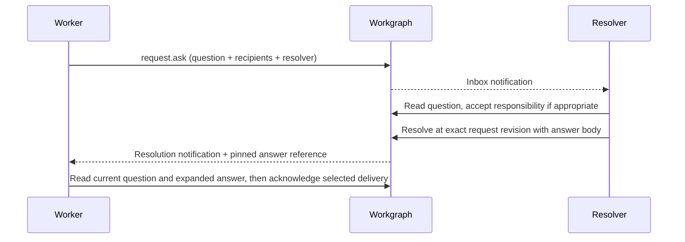

```bash
wg request ask --run-id "$RUN" --request-id module-api-question --title 'Empty input contract?' --kind clarification \
  --resolver-id agent-orch --json-field recipients '[{"kind":"actor","id":"agent-orch"}]' \
  --ticket-id module-a --body 'Should the empty input return zero or an error?'
lead inbox wait --consumer-id orch-current --json-field recipient '{"kind":"actor","id":"agent-orch"}' \
  --exclude-self true --timeout-ms 25000
lead request list --open-only true --resolver-id agent-orch
question=$(lead request get --request-id module-api-question --include-messages true)
jq '.result.data.related.source_message, .result.data.related.messages.items' <<<"$question"
revision=$(jq -er '.result.data.revision' <<<"$question")
lead request resolve --request-id module-api-question --expected-revision "$revision" \
  --body 'Return zero for empty input; keep malformed input as an error.'
answer=$(wg request get --request-id module-api-question --include-messages true)
jq '.result.data.status.answer, .result.data.related.messages.items' <<<"$answer"
notifications=$(wg inbox read --consumer-id "$RUN" --json-field recipient '{"kind":"actor","id":"worker-1"}')
# Select only IDs whose bodies/references you actually processed; never ack all unseen rows.
processed=$(jq -c '[.result.data.items[] | select(.source.kind == "request" and .source.id == "module-api-question") | .notification_id]' <<<"$notifications")
if jq -e 'length > 0' <<<"$processed" >/dev/null; then
  wg inbox ack --consumer-id "$RUN" --json-field recipient '{"kind":"actor","id":"worker-1"}' \
    --json-field notification_ids "$processed"
fi
```

Use `--exclude-self true` where supported to omit echo deliveries from a wait;
that does not acknowledge them. One logical exchange can produce several
notifications. Request revision, thread revision, current source message revision and immutable
answer-comment pin are distinct. A request can be delivered, accepted and resolved
at different times; inbox acknowledgement does not accept or resolve it.

#### CI is a worker with explicit outcomes

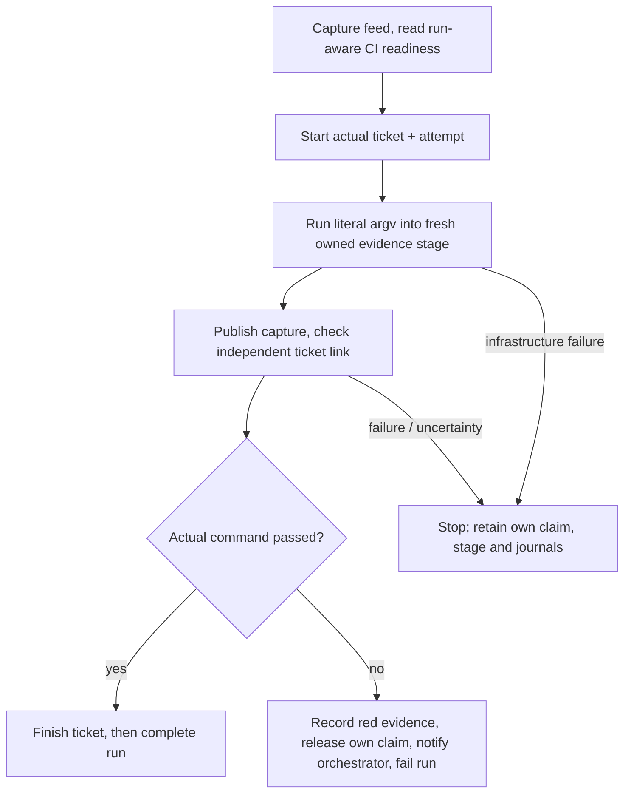

[skills/workgraph/scripts/ci-worker.sh](skills/workgraph/scripts/ci-worker.sh), reproduced completely below, runs
one job per invocation. It has a bounded idle policy, fresh stage leaf under an
existing parent, literal argv, durable capture, independent publication/link
checks, and separate success/red/infrastructure handling. It does not hide stderr
or treat failure as success. The context must have a private journal directory.
For a shell pipeline pass an explicit `bash -o pipefail -c '…'` argv.

```bash
CTX="$WG_HOME/agents/ci.json" RUN=ci-invocation-1 PROJECT=demo-build \
SRC=/absolute/git/checkout STAGES=/absolute/existing/private/stages WG="$WG" \
  bash skills/workgraph/scripts/ci-worker.sh ./dev build @runtest
```

Captured output has observed/retained byte counts and truncation indicators. A
bounded retained prefix is not the whole command output. Declare provenance
sources explicitly; selected files do not establish whole-tree coverage.
Publication retry never reruns the command. Upload and ticket link are independent
commits: on partial failure preserve both actual receipt and saved publication
plan/stage, then retry the saved publication. Never finish from a failed link.

Closeout includes overview, open questions and meaningful notes to the team:

```bash
lead workspace overview
lead request list --open-only true
lead project brief --project-id demo-build
lead message send --message-id demo-closeout \
  --json-field recipients '[{"kind":"actor","id":"worker-1"},{"kind":"actor","id":"worker-2"}]' \
  --body 'Review recorded completion evidence and report remaining blockers before closeout.'
```

Project completion is a guarded declaration after checking current children and
policy, not an automatic consequence of a dashboard count. Orchestrator prompt:

```text
Plan small independently reviewable tickets with explicit dependencies and source
ownership. Register each invocation's capabilities; route CI and scarce pools.
Answer formal questions with the current guard. Read worker evidence and exact
output versions, arrange independent review, and verify the integrated result.
Record decisions and handoffs. Keep completed/deferred scope and release checks
separate. The harness owns processes and approvals for external side effects.
```

Worker prompt:

```text
Read your ticket, instructions, effective policy and current ownership before editing.
Acquire only your declared source scopes. Keep actual token/attempt/run identities.
Ask an accountable question when a material contract is unclear. Publish meaningful
progress, exact source/test evidence and handoff. Satisfy gates before finishing;
release only intended owned holds. On uncertain writes retain and retry exact bytes.
When idle, perform bounded capture/read/wait or stop; never spin claim mutations.
```

### 3. Agent-to-agent Q&A and messages

A direct message is useful for conversation without a tracked answer obligation.
Use a request for accountable clarification, blockers, review or handoff.

```bash
wg message send --run-id "$RUN" --message-id worker-observation \
  --json-field recipients '[{"kind":"actor","id":"agent-orch"}]' \
  --body 'The second fixture also exercises Unicode paths.'
lead message send --message-id orch-reply --reply-to-message-id worker-observation \
  --json-field recipients '[{"kind":"actor","id":"worker-1"}]' \
  --body 'Keep that fixture and include its exact test evidence.'
messages=$(lead inbox read --consumer-id orch-current --json-field recipient '{"kind":"actor","id":"agent-orch"}')
jq '.result.data.items[]' <<<"$messages"
# After processing this known message, select its actual returned delivery IDs.
processed=$(jq -c '[.result.data.items[] | select(.source.kind == "message" and .source.id == "worker-observation") | .notification_id]' <<<"$messages")
if jq -e 'length > 0' <<<"$processed" >/dev/null; then
  lead inbox ack --consumer-id orch-current --json-field recipient '{"kind":"actor","id":"agent-orch"}' \
    --json-field notification_ids "$processed"
fi
```

Use `inbox.wait` to park with a bounded timeout. Reading never acknowledges;
acknowledgement is per consumer and separate from request responsibility. Historical
small-run Q&A latency was approximately 3–6 seconds, not a delivery SLA.

### 4. Independent review gates

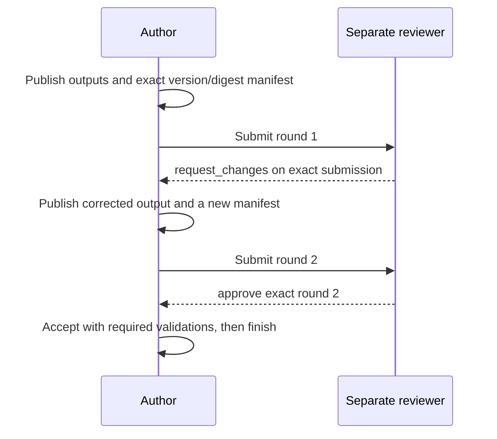

Configure reviewer/separate-actor policy, capture exact input/output pins, submit,
record approve/request_changes, accept and finish. The runnable
[gated review workflow](skills/workgraph/references/gated-review-workflow.md) and
[Python recipe](skills/workgraph/scripts/gated-review-workflow.py) show two actors and two rounds.
An approval binds the exact submitted resource version/digest; later publication
is different evidence. Tests passing do not automatically accept work. The system
records gates; it does not make filesystem edits impossible. The original two-round
example took about two minutes on its historical harness.

### 5. A merge-request snapshot with backstory

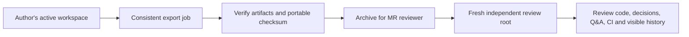

Export captures one consistent moment while writers continue. Choose fresh absolute
output roots. Poll with a deadline and handle failure/cancellation, not an endless
`until completed` loop. Retain the returned job ID rather than choosing an unrelated
most recent job.

```bash
EXPORT=/absolute/fresh/export
job=$(lead workspace export --destination "$EXPORT")
job_id=$(jq -er '.result.data.job_id' <<<"$job")
end=$((SECONDS + 120))
while :; do
  job=$(lead export get --job-id "$job_id")
  state=$(jq -er '.result.data.status' <<<"$job")
  case "$state" in
    completed) break ;;
    failed|canceled|interrupted) printf '%s\n' "$job" >&2; exit 1 ;;
  esac
  [ "$SECONDS" -lt "$end" ] || { echo 'Export still pending; retain job ID.' >&2; exit 1; }
  sleep 1
done
lead export verify --directory "$EXPORT"
tar -czf /absolute/review-workgraph.tar.gz -C "$(dirname "$EXPORT")" "$(basename "$EXPORT")"
# Linux: sha256sum /absolute/review-workgraph.tar.gz
shasum -a 256 /absolute/review-workgraph.tar.gz
```

Review exported records for private data before sharing. Verify the delivered
archive checksum using the separately supplied expected digest, extract to a fresh
parent, then use the matching executable:

```bash
# Archive checksum verification precedes extraction.
mkdir /absolute/fresh/review-package
tar -xzf /absolute/review-workgraph.tar.gz -C /absolute/fresh/review-package
# This operator context must point at an independent review daemon/registry.
: "${REVIEW_OPERATOR_CONTEXT:?set a private review operator context}"
review() { workgraph --context "$REVIEW_OPERATOR_CONTEXT" "$@"; }
EXP=/absolute/fresh/review-package/export
verified=$(review export verify --directory "$EXP")
WS=$(jq -er '.result.data.workspace_id' <<<"$verified")
review workspace restore --directory "$EXP" --root /absolute/fresh/review-workspace
SOCKET=$(jq -er '.socket' "$REVIEW_OPERATOR_CONTEXT")
workgraph init --context /absolute/review-agent.json --socket "$SOCKET" \
  --workspace-id "$WS" --actor-id reviewer --root /absolute/fresh/review-workspace \
  --name "Review $WS" --request-directory /absolute/fresh/reviewer-requests
wgx --context /absolute/review-agent.json status
```

Restore does not merge with the author's live history. The same workspace ID
cannot be simultaneously registered twice in one daemon; use an independent
review daemon/registry. Human-readable artifacts aid review; durable data and
verified content support exact restore. The historical sample was about 100KB and
a reviewer used 35 calls; size and effort depend on retained data.

Review-agent prompt:

```text
Read the code and independently verify the exported Workgraph snapshot. Establish:
1. Who implemented each part and what exact tests ran?
2. Why were important design choices made?
3. Which questions were asked, answered and pinned?
4. What did CI actually capture, retain and publish?
5. Which choices were unspecified or made without agreement?
6. Where did participants disagree, and how was that resolved?
Distinguish recorded claims from independently checked evidence. Cite exact records
and output versions. Do not treat missing indexed hits as absence or attempt to
recover private model reasoning. Report concerns in the review workspace.
```

### 6. Shared skill backlog

```bash
wg allocation.ticket_policy_put --ticket-id train --expected-revision 0 \
  --json-field required_capabilities '["gpu"]' --json-field pools '[]'
wg run register --target-run-id gpu-next --json-field capabilities '["gpu"]' --objective 'GPU backlog'
wg ticket ready --target-run-id gpu-next --project-id demo-build
wg ticket claim_next --run-id gpu-next --target-run-id gpu-next --attempt-id gpu-next-a1 --project-id demo-build
```

Acquisition serializes competing requests; retain the actual selected kind and
claim token. Capability declarations are cooperative, not proof hardware exists.
Run-aware readiness considers the actual worker; ordinary unfiltered lists do not.
The original 13-ticket experiment observed no overlapping claims. Idle workers
should park or exit rather than repeatedly mutating the backlog.

### 7. Same repository, explicit source ownership

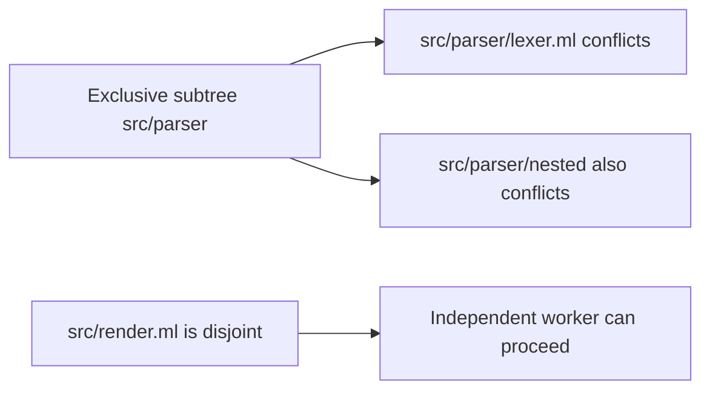

A logical `worktree_id` names a collision domain. Use the same ID across physical
checkouts when they share a protected integration target. The harness canonicalizes
aliases and enforces who edits; reservations are cooperative and do not lock files.
Declare only exact needed paths. A fresh two-ticket plan can create and reserve
scopes atomically on start:

```json
{"operations":[
 {"method":"ticket.create","params":{"ticket_id":"parser","title":"Parser"}},
 {"method":"ticket.create","params":{"ticket_id":"renderer","title":"Renderer"}},
 {"method":"ticket.paths.put","params":{"ticket_id":"parser","expected_revision":"0","require_reservations":true,"declarations":[{"target":{"worktree_id":"integration","kind":"subtree","path":"src/parser"},"mode":"exclusive"}]}},
 {"method":"ticket.paths.put","params":{"ticket_id":"renderer","expected_revision":"0","require_reservations":true,"declarations":[{"target":{"worktree_id":"integration","kind":"file","path":"src/render.ml"},"mode":"exclusive"}]}},
 {"method":"ticket.start","params":{"ticket_id":"parser"}}
]}
```

Save that JSON as `paths.json`. Use a registered run owned by your context actor
when acquiring required paths:

```bash
wg transaction preflight --actor-id worker-1 --run-id "$RUN" --params-file paths.json
wg transaction apply --run-id "$RUN" --params-file paths.json
```

Ticket-scoped automatic grants are tied to their claim borrower and ordinary
lifecycle cleanup. Independently held/manual reservations survive unrelated ticket
finish. Preserve each returned grant/token, not an assumed `1`. An ad-hoc hold:

```bash
held=$(wg reservation paths acquire --run-id "$RUN" --target-run-id "$RUN" \
  --json-field requests '[{"target":{"worktree_id":"integration","kind":"file","path":"docs/notes.md"},"mode":"exclusive","lease_duration_ms":"30000"}]')
jq '.result.data.holds' <<<"$held"
# For a selected actual grant, copy its exact target and current token:
wg reservation path release --run-id "$RUN" --target-run-id "$RUN" \
  --json-field target '{"worktree_id":"integration","kind":"file","path":"docs/notes.md"}' \
  --token ACTUAL_RETURNED_TOKEN
```

For several holds, iterate only the selected owned grants and their exact tokens;
never release every hold of a run indiscriminately or clean foreign ownership.
Expiry is a state signal, **not automatic removal or proof of death**. Recovery
requires explicit stopped/isolated assertions and exact ownership/lease fences.

The opt-in reservation helper retries the original atomic named/path batch only
on definite typed contention for a requested original target. It captures before
parking, journals each exact attempt before send, and stops on uncertainty or
other errors. Defaults: 30s total, 32 attempts, 1000ms recheck; configured bounds
are 1–300s, 1–100 attempts and 1–25000ms. Timer wakeups only recheck state; they
do not acquire expired foreign holds. Inspect actual daemon response separately
from helper metadata and require completion; an incomplete helper exits nonzero.

### 8. Searchable user-visible conversations

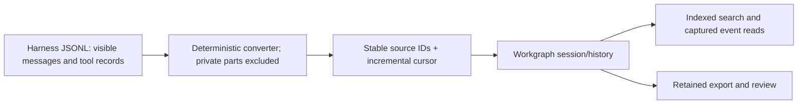

Workgraph does not discover or extract model reasoning. The maintained
[transcript-converter.py](skills/workgraph/scripts/transcript-converter.py), included completely
below, selects visible user/assistant text, tool names/inputs and visible tool
results from Claude JSONL. Private reasoning types are always excluded, with no
opt-in extraction switch. Unknown parts are counted. Missing/duplicate source
UUIDs and malformed records reject before output is published. Large selected
text is split at UTF-8 boundaries without silently clipping its contents.

Find your harness's actual transcript path; a Claude location may be
`~/.claude/projects/ENCODED_PROJECT/SESSION.jsonl`. Subagent files and other harness
formats need an explicit reviewed adapter; do not assume one path captures them.
No mixed-harness transcript compatibility is implied by the historical example.

```bash
mkdir -p "$HOME/.local/bin" /absolute/private/import
install -m 755 skills/workgraph/scripts/transcript-converter.py "$HOME/.local/bin/transcript-converter"
# Only replace the converter output after a complete successful conversion.
transcript-converter /absolute/visible-session.jsonl > /absolute/private/import/events.new
mv /absolute/private/import/events.new /absolute/private/import/events.jsonl
python3 skills/workgraph/scripts/history-adapter.py --help
# Use the adapter's explicit connection/session/source/cursor options below.
python3 skills/workgraph/scripts/history-adapter.py /absolute/daemon.sock /absolute/private/import/events.jsonl \
  /absolute/private/import/cursor.json --workspace demo --actor worker-1 --session visible-session
```

Repeat conversion/import after an append using the same source IDs and cursor.
Identical appends deduplicate; edited prior source bytes must reject rather than
rewrite history. Review the adapter's `--help` for its exact installed version.
Visible data can still contain secrets: select/redact deliberately before import,
keep the original immutable selected source, and review exports before sharing.
History is retained; no automatic pruning or blob garbage collection is promised.

```bash
wg history search --text 'residue decision' --limit 20
wg history read --session-id visible-session --direction after --anchor 0 --limit 20
wgx --context "$WG_CONTEXT" history 'residue decision'
wgx --context "$WG_CONTEXT" convo visible-session 57 5
```

A displayed event might read `57 assistant tool_call: bash {"command":"…"}`.
That is a visible tool record, not private thought. Expand exact payload bytes
under the same returned history capture; `wgx convo` is only a preview. The
original import observed 124 records / 102 events in about a second and roughly
1.2KB per event, growing a 100KB export to 323KB. These are historical sizes,
not a retention budget or throughput guarantee.

## Watch agents work

Install the maintained source from **the matching 0.5.2 checkout or package**.
Preserve a locally adapted installed helper before replacing it.
The complete same source is included below. Requirements: Bash, `jq`, matching
`workgraph` on PATH and an explicit context. `wgx` makes read-only requests.

```bash
mkdir -p "$HOME/.local/bin"
install -m 755 skills/workgraph/scripts/wgx.sh "$HOME/.local/bin/wgx"
install -m 644 skills/workgraph/scripts/wgx_dashboard.py "$HOME/.local/bin/wgx_dashboard.py"
export PATH="$HOME/.local/bin:$PATH"
wgx --context "$WG_CONTEXT" status
wgx --context "$WG_CONTEXT" status --run "$RUN"
# In separate tmux panes:
wgx --context "$WG_CONTEXT" dash
wgx --context "$WG_CONTEXT" watch --all
```

The dashboard opens on a quiet **Overview**: project progress, decisions waiting
on someone, and active work. Each task has a title and a short worker/status line,
with space between items. Attention items appear once, with a link to the full
Questions view when there are more than three.

Five tabs keep the rest nearby: **Overview · Tasks · Questions · Agents · Activity**.
Enter opens the selected item. Detailed readiness reasons, ownership tokens,
policies and evidence stay in the detail views. Press `i` for connection details,
check coverage, file reservations and storage. A visible warning remains on the
main screen while checks are loading or data is incomplete.

The interactive `dash` view and `tree` command need **Python 3.10 or newer**, using
only its standard library. Install both files above beside each other; other
`wgx` commands still use Bash and jq. The companion
[dashboard source](skills/workgraph/scripts/wgx_dashboard.py) is included in the
skill and release bundles.

| Key in `wgx dash` | Action |
| --- | --- |
| `j` / `k`, up/down arrows | Select whole items; wrapped lines and subtitles stay together |
| `Tab` / `Shift-Tab`, left/right arrows | Next/previous tab |
| `1`–`5` | Open Overview, Tasks, Questions, Agents, or Activity |
| `Enter`, `Esc` | Open details; return to the previous view and position |
| `space` / `b`, Page Down / Page Up | Page through the view |
| `g` / `G`, Home / End | Jump to top/bottom |
| `c` | Collapse/expand the selected item's section |
| `/`, `a` | Search this view or filter by worker/resolver; submit an empty value to clear |
| `f` | Open Tasks and cycle all, active, ready, blocked, completed/canceled |
| `h` | Open Agents and hide/show non-running reports |
| `p` | Pause/resume the displayed snapshot; background reads continue |
| `d` | Selected ticket's prerequisite tree and downstream count |
| `i` | Status inspector: connection, coverage, reservations, storage, errors |
| `r`, `?`, `q` | Refresh now, show help, quit |

Selection follows the same item when new records arrive or text rewraps after a
resize. Each tab remembers its position. Detail and dependency views return to
the item you were inspecting.

Recently changed records are highlighted for six seconds. Pausing freezes the
content and relative ages while new observations accumulate; resuming reports the
number of distinct records seen changing, including removals. This is a comparison
of observations, not a complete event log. Use `wgx watch` for recorded activity.

The viewer uses the full terminal height, adapts to resizing, and restores the
previous screen and terminal settings on exit. Reads happen in the background so
navigation and quitting work even during a slow request. On disconnect, the last
successful snapshot remains visible with a **STALE / RECONNECTING** banner, the
last successful read time in the status inspector, and bounded retry delays. A reconnect never silently
replaces a failed panel with an empty one.

The dashboard uses a Linear-inspired dark palette: a charcoal canvas, off-white
headings, gray secondary text, and restrained indigo accents for navigation,
questions and recently changed records. Completed work uses muted green,
active/waiting work uses amber, and errors use soft red. Selection uses a lighter
charcoal surface with pale indigo text. These are standard 256-color terminal
colors. Standalone `status` views retain their status colors. `WGX_COLOR=auto` is the default; use
`WGX_COLOR=always` with a color-aware pager or `WGX_COLOR=never` to disable styles.
A nonempty `NO_COLOR` disables colors in every mode. The dashboard still uses
cursor controls for navigation. Noninteractive or dumb terminals get a single
plain `status` snapshot.

```bash
WGX_COLOR=always wgx --context "$WG_CONTEXT" status | less -R
wgx --context "$WG_CONTEXT" tree release-ticket-id
```

The dependency tree shows declared prerequisites across the workspace, marks
shared or missing nodes, and limits very large trees explicitly. Downstream
counts describe graph reachability, not time estimates or guarantees that those
tickets would become ready. Inherited policies and other eligibility rules are
explained by the daemon's readiness checks.

Collections now use the CLI's bounded captured pagination. Incomplete traversal
fails with exact stop/capture/next/retry metadata; omitted bodies are explicitly
reported. The dashboard's ready set comes from the daemon: without `--run RUN`
it is labeled graph readiness, and with a run it reflects actual eligibility.
Project filtering selects tickets; workspace-wide auxiliary panels retain their
own captures and are labeled accordingly. Failed panels never become empty lists.

Untrusted terminal controls are escaped before styling. Evidence output uses a
verified large-resource download and the existing strict capture inspector, with
bounded safe decoded stdout/stderr previews and retention/provenance metadata.
Explicit `output RESOURCE --raw stdout > FILE` yields exact retained bytes; it
cannot recover discarded process output. Temporary inspection copies never launch
or publish execution. [Detailed semantics](skills/workgraph/references/wgx.md) include paging bounds,
coverage, text replacement, signal/error cleanup and current platform evidence.
See the [review and qualification record](docs/acceptance/v0.5-feedback.md) for
observed checks and platform limits. Actual WSL execution is a separate check.

| Command | View |
| --- | --- |
| `status [-p PROJECT] [--run RUN]` | Colored progress, authoritative readiness, questions, workers, recent events and storage gauges |
| `dash [-p PROJECT] [--run RUN]` | Interactive attention, blockers, details, filters, pause/resume and reconnect status; press `?` for keys |
| `tree TICKET` | Declared prerequisite tree, shared/missing nodes and downstream count |
| `watch [--metadata] [--all\|--cursor CURSOR]` | Readable live events; optional `--metadata` keeps the compact revision/target stream. Advances only after rendering consumed activity |
| `feed [N]` | Last N rendered planning events from one guarded capture |
| `ticket TICKET` | Task/ownership/full handoff, paged notes/resources and explicit preview expansion |
| `questions` | Question titles, linked tickets, author/resolver, status, responsibility, priority and age |
| `agents` | Caller-reported run state, claimed tasks, capabilities and objective; not process liveness |
| `inbox ACTOR [CONSUMER]` | That consumer's unacknowledged notifications; no ack |
| `output RESOURCE [--limit BYTES]` | Verified capture, safe decoded previews; explicit raw stream mode |
| `storage` | Colored gauges, readable byte units, percentages and remaining named allowances |
| `files` | Bounded path holders, fences and lease state |
| `history TEXT` | Captured paged indexed matches with explicit coverage |
| `convo SESSION [SEQ] [N]` | Forward captured window; 1200-byte UTF8/base64 previews and exact expansion positions |

Illustrative views, not fixture output or a completeness claim:

```text
WORKGRAPH   demo     revision 42
  done 4   in_progress 2   waiting/ready: inspect daemon readiness
  module-a     worker-1   Implement module A
  module-b     worker-2   Implement module B
  test-all     waiting    prerequisites: module-a, module-b
  questions: module-api-question → agent-orch
  storage: planning/history use separate cumulative limits
```

```text
revision 39  worker-1  progress module-a
revision 40  worker-2  question: edge-case contract
revision 41  agent-orch resolved module-api-question
revision 42  worker-1  finished module-a with exact evidence
```

```text
module-a — Implement module A
status: done    recorded owner/attempt: inspect current context
decision: use exact integer arithmetic
handoff: summary / objective / completed / decisions / blockers / next / evidence
resources: exact content version and digest; expand beyond preview
```

### Plain jq views

Capture CLI success before parsing. For supported collections, `--paginate` is
opt-in and bounded: check `.result.data.pagination.complete`, continuation and
stop reason. It preserves the method's capture/selectors and stops on no progress,
budget, cancellation or error. It never fakes an atomic multi-page write.

```bash
owners=$(wg ticket list --paginate)
jq '.result.data.pages[].data.items[] | select(.claim != null) | {ticket_id,title,claim}' <<<"$owners"
counts=$(wg workspace overview)
jq '.result.data' <<<"$counts"
questions=$(wg request list --open-only true --paginate)
jq '.result.data.pages[].data.items[] | {request_id,resolver_id,status}' <<<"$questions"
ready=$(wg ticket ready --target-run-id "$RUN" --paginate)
jq '.result.data.pages[].data.items[]' <<<"$ready"
changes=$(wg activity since --after 0 --paginate)
jq '[.result.data.pages[].data.items[]] | .[-10:]' <<<"$changes"
decisions=$(wg comment list --json-field target '{"kind":"ticket","id":"module-a"}' --paginate)
jq '.result.data.pages[].data.items[] | select(.kind == "decision")' <<<"$decisions"
```

The last-ten expression applies only after successful complete traversal, not
to a bounded first page. Preserve method-specific captures and revision guards;
a stale capture is not permission to refresh CAS silently. `attention.read` is
manual because readiness has independent continuation.

## Inspect a workspace

Successful JSON uses `.result.data` for method data and `.result.meta` for
workspace revision/durability/budget information. Errors and nonzero exits require
handling before data extraction. Offline `help METHOD` and family `--help` never
need a socket or context read; `--full` expands the public schema.

| Need | CLI / source |
| --- | --- |
| Daemon, workspaces, lifetime capacity | `daemon.health`, `workspace.list`, `workspace.metrics` |
| Workspace summary | `workspace.overview` |
| Project brief | `project.brief` |
| Compact ticket / full recorded context | `ticket.brief` / `ticket.context`; `ticket.get` stays full |
| Resume and selected fact values | `ticket.resume`; explicit `fact_selections` |
| Run-aware ready work and exact blockers | `ticket.ready --target-run-id RUN`, `ticket.readiness`, `ticket.blockers` |
| Coordination / actor / run overview | `coordinator.overview`, `actor.overview`, `run.get/list` |
| Notes and decisions | `comment.list`, `search.query` |
| Handoff current/history | `handoff.get/history` |
| Fact names/value/history | `fact.keys/get/multi_get/history` |
| Request filters and expanded question/answer | `request.list`, `request.get --include-messages true` |
| Consumer-specific notifications | `inbox.read/wait`; selected `inbox.ack` is a write |
| Resource metadata/content | `resource.brief/get/versions/read`; download for exact large bytes |
| Decoded execution output | `evidence-show`; separate stdout/stderr and retention metadata |
| Recorded conversation | `history.search/read/payload`; preserve captured head/index coverage |
| Incremental trail | `activity.since/digest`, `changes.read/wait` |
| Usage and caller-supplied model counts | `usage.aggregate`, `workspace.metrics`; not provider quota enforcement |
| Method spelling and precise response paths | `help ticket.start`, `ticket --help`, `help METHOD --full` |

```bash
# Owned local stage: decoded bounded output, including truthful tail semantics.
workgraph evidence-show --stage /absolute/owned/stage --stdout --offset 0 --length 4096
# Download first for verified large/binary published captures; inspect in the matching helper.
wg resource download --resource-id ci-capture --destination /absolute/fresh/capture.json
# Preserve input bytes before journaling, including a trailing newline; one stdin consumer.
wg resource put_text --resource-id long-note --expected-revision 0 --title 'Long note' --field-file text - < note.txt
```

Inspect helper help for exact stream bounds and supported capture inputs. A tail
is of the retained bytes; it does not reconstruct discarded output. Resource
metadata revision guards publication; immutable content version/digest pins bytes.
Omitting a title preserves the current title only after the exact entity guard;
creation requires a title. Owned-stage cleanup never removes foreign stages or
reruns a command during publication retry.

| Identity / revision | Meaning |
| --- | --- |
| Workspace planning revision | One serialized state capture / planning feed position |
| Entity revision | CAS guard for that entity; never substitute workspace revision |
| Domain revision | Coordination/discussion serial where a method declares it |
| Content revision + digest | Immutable resource bytes, independent of metadata changes |
| Run revision / claim token | Resulting run state / current ownership fence |
| Request revision / answer-comment pin | Request transitions / exact durable answer version |
| History through / index coverage | Captured event boundary / searchable coverage |
| Inbox notification ID / consumer | Delivery identity / independent acknowledgement scope |
| Opaque cursor | Method/source/filter-bound continuation, not a revision number |

## Backup, share, move and retire

| Action | Contract |
| --- | --- |
| Export one / all | `workspace.export` / `daemon.export_all`; fresh absolute non-overlapping destinations |
| Follow jobs | `export.get/list`; use returned ID, terminal failure/cancellation and a deadline |
| Verify | `export.verify`; verify content, metadata, hashes and replay artifacts |
| Restore | `workspace.restore`; fresh root, matching schema/executable, independent copy |
| Register/open/init | Follow administration guide; same workspace ID once per daemon |
| Close/unregister | Drain work and close before moving or Git handoff; preserve needed data |

Export a consistent moment while writers continue, then verify before sharing.
Keep review copies private until their content is checked. For Git handoff, close
the managed root and transfer one writer's history; never pull into an open tree.
Disconnected histories are not mergeable synchronization branches. Do not mutate
managed JSON/journals by hand. A successor workspace is deliberate capacity
rollover, not silent pruning or an automatic migration.

## Limits and operational care

- The daemon is local and cooperative. Actor identity, capability declarations,
  reservations and reported run state do not authenticate users or prove liveness.
- Current preview supports its current schema only. Keep old required data with
  its matching executable; start incompatible versions with fresh roots/journals.
- Planning and history have separate lifetime admission limits and named meters;
  inspect `workspace.metrics`. Current named maxima include 100000 planning commits,
  128MiB planning transaction bytes, 64MiB planning payload bytes, 1000000 history
  commits and 64MiB history batch bytes. The original guide's roughly 40000 writes
  and 50000 events were average-size estimates against byte budgets, not count
  limits. Other resource/fact/upload meters apply independently; no retained data
  is silently deleted.
- Ready/waiting are derived. Explicit holds, policy/gates, capabilities, pools,
  paths, dependencies and cancellations matter. A partial dashboard is not proof.
- Timed expiry does not remove a holder. Recovery needs exact guards and an
  explicit stopped/isolated assertion; never unlink a socket or clean foreign holds
  from process-name or wall-clock guesses.
- Saved exact writes support original receipts after lost replies/restart. An
  uncertain write fences unsafe fresh mutations. Retry exact bytes/identity;
  parameter overrides or new stdin on retry reject before reading input.
- Captured execution and publication/linking are separate. External tools are
  outside transactions; output/provenance omissions are explicit. No full-tree or
  full-output claim follows from a selected bounded capture.
- Lists and searches are bounded. Check budget, index coverage, continuation,
  no-progress and incomplete indicators. Each feed/cursor retains its own source
  and selectors. Do not advance past unconsumed pages or acknowledge unread inboxes.
- Private reasoning is excluded from the transcript converter. Visible transcripts,
  payloads, resources and exports may still contain private data; select deliberately.

## References

- [Agent overview](skills/workgraph/SKILL.md), [team checkpoints](skills/workgraph/references/team-workflows.md), [wgx limits](skills/workgraph/references/wgx.md)
- [CLI/context](skills/workgraph/references/cli-contract.md), [planning](skills/workgraph/references/planning.md), [resume/digest](skills/workgraph/references/resume-digest.md)
- [Coordination](skills/workgraph/references/coordination.md), [paths and recovery](skills/workgraph/references/path-conditions-recovery.md), [communication/evidence](skills/workgraph/references/communication-evidence.md)
- [Resources](skills/workgraph/references/resources.md), [execution](skills/workgraph/references/execution.md), [history](skills/workgraph/references/history.md), [harness hooks](skills/workgraph/references/harness-hooks.md)
- [Administration](skills/workgraph/references/administration.md), [capacity rollover](skills/workgraph/references/capacity-rollover.md), [metrics](skills/workgraph/references/metrics.md)
- [macOS](docs/macos-install.md), [AlmaLinux/WSL](docs/wsl-quickstart.md), [gated review](skills/workgraph/references/gated-review-workflow.md)
- [Coordination runner](skills/workgraph/scripts/coordination-runner.py), [coordination shell](skills/workgraph/scripts/coordination-workflow.sh), [notifications](skills/workgraph/scripts/notification-watcher.py), [history adapter](skills/workgraph/scripts/history-adapter.py), [Codex hooks](skills/workgraph/scripts/codex-hooks)
- [Generated API reference](skills/workgraph/references/api/index.md), offline `workgraph help METHOD`, `workgraph help METHOD --full`
- [v0.6.1 release and upgrade notes](docs/releases/v0.6.1.md), [repository](https://github.com/dakotamurphyucf/workgraph), [published releases](https://github.com/dakotamurphyucf/workgraph/releases), [coverage audit](docs/guide-coverage.md)

## Complete maintained scripts

These are the complete maintained sources, repeated for a self-contained team guide.
The consistency test rejects drift between each block and its linked source file.
Read the qualification limits above before using the preview helper.

<!-- MAINTAINED_SCRIPT_SOURCES -->

<details>
<summary>CI worker: skills/workgraph/scripts/ci-worker.sh</summary>

<!-- source: skills/workgraph/scripts/ci-worker.sh -->

```bash
#!/usr/bin/env bash
# One CI job per invocation; bounded idle waits, explicit lifecycle and exact journals.
# Usage: CTX=ABS_CONTEXT RUN=FRESH_RUN PROJECT=P SRC=ABS_CHECKOUT STAGES=ABS_PARENT
#        WG=ABS_MATCHING_EXECUTABLE bash ci-worker.sh COMMAND ARG...
# The context must configure an existing private request_directory. No stderr hiding.
set -euo pipefail
set -o noclobber
WG=${WG:-workgraph}
: "${CTX:?set CTX}" "${RUN:?set a fresh RUN}" "${PROJECT:?set PROJECT}"
: "${SRC:?set absolute SRC}" "${STAGES:?set existing absolute STAGES}"
ORCH=${ORCH:-agent-orch}
[ "$#" -gt 0 ] || { echo 'ci-worker: supply the literal test argv' >&2; exit 1; }
case "$SRC:$STAGES" in /*:/*) ;; *) echo 'ci-worker: absolute paths required' >&2; exit 1 ;; esac
[ -d "$STAGES" ] || { echo 'ci-worker: stage parent must exist' >&2; exit 1; }
jq -e '.request_directory | type == "string" and startswith("/")' "$CTX" >/dev/null
wg() { "$WG" --context "$CTX" "$@"; }
trap 'echo "ci-worker interrupted; retain own claim/stage/journals; inspect before retry" >&2; exit 130' INT TERM

wg run register --run-id "$RUN" --target-run-id "$RUN" \
  --json-field capabilities '["ci"]' --objective "CI for $PROJECT" >/dev/null
finish_run() {
  local status=$1 evidence=$2 record revision
  record=$(wg run get --target-run-id "$RUN")
  revision=$(jq -er '.result.data.revision' <<<"$record")
  wg run transition --run-id "$RUN" --target-run-id "$RUN" \
    --expected-revision "$revision" --status "$status" --evidence "$evidence" >/dev/null
}

n=0
while [ "$n" -lt 24 ]; do
  n=$((n + 1))
  # Capture before readiness to avoid losing a release between read and park.
  overview=$(wg workspace overview)
  revision=$(jq -er '.result.meta.workspace_revision' <<<"$overview")
  feed=$(wg changes read --source planning --after "$revision")
  jq -e '.result.data.needs_larger_budget == false' <<<"$feed" >/dev/null
  cursor=$(jq -er '.result.data.cursor' <<<"$feed")
  ready=$(wg ticket ready --project-id "$PROJECT" --target-run-id "$RUN" \
    --label-id ci --leaf-only true --limit 1 --max-bytes 1048576)
  jq -e '(.result.meta.budget.truncated // false) == false' <<<"$ready" >/dev/null
  ticket=$(jq -er '.result.data.items[0].ticket_id // ""' <<<"$ready")
  if [ -z "$ticket" ]; then
    # The feed is a wake hint; readiness is always re-read. Never poll claim_next.
    wg changes wait --source planning --cursor "$cursor" --timeout-ms 2500 >/dev/null
    continue
  fi
  # A competing start is a reason to stop and inspect, not to parse a null token
  # or repeat a possibly committed acquisition with a fresh identity.
  started=$(wg ticket start --run-id "$RUN" --ticket-id "$ticket" --attempt-id "$RUN-$n")
  token=$(jq -er '.result.data.token' <<<"$started")
  stage="$STAGES/$RUN-$ticket-$n"
  resource="$RUN-$ticket-$n"
  test_status=0
  "$WG" evidence-run --stage "$stage" --cwd "$SRC" --source-root "$SRC" \
    --output-limit 1048576 -- "$@" >"$STAGES/$RUN-$n.capture-summary.json" || test_status=$?
  if [ "$test_status" -ne 0 ] && [ "$test_status" -ne 2 ]; then
    echo "ci-worker: capture infrastructure failure; preserve $stage and own claim $ticket/$token" >&2
    exit 1
  fi
  # Publication + linking are independent commits. A nonzero result can mean
  # publication committed but link failed; stop and retry stage/publication.json.
  published=$(wg evidence-publish --run-id "$RUN" --stage "$stage" \
    --resource-id "$resource" --expected-revision 0 --title "CI for $ticket" --ticket-id "$ticket")
  digest=$(jq -er '.result.data.version.digest' <<<"$published")
  version=$(jq -er '.result.data.version.revision' <<<"$published")
  outcome=$(jq -ce ' .outcome ' "$STAGES/$RUN-$n.capture-summary.json")
  evidence="Capture helper exit=$test_status; command outcome=$outcome; resource=$resource version=$version sha256=$digest; publication/link receipts checked."
  if [ "$test_status" -eq 0 ]; then
    wg ticket finish --run-id "$RUN" --ticket-id "$ticket" --token "$token" --evidence "$evidence" >/dev/null
    finish_run completed "$evidence"
    echo "$ticket: passed; $resource@$version"
    exit 0
  fi
  wg ticket progress --run-id "$RUN" --ticket-id "$ticket" --token "$token" \
    --kind evidence --body "$evidence" >/dev/null
  wg ticket release --run-id "$RUN" --ticket-id "$ticket" --token "$token" >/dev/null
  recipients=$(jq -nc --arg actor "$ORCH" '[{kind:"actor",id:$actor}]')
  wg message send --run-id "$RUN" --message-id "$RUN-$n-failed" \
    --json-field recipients "$recipients" --body "$ticket failed. $evidence Add a fix prerequisite before another CI run." >/dev/null
  finish_run failed "$evidence"
  exit 2
done
finish_run completed 'No eligible CI ticket during 24 bounded wake/read cycles; no work claimed.'
echo 'ci-worker: idle limit reached; harness decides whether/when to launch a fresh run' >&2
exit 3
```

</details>

<details>
<summary>Visible transcript converter: skills/workgraph/scripts/transcript-converter.py</summary>

<!-- source: skills/workgraph/scripts/transcript-converter.py -->

```python
#!/usr/bin/env python3
"""Convert selected user-visible Claude JSONL parts into deterministic history events.

Text, tool names/inputs and visible tool results only. Private reasoning is never
imported. Oversized visible parts are split on UTF-8 boundaries without clipping.
Unsupported parts are counted on stderr; missing/duplicate UUIDs and malformed
records reject. Publish output only after successful conversion.
"""
import argparse
import json
from pathlib import Path
import sys


def canonical(value):
    return json.dumps(value, ensure_ascii=False, sort_keys=True, separators=(",", ":"))


def chunks(text, limit):
    current, size = [], 0
    for char in text:
        count = len(char.encode("utf-8"))
        if size + count > limit:
            yield "".join(current)
            current, size = [], 0
        current.append(char)
        size += count
    if current:
        yield "".join(current)


def visible(part, counts):
    if not isinstance(part, dict):
        raise ValueError("message part must be an object")
    kind = part.get("type")
    if kind == "text":
        text = part.get("text")
        if not isinstance(text, str):
            raise ValueError("text part requires text")
        return "message", text
    if kind == "tool_use":
        name = part.get("name")
        if not isinstance(name, str) or not name or "input" not in part:
            raise ValueError("tool use requires name and input")
        return "tool_call", name + " " + canonical(part["input"])
    if kind == "tool_result":
        content = part.get("content")
        if isinstance(content, str):
            return "tool_result", content
        if not isinstance(content, list):
            raise ValueError("tool result requires string or part list")
        texts = []
        for item in content:
            if isinstance(item, dict) and item.get("type") == "text" and isinstance(item.get("text"), str):
                texts.append(item["text"])
            else:
                counts["unsupported_parts"] += 1
        return "tool_result", "\n".join(texts)
    if kind in ("thinking", "redacted_thinking", "reasoning"):
        counts["private_parts_excluded"] += 1
    else:
        counts["unsupported_parts"] += 1
    return None


def convert(lines, max_bytes=32768):
    if not 1024 <= max_bytes <= 262144:
        raise ValueError("max-event-bytes must be 1024..262144")
    seen, result = set(), []
    counts = {"records": 0, "events": 0, "private_parts_excluded": 0, "unsupported_parts": 0, "non_message_records": 0}
    for number, line in enumerate(lines, 1):
        if not line.strip():
            raise ValueError(f"line {number}: blank JSONL record")
        entry = json.loads(line)
        if not isinstance(entry, dict):
            raise ValueError(f"line {number}: record must be an object")
        if entry.get("type") not in ("user", "assistant"):
            counts["non_message_records"] += 1
            continue
        counts["records"] += 1
        uuid = entry.get("uuid")
        if not isinstance(uuid, str) or not uuid or len(uuid.encode()) > 128 or uuid in seen:
            raise ValueError(f"line {number}: missing, duplicate or oversized source UUID")
        seen.add(uuid)
        message = entry.get("message")
        if not isinstance(message, dict):
            raise ValueError(f"line {number}: message object required")
        role = message.get("role", entry["type"])
        if role not in ("user", "assistant"):
            raise ValueError(f"line {number}: unsupported visible role")
        content = message.get("content")
        parts = [{"type": "text", "text": content}] if isinstance(content, str) else content
        if not isinstance(parts, list):
            raise ValueError(f"line {number}: content must be text or a part list")
        for index, part in enumerate(parts):
            selected = visible(part, counts)
            if selected is None:
                continue
            kind, text = selected
            for chunk_index, text_chunk in enumerate(chunks(text, max_bytes)):
                result.append({"source_id": f"{uuid}:{index}:{chunk_index}", "role": role, "kind": kind,
                               "payload": {"timestamp": entry.get("timestamp"), "role": role, "kind": kind,
                                           "part_index": index, "chunk_index": chunk_index, "text": text_chunk},
                               "searchable_text": text_chunk})
    counts["events"] = len(result)
    return result, counts


def main():
    parser = argparse.ArgumentParser(description=__doc__)
    parser.add_argument("transcript", type=Path)
    parser.add_argument("--max-event-bytes", type=int, default=32768)
    args = parser.parse_args()
    try:
        with args.transcript.open(encoding="utf-8") as source:
            events, counts = convert(source, args.max_event_bytes)
        for event in events:
            print(canonical(event))
        print(canonical(counts), file=sys.stderr)
    except (ValueError, OSError, UnicodeError) as error:
        parser.exit(1, f"transcript-converter: {error}\n")


if __name__ == "__main__":
    main()
```

</details>

<details>
<summary>Read-only terminal helper: skills/workgraph/scripts/wgx.sh</summary>

<!-- source: skills/workgraph/scripts/wgx.sh -->

```bash
#!/usr/bin/env bash
# wgx: read-only terminal views for the matching current Workgraph executable.
# Usage: WG=/absolute/workgraph wgx --context ABS_FILE COMMAND [ARGS]
# status|dash [-p PROJECT] [--run RUN]   graph readiness or explicit run eligibility
# watch [--metadata] [--all|--cursor CURSOR]  readable events, until interrupted
# feed [N]                             last N semantic entries in recent N revisions
# ticket T | tree T | questions | agents | storage | files | contention named NAME
# contention path WORKTREE file|subtree PATH | inbox ACTOR [CONSUMER]
# output RESOURCE [--limit BYTES|--raw stdout|stderr]   verified capture, safe by default
# history TEXT | convo SESSION [SEQ] [N]              bounded captured history previews
# Requires Bash 3.2+, jq 1.6+, matching workgraph; dash/tree also use Python 3.10+.
# WGX_COLOR=auto|always|never (NO_COLOR disables); WGX_MAX_PAGES / WGX_TOTAL_BYTES bound reads.
set -o pipefail
WG=${WG:-workgraph}
CTX=${WG_CONTEXT:-}
if [ "${1:-}" = '--context' ]; then
  [ "$#" -ge 2 ] && [ -n "$2" ] || { echo 'wgx: --context requires a file' >&2; exit 2; }
  CTX=$2; shift 2
fi
case "${1:-}" in -h|--help|help) sed -n '2,12p' "$0" | sed 's/^# *//'; exit 0 ;; esac
fail() {
  if [ -n "${JQLIB:-}" ]; then
    printf '%s' "$*" | jq -Rrs "${COLORS[@]}" "$JQLIB clean | \"wgx: \" + ." >&2
  else printf 'wgx: %s\n' "$*" >&2; fi
  return 1
}
uint() { case "$1" in ''|*[!0-9]*|0[0-9]*) return 1 ;; esac; [ "${#1}" -le 9 ] && [ "$1" -ge "$2" ] && [ "$1" -le "$3" ]; }
identifier() { case "$1" in ''|*[!a-zA-Z0-9_-]*) return 1 ;; esac; [ "${#1}" -le 96 ]; }
MAX_PAGES=${WGX_MAX_PAGES:-100}; TOTAL_BYTES=${WGX_TOTAL_BYTES:-16777216}
uint "$MAX_PAGES" 1 1000 && uint "$TOTAL_BYTES" 4096 67108864 || { fail 'invalid traversal bounds'; exit 2; }
command -v jq >/dev/null && command -v "$WG" >/dev/null || { fail 'jq and the matching WG executable are required'; exit 1; }
[ -n "$CTX" ] && [ -f "$CTX" ] || { fail 'supply WG_CONTEXT or --context ABS_FILE'; exit 1; }
case "${WGX_COLOR:-auto}" in auto|always|never) ;; *) fail 'WGX_COLOR must be auto, always or never'; exit 2 ;; esac
if [ -z "${NO_COLOR:-}" ] && { [ "${WGX_COLOR:-auto}" = always ] || { [ "${WGX_COLOR:-auto}" = auto ] && [ -t 1 ] && [ "${TERM:-dumb}" != dumb ]; }; }; then
  B=$'\033[1m' D=$'\033[2m' R=$'\033[0m' G=$'\033[32m' Y=$'\033[33m' C=$'\033[36m' M=$'\033[35m' RED=$'\033[31m'
else B='' D='' R='' G='' Y='' C='' M='' RED=''; fi
COLORS=(--arg B "$B" --arg D "$D" --arg R "$R" --arg G "$G" --arg Y "$Y" --arg C "$C" --arg M "$M" --arg RED "$RED")

# One envelope, checked exit before interpretation; a pagination partial result
# remains available to pages() for its explicit stop/retry diagnostic.
wg() {
  local out code=0
  out=$("$WG" --context "$CTX" "$@") || code=$?
  if ! printf '%s\n' "$out" | jq -se 'length == 1 and (.[0]|type == "object" and has("result") and (has("error")|not) and (.result|type == "object"))' >/dev/null; then
    printf '%s\n' "$out" | jq -ac '.error // empty' >&2
    fail "request failed ($code): $*; no valid success envelope"; return 1
  fi
  printf '%s\n' "$out" | jq -c '.result'
  return "$code"
}

# Family-specific capture/continuation belongs to the typed CLI helper. Refuse
# to render an incomplete collection as complete; never erase an optional error.
pages() {
  local value code=0
  value=$(wg "$@" --paginate --page-limit "$MAX_PAGES" --total-bytes "$TOTAL_BYTES" --limit 100 --max-bytes 1048576) || code=$?
  if [ "$code" -ne 0 ] || ! jq -e '.data.pagination.complete == true' <<<"$value" >/dev/null; then
    fail "incomplete collection $*"
    [ -n "$value" ] || value='{}'
    jq -ac '.data.pagination // {stop:"invalid_or_failed_response"}' <<<"$value" >&2
    return 1
  fi
  if jq -e 'any(.data.pages[]; .meta.budget.truncated == true or ((.data.omitted_for_budget // "0")|tonumber)>0)' <<<"$value" >/dev/null; then
    fail "$* has omitted fields/bodies"
    jq -ac '[.data.pages[] | {budget:.meta.budget,omitted_for_budget:(.data.omitted_for_budget // "0")}]' <<<"$value" >&2
  fi
  jq -c '{data:((.data.pages[-1].data // {}) + {items:[.data.pages[].data.items[]?]}),meta:(.data.pages[0].meta // {}),pagination:.data.pagination}' <<<"$value"
}
all_tickets() { pages ticket.list "$@"; }
JQLIB='
def t: if . == null then "        " else .[11:19] end;
def epoch: if . == null then null else (.[0:10] + "T" + .[11:19] + "Z" | fromdateiso8601) end;
def ago($now): (epoch) as $e | if $e == null then "" else ($now - $e) as $s |
  if $s < 60 then "\($s|floor)s ago" elif $s < 3600 then "\($s/60|floor)m ago"
  elif $s < 86400 then "\($s/3600|floor)h ago" else "\($s/86400|floor)d ago" end end;
def one: (. // "") | gsub("\\s+"; " ") | if length > 90 then .[0:87] + "..." else . end;
def short($n): (. // "") | gsub("\\s+"; " ") | if length > $n then .[0:($n-1)] + "~" else . end;
def pad($n): tostring | if length >= $n then .[0:$n] else . + (" " * ($n - length)) end;
def whorun: if . == null then "unclaimed" else (.actor_id // "?") + (if .run_id then " (" + .run_id + ")" else "" end) end;
def hdr($s): "\n" + $B + $s + $R;
def empty_rows: if length == 0 then ["  " + $D + "none" + $R] else . end | .[];
def state_color: if . == "done" or . == "resolved" then $G elif . == "in_progress" or . == "running" then $Y
  elif . == "open" then $M elif . == "todo" then $C else $D end;
def styled_state: (state_color) + . + $R;
def bytes: tonumber | if . < 1024 then "\(.) B" elif . < 1048576 then "\(./1024*10|floor/10) KiB" else "\(./1048576*10|floor/10) MiB" end;
def gauge($used; $limit; $color):
  (if $limit > 0 then [0, ([1, ($used/$limit)]|min)]|max else 0 end) as $ratio |
  ($ratio*24|floor) as $filled | $color + "[" + ("#"*$filled) + ("-"*(24-$filled)) + "]" + $R;
def meter:
  (.used|tonumber) as $used | (.limit|tonumber) as $limit |
  (if $limit > 0 then $used*100/$limit else 0 end) as $pct |
  (if $pct >= 95 then $RED elif $pct >= 80 then $Y else $G end) as $color |
  "  \(.name)  " + gauge($used;$limit;$color) + " \($pct*10|floor/10)%  " +
  (if (.name|endswith("bytes")) then ($used|bytes) + " / " + ($limit|bytes) else "\($used) / \($limit)" end) +
  "  \(.severity)";
def request_rows:
  . as $q | (.thread_summary // {title:"[thread title unavailable]",title_bytes:"0",links:[],link_count:"0"}) as $thread |
  "  " + (.status.kind|styled_state) + "  " + $B + .request_id + $R + "  " + (($thread.title // "[thread title unavailable]")|short(72)),
  "    \(.created.actor_id) -> " + $B + .resolver_id + $R + "  (\(.responsibility.kind))  priority=\(.priority // "0")  " +
    $D + (.created.timestamp|ago(now)) + $R +
    (if .deadline_unix_ms then "  deadline(ms)=\(.deadline_unix_ms)" else "" end) + "  scope=" + ($thread.scope|tojson),
  (if ($thread.title|utf8bytelength) < ($thread.title_bytes|tonumber) or ($thread.links|length) < ($thread.link_count|tonumber) then "    [thread summary prefix; expand thread.get --thread-id " + $q.thread_id + "; compare returned .result.data.revision with captured thread revision " + $thread.thread_revision + "]" else empty end),
  ([$thread.links[]? | select(.kind=="ticket") | .id] | if length > 0 then "    on " + join(", ") else empty end);
def run_rows($tickets):
  . as $run | [$tickets[] | select(.claim != null and .claim.run_id == $run.run_id) | .ticket_id] as $work |
  "  " + $B + .run_id + $R + "  " + .actor_id + "  " + (.status|styled_state) +
    (if ($work|length)>0 then "  on " + ($work|join(", ")) else "  " + $D + "no claimed tickets in this view" + $R end),
  "    " + (.objective // ""|short(90)) + (if (.capabilities|length)>0 then "  [" + (.capabilities|join(", ")) + "]" else "" end);
def observation_row:
  .metadata as $m | "  " + .source.run_id + "  " +
  (if $m.clock_regressed then "observation clock regressed; age unknown"
   elif $m.liveness=="unobserved" then "unobserved; age unknown"
   else "stale observation age=" + $m.observation_age_ms + "ms" end) +
  "  held_work=" + ($m.held_work|tojson);
def ticket_row:
  "  " + $B + .ticket_id + $R + "  " + (.title|short(72)) +
    (if (.label_ids|length)>0 then "  " + $D + "[" + (.label_ids|join(", ")) + "]" + $R else "" end);

def tgt: if .kind == "ticket" then .ticket_id // .id elif .kind == "project" then "project " + (.project_id // .id)
  elif .kind == "workspace" then "workspace" else (.kind + " " + (.id // "")) end;
def events: .data.entries[] | . as $entry | .item as $item |
  $D + "revision " + .workspace_revision + ":" + .change_index + $R + "  " +
  (if .category == "completion" then $G elif .category == "blocker" then $RED elif .category == "request" then $M else $C end) +
  .category + $R + "  " + ($item.summary|one) +
  (if $item.record.body then ": " + ($item.record.body|one) else "" end) +
  (if ($item.clipped_fields|length)>0 then " [source excerpt]" else "" end) +
  "  sources=" + ($item.sources|tojson);
'

# Escape untrusted terminal controls before adding our own optional styles.
JQLIB+='
def hex4: . as $n | [4096,256,16,1] | map(. as $d | "0123456789abcdef"[((($n/$d)|floor)%16):(((($n/$d)|floor)%16)+1)]) | join("");
def clean: walk(if type == "string" then explode | map(if . < 32 or (.>=127 and .<=159) or (.>=8234 and .<=8238) or (.>=8294 and .<=8297) then "\\u" + hex4 else [.]|implode end) | join("") else . end);
'
render() { local filter=$1; shift; jq -r "${COLORS[@]}" "$@" "$JQLIB clean | $filter"; }

# Semantic entries have their own cursor lineage and collection field.
# Keep the unconsumed boundary on failure; excerpts stay explicit in each row.
digest() {
  local page next count=0 bytes=0 size cursor='' boundary="${1:-0}" scope="${2:-}" entries='[]' capture='{}'
  [ -n "$scope" ] || scope='{"kind":"workspace"}'
  page=$(wg activity.digest --after "$boundary" --json-field scope "$scope" --limit 100 --max-bytes 1048576) || { fail "restart digest after: $boundary scope: $scope"; return 1; }
  while :; do
    next=$(jq -er '.data.cursor' <<<"$page") || { fail "invalid digest; restart digest after: $boundary scope: $scope; failed-page cursor (diagnostic only): $cursor"; return 1; }
    size=$(printf '%s' "$page" | wc -c); bytes=$((bytes+size)); count=$((count+1))
    if [ "$count" -gt "$MAX_PAGES" ] || [ "$bytes" -gt "$TOTAL_BYTES" ]; then fail "digest drain limit; restart digest after: $boundary scope: $scope; failed-page cursor (diagnostic only): $cursor"; return 1; fi
    if jq -e '.data.has_more == true' <<<"$page" >/dev/null && [ "$next" = "$cursor" ]; then fail "digest made no progress; restart digest after: $boundary scope: $scope; failed-page cursor (diagnostic only): $cursor"; return 1; fi
    entries=$(printf '%s\n' "$entries" "$page" | jq -sc '.[0] + .[1].data.entries') || return 1
    capture=$(jq -c '.data.capture' <<<"$page") || return 1
    cursor=$next
    if ! jq -e '.data.has_more == true' <<<"$page" >/dev/null; then break; fi
    page=$(wg activity.digest --cursor "$cursor" --json-field scope "$scope" --limit 100 --max-bytes 1048576) || { fail "restart digest after: $boundary scope: $scope; failed-page cursor (diagnostic only): $cursor"; return 1; }
  done
  printf '%s\n' "$entries" "$capture" | jq -sc '{data:{entries:.[0],capture:.[1]}}'
}
cmd_feed() {
  local n=${1:-30} ov revision from value
  uint "$n" 1 1000 && [ "$#" -le 1 ] || { fail 'feed N requires 1..1000'; return 2; }
  ov=$(wg workspace.overview) || return 1
  revision=$(jq -er '.meta.workspace_revision' <<<"$ov") || return 1
  from=$((revision > n ? revision-n : 0))
  value=$(digest "$from") || return 1
  render 'events' <<<"$value" | tail -n "$n"
  render '"Semantic capture: " + (.data.capture|tojson) + "; at most " + $n + " entries from recent " + $n + " planning revisions"' --arg n "$n" <<<"$value" >&2
}
cmd_watch() {
  if [ "${1:-}" = --metadata ]; then cmd_metadata_watch "$@"; return $?; fi
  local cursor='' after='' page next through wake count=0 bytes=0 size
  case "$#:${1:-}" in
    0:) page=$(wg workspace.overview) || return 1; after=$(jq -er '.meta.workspace_revision' <<<"$page") || return 1 ;;
    1:--all) after=0 ;;
    2:--cursor) [ -n "$2" ] || return 2; cursor=$2 ;;
    *) fail 'watch accepts [--metadata] [--all or --cursor CURSOR]'; return 2 ;;
  esac
  trap 'fail "interrupted; retained cursor: $cursor (initial after: ${after:-not supplied})"; exit 130' INT
  trap 'fail "interrupted; retained cursor: $cursor (initial after: ${after:-not supplied})"; exit 143' TERM
  while :; do
    if [ -n "$cursor" ]; then page=$(wg activity.digest --cursor "$cursor" --limit 100 --max-bytes 1048576) || { fail "retained cursor: $cursor"; return 1; }
    else page=$(wg activity.digest --after "$after" --limit 100 --max-bytes 1048576) || { fail "retained initial after: $after"; return 1; }; fi
    next=$(jq -er '.data.cursor' <<<"$page") || { fail "invalid digest; retained cursor: $cursor (initial after: ${after:-not supplied})"; return 1; }
    through=$(jq -er '.data.capture.through' <<<"$page") || { fail "invalid digest; retained cursor: $cursor (initial after: ${after:-not supplied})"; return 1; }
    size=$(printf '%s' "$page" | wc -c); bytes=$((bytes+size)); count=$((count+1))
    if [ "$count" -gt "$MAX_PAGES" ] || [ "$bytes" -gt "$TOTAL_BYTES" ]; then fail "watch drain limit; retained cursor: $cursor (initial after: ${after:-not supplied})"; return 1; fi
    if jq -e '.data.has_more == true' <<<"$page" >/dev/null && [ "$next" = "$cursor" ]; then fail "watch made no progress; retained cursor: $cursor"; return 1; fi
    render 'events' <<<"$page" || { fail "retained cursor: $cursor"; return 1; }
    cursor=$next
    if jq -e '.data.has_more == true' <<<"$page" >/dev/null; then continue; fi
    count=0; bytes=0
    # The changes namespace is only a wake signal, never a digest continuation.
    wake=$(wg changes.wait --source planning --after "$through" --timeout-ms 25000 --limit 1 --max-bytes 1048576) || { fail "retained cursor: $cursor"; return 1; }
    # Starting a fresh digest after a completed capture is explicit. Its numeric
    # boundary belongs to that digest capture, not changes.wait's cursor/through.
    after=$through; cursor=''
  done
}
cmd_metadata_watch() {
  local cursor='' after page next count=0 bytes=0 size metadata=''
  if [ "${1:-}" = --metadata ]; then metadata=1; shift; fi
  case "$#:${1:-}" in
    0:) page=$(wg workspace.overview) || return 1; after=$(jq -er '.meta.workspace_revision' <<<"$page") || return 1 ;;
    1:--all) after=0 ;;
    2:--cursor) [ -n "$2" ] || return 2; cursor=$2 ;;
    *) fail 'watch accepts [--metadata] [--all or --cursor CURSOR]'; return 2 ;;
  esac
  trap 'fail "interrupted; retained cursor: $cursor (initial after: ${after:-not supplied})"; exit 130' INT
  trap 'fail "interrupted; retained cursor: $cursor (initial after: ${after:-not supplied})"; exit 143' TERM
  if [ -n "$cursor" ]; then page=$(wg changes.read --source planning --cursor "$cursor" --limit 100 --max-bytes 1048576) || { fail "retained cursor: $cursor"; return 1; }
  else page=$(wg changes.read --source planning --after "$after" --limit 100 --max-bytes 1048576) || return 1; fi
  while :; do
    if ! jq -e '.data.needs_larger_budget == false and (.data.cursor|type == "string" and length > 0) and (.data.items|type == "array")' <<<"$page" >/dev/null; then
      fail "watch budget/invalid page; retained cursor: $cursor"; return 1
    fi
    next=$(jq -er '.data.cursor' <<<"$page") || return 1
    if jq -e '.data.has_more == true' <<<"$page" >/dev/null && [ "$next" = "$cursor" ]; then fail "watch made no progress; retained cursor: $cursor"; return 1; fi
    size=$(printf '%s' "$page" | wc -c); bytes=$((bytes+size)); count=$((count+1))
    if [ "$count" -gt "$MAX_PAGES" ] || [ "$bytes" -gt "$TOTAL_BYTES" ]; then fail "watch drain limit; retained cursor: $cursor"; return 1; fi
    if [ -n "$metadata" ]; then
      # kinds are distinct event tags, not a count of changes in the commit.
      render '.data.items[] | $D + "revision " + .revision + $R + "  " + (.timestamp|t) + "  " + $B + .actor_id + $R + (if .run_id then " (" + .run_id + ")" else "" end) + "  " + $C + (.targets|map(tgt)|join(", ")) + $R + "  " + $M + (.kinds|join(", ")) + $R' <<<"$page" || return 1
    fi
    cursor=$next                         # only after the returned rows were emitted
    if jq -e '.data.has_more == true' <<<"$page" >/dev/null; then
      page=$(wg changes.read --source planning --cursor "$cursor" --limit 100 --max-bytes 1048576) || { fail "retained cursor: $cursor"; return 1; }
    else
      count=0; bytes=0
      page=$(wg changes.wait --source planning --cursor "$cursor" --timeout-ms 25000 --limit 100 --max-bytes 1048576) || { fail "retained cursor: $cursor"; return 1; }
    fi
  done
}

status_args() {
  while [ "$#" -gt 0 ]; do
    case "$1" in -p|--run) [ "$#" -ge 2 ] && identifier "$2" || { fail 'missing/invalid status selector'; return 2; }; shift 2 ;; *) fail 'status/dash accepts -p PROJECT and --run RUN'; return 2 ;; esac
  done
}
cmd_status() {
  status_args "$@" || return 2
  local project='' run='' pf=() rf=() ov tl ready rq rn pr mt recent revision from warnings
  while [ "$#" -gt 0 ]; do
    case "$1" in
      -p) project=$2; pf=(--project-id "$2"); shift 2 ;;
      --run) run=$2; rf=(--target-run-id "$2"); shift 2 ;;
    esac
  done
  ov=$(wg workspace.overview) || return 1
  revision=$(jq -er '.meta.workspace_revision' <<<"$ov") || return 1
  tl=$(all_tickets "${pf[@]}" --at-revision "$revision") || return 1
  ready=$(pages ticket.ready "${pf[@]}" "${rf[@]}" --at-revision "$revision") || return 1
  rq=$(pages request.list) || return 1
  rn=$(pages run.list) || return 1
  warnings=$(pages coordinator.overview --json-field kinds '["stale_run","unobserved_run"]') || return 1
  pr=$(pages reservation.path.list) || return 1; mt=$(wg workspace.metrics) || return 1
  from=$((revision > 6 ? revision-6 : 0))
  recent=$(digest "$from") || return 1
  printf '%s\n' "$tl" "$ready" "$rq" "$rn" "$pr" "$mt" "$warnings" "$recent" | render '
    . as [$tickets,$ready,$requests,$runs,$paths,$metrics,$warnings,$recent] | $tickets.data.items as $T |
    [$T[]|select(.status=="in_progress")] as $doing |
    [$T[]|select(.status=="done")] as $done |
    [$T[]|select(.status=="canceled")] as $canceled |
    [$T[]|select(.status=="todo")|. as $t|select(all($ready.data.items[];.ticket_id != $t.ticket_id))] as $waiting |
    [$requests.data.items[]|select(.status.kind=="open")] as $open |
    def count_row($label;$n;$color): "  " + $color + ($label|pad(12)) + $R + " " + ($n|pad(5)) + gauge($n;($T|length);$color);
    $B + "Workgraph" + $R + " · " + $ws + " · planning capture " + $revision + (if $project=="" then "" else " · project " + $project end),
    "Readiness: " + (if $run=="" then "graph-ready only; select --run RUN for worker eligibility" else "eligible for run " + $run end),
    "", count_row("done";($done|length);$G), count_row("working";($doing|length);$Y),
    count_row("ready";($ready.data.items|length);$C), count_row("other todo";($waiting|length);$M),
    (if ($canceled|length)>0 then count_row("canceled";($canceled|length);$D) else empty end),
    "  " + $D + "\($T|length) tickets · \($open|length) open requests (workspace-wide)" + $R,
    hdr("IN PROGRESS"),
    ([$doing[]|ticket_row, ("    " + $Y + (.claim|whorun) + $R + "  " + $D + (.updated_at|ago(now)) + $R)]|empty_rows),
    hdr(if $run=="" then "GRAPH READY (not run eligibility)" else "ELIGIBLE FOR " + $run end),
    ([$ready.data.items[]|ticket_row]|empty_rows),
    hdr("OTHER TODO (inspect ticket.readiness for exact reasons)"),
    ([$waiting[]|ticket_row,
      (if (.prerequisite_ticket_ids|length)>0 then "    " + $D + "declared prerequisites: " + (.prerequisite_ticket_ids|join(", ")) + $R else empty end),
      (if .hold then "    " + $RED + "hold: " + (.hold|tojson|short(100)) + $R else empty end)]|empty_rows),
    hdr("OPEN REQUESTS (workspace-wide)"), ([$open[]|request_rows]|empty_rows),
    hdr("RUNS (caller-reported, workspace-wide)"), ([$runs.data.items[]|run_rows($T)]|empty_rows),
    hdr("RUN OBSERVATION WARNINGS (advisory; held records are not processes)"),
    ([$warnings.data.items[]|observation_row]|empty_rows),
    hdr("RESERVED FILES (workspace-wide)"),
    ([$paths.data.items[]|. as $p|.holders[]|"  " + $C + "\($p.target.worktree_id):\($p.target.path)" + $R + "  \(.actor_id)/\(.run_id)  \(.mode) token=\(.token)"]|empty_rows),
    hdr("RECENT (workspace-wide; last 6 semantic entries; independently captured)"),
    ([$recent|events]|.[-6:]|map("  " + .)|empty_rows),
    "  digest capture: " + ($recent.data.capture|tojson),
    hdr("STORAGE (independent named meters)"),
    (($metrics.data.planning_admission + $metrics.data.storage_admission)[]? | select(.name=="planning_payload_bytes" or .name=="history_batch_bytes") | meter),
    "\n" + $D + "Panels have independent captured collection revisions; list text is a preview. No read acknowledges an inbox." + $R,
    $D + "Details: wgx ticket ID · questions · agents · feed 30 · storage" + $R
  ' -s --arg ws "$(jq -er '.workspace_id' "$CTX")" --arg revision "$revision" --arg project "$project" --arg run "$run"
}

dashboard() {
  local script
  script="$(cd "$(dirname "$0")" && pwd)/wgx_dashboard.py"
  command -v python3 >/dev/null && [ -f "$script" ] || { fail 'dash/tree require Python 3 and wgx_dashboard.py beside wgx; reinstall both viewer files'; return 1; }
  python3 "$script" --wg "$WG" --context "$CTX" "$@"
}
cmd_dash() {
  status_args "$@" || return 2
  if [ ! -t 0 ] || [ ! -t 1 ] || [ "${TERM:-dumb}" = dumb ]; then cmd_status "$@"; return $?; fi
  # Replace Bash so terminal signals reach the UI and its cancellable read worker.
  local script
  script="$(cd "$(dirname "$0")" && pwd)/wgx_dashboard.py"
  command -v python3 >/dev/null && [ -f "$script" ] || { fail 'dash requires Python 3 and the adjacent wgx_dashboard.py'; return 1; }
  exec python3 "$script" --wg "$WG" --context "$CTX" "$@"
}

cmd_ticket() {
  local id=$1 context comments resources target
  identifier "$id" || return 2
  target=$(jq -nc --arg id "$id" '{kind:"ticket",id:$id}')
  local core history
  core=$(wg ticket.read --ticket-id "$id" --max-bytes 1048576) || return 1
  context=$(jq -c '.data.expand_context.params' <<<"$core" | wg "$(jq -er '.data.expand_context.method' <<<"$core")" --params-file -) || return 1
  history=$(digest 0 "$(jq -nc --arg id "$id" '{kind:"ticket",ticket_id:$id}')") || return 1
  comments=$(pages comment.list --json-field target "$target") || return 1
  resources=$(pages resource.list --json-field target "$target") || return 1
  if jq -e '.meta.budget.truncated == true' <<<"$context" >/dev/null; then fail 'ticket context has omissions; inspect its budget/continuation metadata'; return 1; fi
  printf '%s\n' "$context" "$comments" "$resources" "$history" | render '
    . as [$x,$comments,$resources,$history] | $x.data.ticket as $t |
    $B + "\($t.display_key // "")  \($t.ticket_id) — \($t.title)" + $R,
    "status=" + ($t.status|styled_state) + " project=\($t.project_id // "none") priority=\($t.priority)",
    "owner=" + $Y + ($t.claim|whorun) + $R + (if $t.claim then " token=\($t.claim.token)" else "" end),
    (if ($t.label_ids|length)>0 then "labels: " + ($t.label_ids|join(", ")) else empty end),
    (if $t.parent_ticket_id then "parent: " + $t.parent_ticket_id else empty end),
    (if ($t.prerequisite_ticket_ids|length)>0 then "declared prerequisites: " + ($t.prerequisite_ticket_ids|join(", ")) else empty end),
    (if ($x.data.blocker_ticket_ids|length)>0 then $RED + "blocked by: " + ($x.data.blocker_ticket_ids|join(", ")) + $R else empty end),
    (if $t.hold then $RED + "hold: " + ($t.hold|tojson) + $R else empty end),
    hdr("TASK"), $t.description, hdr("ACCEPTANCE"), $t.acceptance_criteria,
    (if $x.data.handoff then hdr("HANDOFF"), ($x.data.handoff | to_entries[] | "\(.key): \(.value|if type=="string" then . else tojson end)") else empty end),
    hdr("NOTES, DECISIONS, EVIDENCE (all captured rows; body previews)"),
    ([$comments.data.items[] |
      (if .kind=="decision" then $C elif .kind=="evidence" then $G elif .kind=="blocker" then $RED else $D end) as $color |
      "  " + (.created_at|t) + "  " + (.author_id // .actor_id // "?") + "  " + $color + .kind + $R + "  " + .comment_id,
      "    " + (.body|one)]|empty_rows),
    hdr("LINKED RESOURCES"), ([$resources.data.items[] | "  " + $C + .resource_id + $R + "  " + .metadata.title]|empty_rows),
    hdr("LINKED REQUESTS / REVIEW / CONDITIONS / ATTEMPTS (bounded context)"),
    ($x.data | {communication,evidence,external_conditions,attempts,recoveries,amendments,pending_amendment_acknowledgements} | tojson),
    hdr("INDEPENDENT CAPTURES"), ({context:$x.meta,comments:$comments.meta,resources:$resources.meta,history:$history.data.capture}|tojson),
    hdr("CONTEXT COLLECTION BOUNDARIES"),
    ($x.data | to_entries[] | select(.value|type=="object") | select(.value|has("remaining") or has("next_offset")) | .key + ": " + (.value|del(.items)|tojson)),
    hdr("OTHER RELATED CONTEXT"), ($x.data|del(.ticket,.communication,.evidence,.external_conditions,.attempts,.recoveries,.amendments,.pending_amendment_acknowledgements,.updates,.resources)|tojson),
    hdr("SCOPED SEMANTIC HISTORY (source refs; excerpts labelled)"), ($history|events),
    $D + "Expand clipped bodies: comment.get --comment-id ID; full bounded context: ticket.context --ticket-id " + $t.ticket_id + $R
  ' -s
}
cmd_questions() {
  local value; value=$(pages request.list) || return 1
  render '$B + "QUESTIONS / REQUESTS" + $R, ([.data.items[]|request_rows]|empty_rows),
    $D + "Pinned answer/status: request.get --request-id ID or local request wait --request-id ID; related messages are optional." + $R' <<<"$value"
}
cmd_agents() {
  local runs tickets warnings; runs=$(pages run.list) || return 1; tickets=$(all_tickets --status in_progress) || return 1
  warnings=$(pages coordinator.overview --json-field kinds '["stale_run","unobserved_run"]') || return 1
  printf '%s\n' "$runs" "$tickets" "$warnings" | render '. as [$runs,$tickets,$warnings] |
    $B + "RUN / ACTOR / REPORTED STATE / WORK / CAPABILITIES / OBJECTIVE" + $R,
    ([$runs.data.items[]|run_rows($tickets.data.items)]|empty_rows),
    hdr("OBSERVATION WARNINGS (advisory age/held counts)"), ([$warnings.data.items[]|observation_row]|empty_rows),
    $D + "Reported state is not process liveness." + $R' -s
}
cmd_inbox() {
  local actor=$1 consumer=${2:-$1} value recipient
  identifier "$actor" && identifier "$consumer" || return 2
  recipient=$(jq -nc --arg id "$actor" '{kind:"actor",id:$id}')
  value=$(pages inbox.read --consumer-id "$consumer" --json-field recipient "$recipient") || return 1
  printf 'Unacknowledged for %s / consumer %s (read only)\n' "$actor" "$consumer"
  render '[.data.items[] | $B + .notification_id + $R + " \(.kind) from \(.attribution.actor_id) " + $D + (.attribution.timestamp|ago(now)) + $R + "  \(.body_source.body // "[no body supplied]"|one)"]|empty_rows' <<<"$value"
}
cmd_output() (
  local id=$1 limit=4096 raw='' tmp receipt inspection stream offset retained
  shift; identifier "$id" || return 2
  case "$#:${1:-}" in 0:) ;; 2:--limit) limit=$2; uint "$limit" 1 65536 || return 2 ;; 2:--raw) raw=$2; case "$raw" in stdout|stderr) ;; *) return 2 ;; esac ;; *) return 2 ;; esac
  umask 077; tmp=$(mktemp -d "${TMPDIR:-/tmp}/wgx-inspect.XXXXXXXX") || return 1
  trap 'rm -f "$tmp/command.json" "$tmp/capture.json"; rmdir "$tmp"' EXIT
  trap 'exit 130' INT; trap 'exit 143' TERM
  receipt=$(wg resource.download --resource-id "$id" --destination "$tmp/capture.json") || return 1
  jq -ce '.command' "$tmp/capture.json" > "$tmp/command.json" || return 1
  # The public typed decoder validates the untouched complete capture before any
  # stream output. This is a private inspection copy, never a launch/publication.
  for stream in stdout stderr; do
    inspection=$("$WG" evidence-show --stage "$tmp" --"$stream" --length "$limit" --output json) || return 1
    if [ -n "$raw" ]; then
      [ "$stream" = "$raw" ] || continue
      jq -c 'del(.text,.data_base64)' <<<"$inspection" >&2
      retained=$(jq -er '.retained_bytes' <<<"$inspection"); offset=0
      while [ "$offset" -lt "$retained" ]; do
        "$WG" evidence-show --stage "$tmp" --"$raw" --offset "$offset" --length 65536 --output bytes || return 1
        offset=$((offset+65536))
      done
    else
      if [ "$stream" = stdout ]; then
        render '"$ " + (.command.argv|join(" ")) + " (cwd " + .command.cwd + ")"' < "$tmp/capture.json" || return 1
        render '"Verified resource: " + (.data|del(.destination)|tojson)' <<<"$receipt" || return 1
      fi
      render '"--- " + .stream + " (safe decoded preview) ---", (del(.text,.data_base64)|tojson), .text, "Use output RESOURCE --raw STREAM > FILE for exact retained bytes; discarded bytes cannot be reconstructed."' <<<"$inspection" || return 1
    fi
  done
)
cmd_storage() {
  local value; value=$(wg workspace.metrics) || return 1
  render '(.data.planning_admission + .data.storage_admission)[] | meter, ("    remaining=\(.remaining // "unknown") lifetime=\(.lifetime)")' <<<"$value" || return 1
  echo 'Advisory: at 80% of a cumulative meter, plan a successor workspace; retained data is not silently freed. See skills/workgraph/references/capacity-rollover.md.'
}
cmd_contention() {
  local target value page cursor='' next items='[]' count=0 bytes=0 size
  case "${1:-}" in
    named) [ "$#" -eq 2 ] && identifier "$2" || return 2; target=$(jq -nc --arg name "$2" '{kind:"named",reservation_id:$name}') ;;
    path) [ "$#" -eq 4 ] && identifier "$2" || return 2; case "$3" in file|subtree) ;; *) return 2 ;; esac
      target=$(jq -nc --arg tree "$2" --arg kind "$3" --arg path "$4" '{kind:"path",target:{worktree_id:$tree,kind:$kind,path:$path}}') ;;
    *) fail 'contention named NAME | contention path WORKTREE file|subtree PATH'; return 2 ;;
  esac
  page=$(wg reservation.contention --json-field target "$target" --include-inactive true --limit 100 --max-bytes 1048576) || { fail "restart contention target: $target include_inactive=true"; return 1; }
  while :; do
    size=$(printf '%s' "$page" | wc -c); bytes=$((bytes+size)); count=$((count+1))
    next=$(jq -r '.data.cursor // ""' <<<"$page") || { fail "invalid contention; restart contention target: $target include_inactive=true; failed-page cursor (diagnostic only): $cursor"; return 1; }
    if [ "$count" -gt "$MAX_PAGES" ] || [ "$bytes" -gt "$TOTAL_BYTES" ] || jq -e '.data.needs_larger_budget == true' <<<"$page" >/dev/null; then fail "contention drain limit; restart contention target: $target include_inactive=true; failed-page cursor (diagnostic only): $cursor"; return 1; fi
    if jq -e '.data.has_more == true' <<<"$page" >/dev/null && [ "$next" = "$cursor" ]; then fail "contention made no progress; restart contention target: $target include_inactive=true; failed-page cursor (diagnostic only): $cursor"; return 1; fi
    items=$(printf '%s\n' "$items" "$page" | jq -sc '.[0]+.[1].data.items') || return 1
    cursor=$next
    if ! jq -e '.data.has_more == true' <<<"$page" >/dev/null; then break; fi
    page=$(wg reservation.contention --json-field target "$target" --include-inactive true --cursor "$cursor" --limit 100 --max-bytes 1048576) || { fail "restart contention target: $target include_inactive=true; failed-page cursor (diagnostic only): $cursor"; return 1; }
  done
  value=$(printf '%s\n' "$items" "$page" | jq -sc '.[0] as $items | .[1] | .data.items=$items') || return 1
  render '$B + "ADVISORY CONTENTION (no FIFO or automatic grant)" + $R,
    .data.observed_unix_ms as $now | (.data.items[] | if .kind=="waiter" then
      "waiter " + .record.actor_id + "/" + .record.run_id + " phase=" + .phase + " elapsed_ms=" + (.elapsed_ms // "unknown") + " clock_regressed=" + (.clock_regressed|tostring) + " note=" + .record.note
    else "holder " + .holder.actor_id + "/" + .holder.run_id + " token=" + .holder.token + " lease_observation=" + (if ($now|tonumber) < (.holder.lease.last_unix_ms|tonumber) then "clock_regressed" elif .holder.lease.deadline_unix_ms==null then "unbounded" elif ($now|tonumber) >= (.holder.lease.deadline_unix_ms|tonumber) then "expired (still held)" else "active" end) + " lease=" + (.holder.lease|tojson) + " reported release note=" + (.note|tojson) + " note_clock_regressed=" + (.note_clock_regressed|tostring) end),
    $D + "Expected release is advisory; lease expiry does not remove ownership. Rows are not queue positions." + $R' <<<"$value"
}
cmd_files() {
  local value; value=$(pages reservation.path.list) || return 1
  render '[.data.items[] | . as $p | .holders[] | $C + "\($p.target.worktree_id):\($p.target.path)" + $R + " \(.actor_id)/\(.run_id) \(.mode) token=\(.token) deadline=\(.lease.deadline_unix_ms // "none") (expiry does not remove ownership)"]|empty_rows' <<<"$value"
}
cmd_history() {
  local value; [ -n "$1" ] || return 2; value=$(pages history.search --text "$1") || return 1
  render '(.data.items[]|"\(.event_ref.session_id)#\(.event_ref.sequence) \(.role)/\(.kind) \(.snippet|one)"), "Index complete=\(.data.complete) unindexed=\(.data.unindexed_events) unsearchable=\(.data.unsearchable_events). A no-hit partial index is not absence. Preview: convo SESSION SEQ."' <<<"$value"
}
cmd_convo() {
  local session=$1 sequence=${2:-0} n=${3:-8} value head event ref payload anchor part
  identifier "$session" && uint "$sequence" 0 1000000 && uint "$n" 1 100 || return 2
  # A bounded forward window, not a fabricated around-page continuation.
  anchor=$((sequence > 0 ? sequence-1 : 0))
  value=$(wg history.read --session-id "$session" --direction after --anchor "$anchor" --limit "$n" --max-bytes 1048576) || return 1
  head=$(jq -er '.meta.history_capture.head' <<<"$value") || return 1
  while IFS= read -r event; do
    render '"#\(.event_ref.sequence) \(.actor_id) \(.event.role)/\(.event.kind)"' <<<"$event"
    ref=$(jq -c '.event_ref' <<<"$event")
    part=payload; [ "$(jq -r '.event.searchable_text != null' <<<"$event")" = true ] && part=searchable_text
    payload=$(wg history.payload --head "$head" --json-field event_ref "$ref" --json-field part "{\"kind\":\"$part\"}" --length 1200) || return 1
    # Best-effort UTF8, explicitly a preview; exact base64 and byte continuation
    # remain available. Sanitize AFTER decoding, including a clipped UTF8 suffix.
    render '"best-effort UTF8 preview: " + (.data.bytes_base64|@base64d|clean), "exact preview base64: " + .data.bytes_base64, "total=\(.data.total_bytes) next_offset=\(.data.next_offset) has_more=\(.data.has_more)"' <<<"$payload"
  done < <(jq -c '.data.items[]' <<<"$value")
  render '"History window has_more=\(.data.has_more) next_anchor=\(.data.next_anchor) omitted_for_budget=\(.data.omitted_for_budget). Preserve head " + $head + "; expand with history.payload."' --arg head "$head" <<<"$value"
}
command=${1:-status}; [ "$#" -eq 0 ] || shift
case "$command" in
  status) cmd_status "$@" ;; dash) cmd_dash "$@" ;; watch) cmd_watch "$@" ;; feed) cmd_feed "$@" ;;
  tree) [ "$#" -eq 1 ] && identifier "$1" || exit 2; dashboard --tree "$1" ;;
  ticket) [ "$#" -eq 1 ] && cmd_ticket "$@" ;; questions) [ "$#" -eq 0 ] && cmd_questions ;;
  contention) cmd_contention "$@" ;;
  agents) [ "$#" -eq 0 ] && cmd_agents ;; inbox) [ "$#" -ge 1 ] && [ "$#" -le 2 ] && cmd_inbox "$@" ;;
  output) [ "$#" -ge 1 ] && cmd_output "$@" ;; storage) [ "$#" -eq 0 ] && cmd_storage ;; files) [ "$#" -eq 0 ] && cmd_files ;;
  history) [ "$#" -eq 1 ] && cmd_history "$@" ;; convo) [ "$#" -ge 1 ] && [ "$#" -le 3 ] && cmd_convo "$@" ;;
  *) fail "unknown command: $command (try help)"; exit 2 ;;
esac
```

</details>
