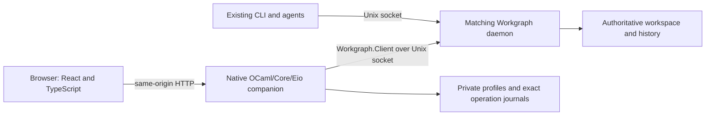

# UI architecture

This is the development architecture for the optional Workgraph UI. It describes
required boundaries; it does not certify a completed installed application.

The daemon remains authoritative. The browser holds disposable views and drafts.
The companion serves embedded assets, validates the browser boundary and bridges
typed requests to the existing client API. It retains connection profiles, exact
saved requests, operation observations and temporary transfer files; it is not a
second workspace database. Browser API `/ui-api/v1` is a separate contract from
the daemon's application API 0.7.

`Daemon_qualification` enforces the companion's installed-package policy, separate
from core CLI API compatibility. It fully decodes `initialize`, requires daemon
name `workgraph` and exact compiled `Version.value`, and reports existing typed
version details. Every fresh ordinary RPC is checked, including retained profile
generations, preparation, service-owned write admission and receipt lookup. A
bounded native helper is checked once for each explicit start, exact retry or
recovery before admission. Its internal exchanges remain one invocation. Local
profile/journal inspection and offline helpers do not require a daemon.

There is no cross-invocation qualification cache. Probe time is capped at two
seconds within the caller's remaining total deadline. Startup readiness applies
the same check before every workspace listing; a typed incompatibility never
becomes permission to launch another child. Transport unavailability retains
the ordinary explicit startup/socket-owner behavior. Separate Unix connections
cannot authenticate same-version custom builds or prove that a daemon remains
the same process during a helper or between qualification and its request.

## Ownership and exact changes

A private state root has one lifetime owner enforced by a native file lock.
A second instance using that root must report a conflict. Different roots may
attach to the same daemon. Lock files are not removed or replaced to guess that
an owner is dead. Processes, prompts, model calls and external tools remain the
runner's responsibility.

The companion classifies methods from the executable API catalog. Reads cannot
invoke a write through the read route. Writes capture the complete connection,
writer, scope, method, raw fields and guards in an immutable preparation. The
exact request and intention mapping are saved before transmission; a synced
sending barrier prevents a possibly transmitted request from appearing known
unsent after a crash. Writes belong to the companion task, so a browser disconnect
cannot safely be interpreted as cancellation or rejection.

A response is validated against its exact method and durable namespace. A generic
successful HTTP response is insufficient proof of commit. Receipt recovery checks
the original request hash and nested acknowledgement. Unknown outcomes retain
uncertainty and fence dependent changes. See [recovery](recovery.md).

## Captured profiles and template helpers

The companion exposes three narrow read-only seams for workflow authoring:

| Route under `/ui-api/v1`                       | Contract                                                                                                                                                                                                                                                       |
| ---------------------------------------------- | -------------------------------------------------------------------------------------------------------------------------------------------------------------------------------------------------------------------------------------------------------------- |
| `GET /connections/:id/generations/:generation` | Resolve the exact retained profile using typed ID/generation decoding. Return the immutable profile or explicit Not_found; never probe the daemon, create a profile or fall back to its current generation.                                                    |
| `POST /template-publications/prepare`          | Validate captured connection/generation and native publication params; return a frozen canonical `transaction.apply` request from `Template_publication`. It has no journal until ordinary operation preparation succeeds.                                     |
| `POST /template-instances/preview`             | Read a complete exact template ID/version/digest and delegate deterministic substitution, placement and expansion validation to native `Workflow_template.instantiate`. Return the pinned template, instance and actual native `template.instantiate` request. |

Both POST helpers use the normal capability/Origin/body boundary and captured
`Rpc_bridge` read scheduling. They do not write, generate mutation identities,
reserve IDs or create journals. Cancellation and unexpected exceptions propagate.
Exact execution, retry and recovery never rerun a helper. Imported or restored
workflow drafts compare retained profile ID, generation and socket before any
daemon-targeting work. See [workflow drafts and recovery](workflows.md) for the
source/publication distinction, explicit batch exposure and local recovery limits.

## Browser and content boundary

The companion defaults to loopback and checks the exact configured Host before
serving its bootstrap page or dispatching work. Every API request carries a fresh
per-launch capability; writes require the exact same Origin and reads reject a
foreign or literal null Origin when present. There is no broad CORS grant or
write-on-GET. The launch capability protects the local browser boundary; it is
not an actor credential. Bootstrap and API responses are not cached.

Assets come only from the generated embedded manifest. Restrictive content policy
prevents third-party scripts and frames. Imported text and rich content remain
data; they never become executable HTML, shell commands or plug-ins. JSON decoding
preserves numeric lexemes before any feature viewer runs. File downloads use a
verified private spool before success. Temporary or partial bytes cannot masquerade
as a complete artifact.

Reads use bounded lanes and exact pagination. Cancellation discards obsolete
unsent reads; late responses cannot populate a new selection. Capture counters,
history heads, event sequences and entity revisions remain distinct. There is no
claim of one atomic snapshot across independent journals. Content selection can
remain pinned while activity reports newer records.

## Build boundaries

| Source                                 | Responsibility                                                                            |
| -------------------------------------- | ----------------------------------------------------------------------------------------- |
| `ui/frontend/`                         | React/TypeScript shell, feature views, validated transport and passive content renderers. |
| `ui/companion/`                        | Typed native profiles, journals, RPC, HTTP, lifecycle and transfer services.              |
| `ui/tools/`                            | Pinned toolchain checks, build provenance and embedded asset generation.                  |
| `dev-ui`, `workgraph-ui.opam.template` | Explicit optional build and package entry points.                                         |

UI-only Dune targets are enabled explicitly with `WORKGRAPH_UI_BUILD=true`.
Core-only checks do not run npm. Frontend builds capture their source inputs;
embedding rejects a stale or mismatched bundle and checks the exact bootstrap
capability marker. No CDN assets or runtime dependency installation is part of
the installed design. In a source checkout, `ui/frontend/README.md` records
engineering conventions and exact commands. Real native linking, installer and
browser/platform qualification remain required beyond a successful frontend build.
