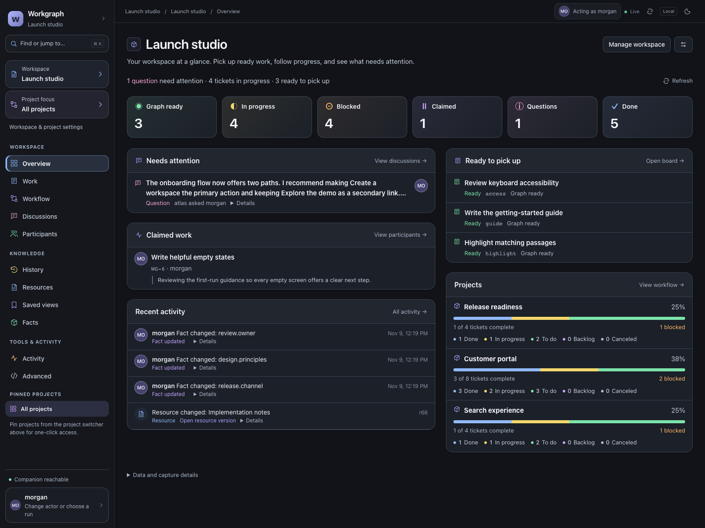
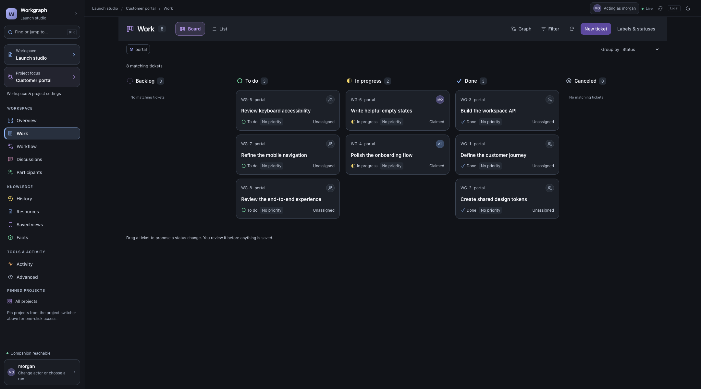
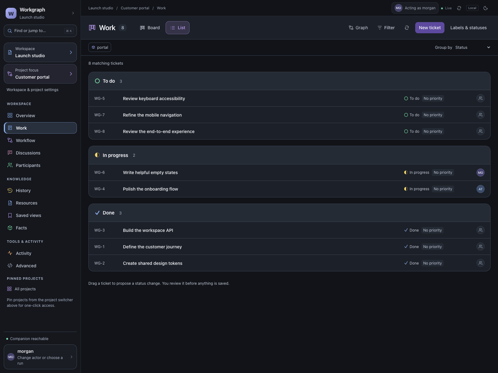
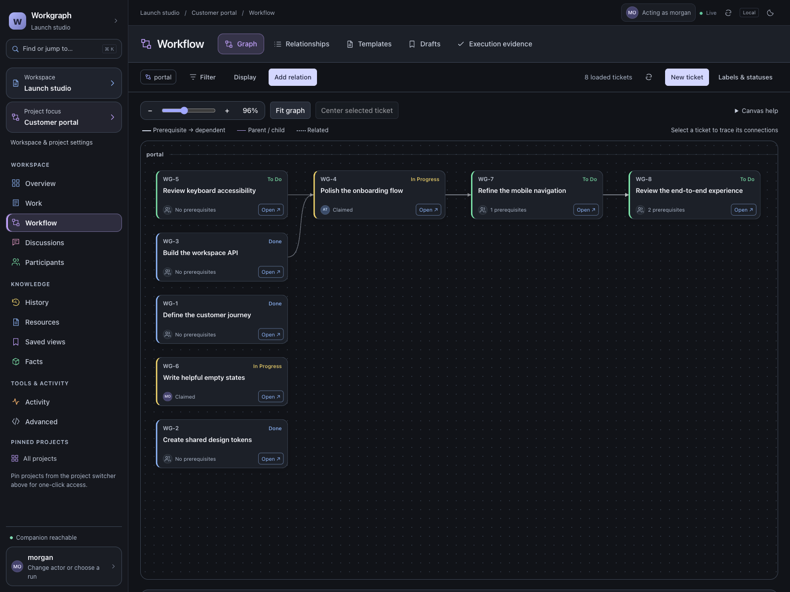
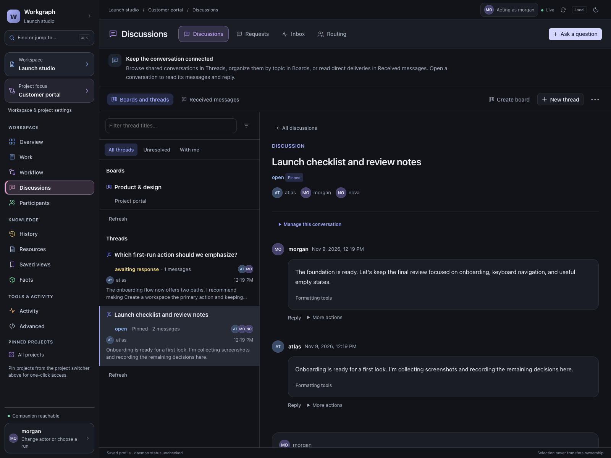
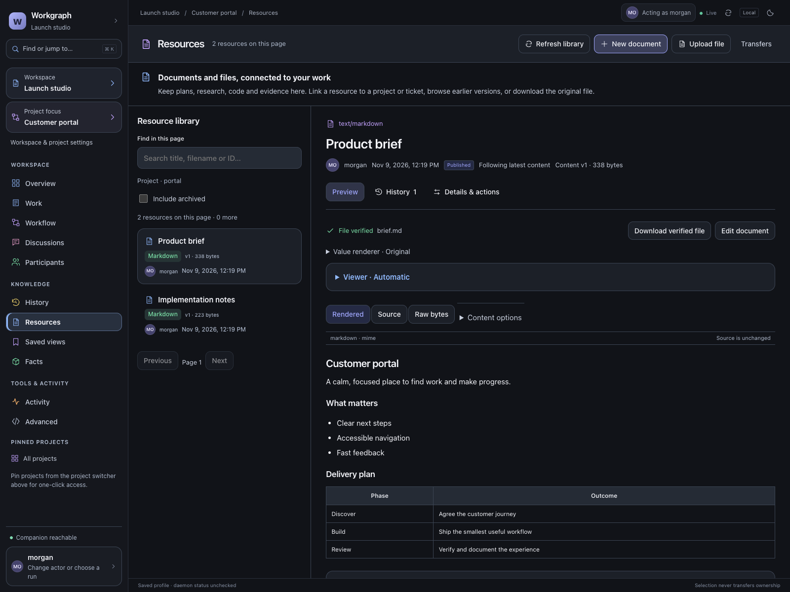
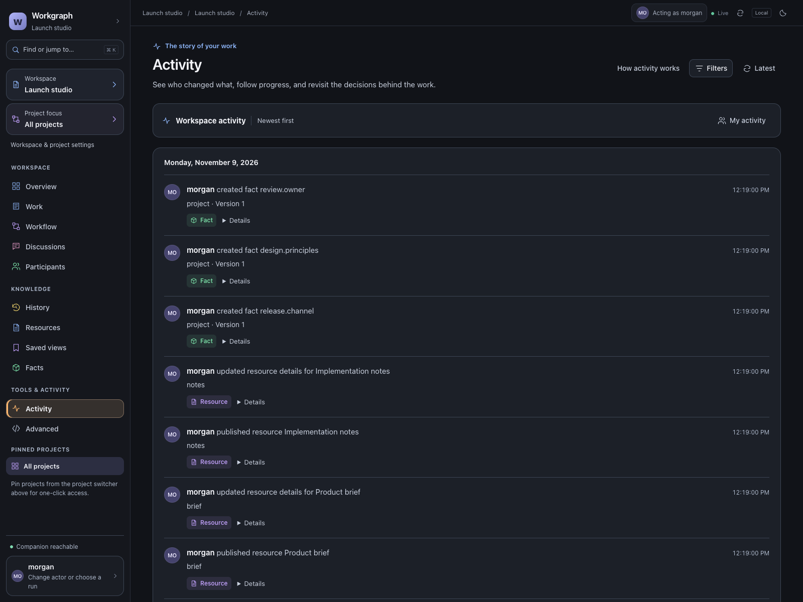

# Workgraph UI gallery

These are screenshots of the running Workgraph 0.8.0 UI, connected to a real local
daemon. **Launch studio is a fictional workspace**: its people, agents, projects,
messages and resources were created for this showcase. No private workspace data
or imported conversations appear here.

The optional UI is available separately from the core CLI.
[Install the UI](../installation.md#install-a-release) or read the [UI guide](../README.md).
Click an image to see it at full size. Images use the dark theme; the UI also has
a light theme.

## Overview

See what needs attention, pick up ready work, follow active tickets and compare
progress across projects.

## Board

See tickets grouped by status, with ownership and priority visible on each card.
Drag a ticket to propose a status change and review it before saving.

## Work list

Scan a compact list of tickets, filter the work and open a ticket to read its
conversation or make a change.

## Workflow graph

Follow prerequisites, trace connections and open tickets from the graph.
Zoom and fit controls help navigate larger workflows.

## Discussions

Keep project conversations together, ask accountable questions and follow replies
from people and agents.

## Resources

Browse shared files and read formatted content alongside its version and links.

## Activity

Follow workspace changes with actor attribution, timestamps and links to the
records behind each update.

## Maintaining this gallery

Capture the running UI with populated synthetic data after design changes.
Use a consistent dark theme and readable desktop viewport, wait for content to
settle, and inspect every image for clipping, loading states and private data.
Keep the Overview image linked from the root README and regenerate the bundled
skill README with `python3 tools/sync_skill_readme.py` after changing that link.
Screenshots document appearance; they are not a substitute for runtime checks.
